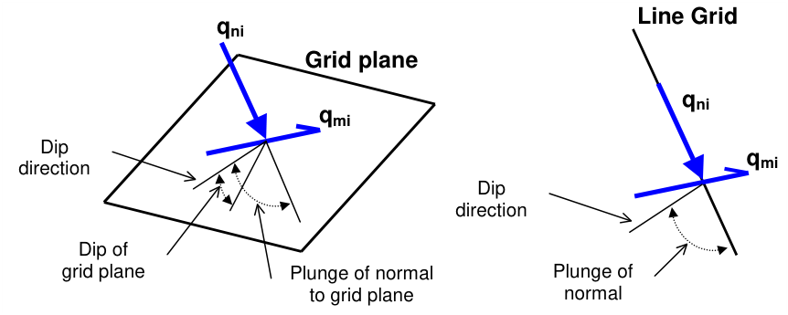
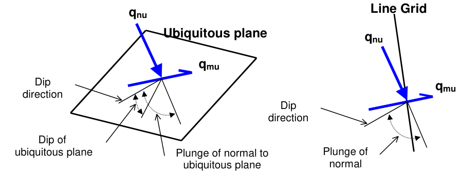

## 5.3.5.1 Plot > Thermal/Flux

Activa la barra de herramientas Thermal/Flux, después de un análisis BEM de flujo termo-fluido de Map3D.

Los parámetros del análisis térmico/de flujo se describen en Expansion Coefficient y Conductivity.

Esta barra de herramientas ofrece acceso rápido a las componentes térmicas y de flujo.

Plot > Flux > t/h   Temperatura/Carga hidráulica

Plot > Flux > qtotal = ( qx² + qy² + qz² )½ Flujo total   genera contornos del flujo total

Plot > Flux > qx Flujo X   genera contornos de la componente x del flujo

Plot > Flux > qy Flujo Y   genera contornos de la componente y del flujo

Plot > Flux > qz Flujo Z   genera contornos de la componente z del flujo

Para calcular el flujo en el plano, el estado de flujo en cada punto del plano de la grilla se reorienta para determinar el flujo máximo paralelo al plano de la grilla y el flujo normal al plano. Tenga en cuenta que qni está orientado normal al plano de la grilla y paralelo a la dirección de una grilla lineal.

Plot > Flux > qni Normal en el plano   genera contornos de la componente del flujo normal al plano de la grilla.

Plot > Flux > qmi Máximo en el plano   genera contornos del flujo máximo tangencial al plano de la grilla.

Para calcular el flujo del plano ubicuo n.º 1, el estado de flujo en cada punto del plano de la grilla se reorienta para determinar el flujo máximo paralelo al plano ubicuo n.º 1 y el flujo normal al plano. Tenga en cuenta que dmi no está orientado normal al plano de la grilla.

Plot > Flux > qnu Normal al plano ubicuo   genera contornos de la componente del flujo normal al plano ubicuo.

Plot > Flux > qmu Máximo en el plano ubicuo   genera contornos del flujo máximo tangencial al plano ubicuo.

- la dirección de manteo se mide positiva en sentido horario desde el eje y.

- el manteo del plano se mide positivo hacia abajo desde la horizontal (es decir, la dirección de manteo).

- la inclinación de la normal se mide positiva hacia abajo (es decir, negativa hacia arriba) desde la horizontal.

#### Notas:

La barra de herramientas de flujo solo se puede activar después de la etapa de construcción del modelo (CAD)

#### Etapas de análisis de Map3D.

La orientación del plano de corte ubicuo se define con

Plot > Strength Factors > Ubiquitous Parameters

El rango de contornos se define con

#### Plot > Range

Esta componente se puede agregar a la barra de herramientas de contornos si se desea

Tools > Configure Contouring Toolbar > Displacement

Puede resultar útil agregar el botón

#### More Flow Components

a la barra de herramientas de contornos para acceder rápidamente a todas las componentes de flujo.
