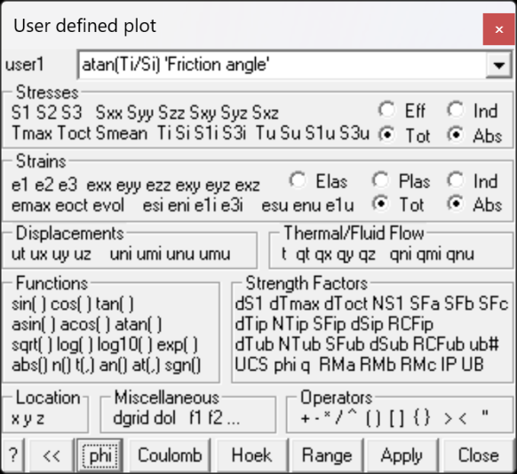

Genera contornos de una componente de esfuerzo definida por el usuario.

#### Stresses:

- S1 S2 S3 componentes de esfuerzo principal s1 s2 s3

- Sxx Syy Szz Sxy Syz Sxz componentes cartesianas del esfuerzo sxx syy szz txy tyz tzx

- Tmax esfuerzo de corte máximo ½(s1 - s3)

- Toct esfuerzo de corte octaédrico toct = ¹/3 [(s1 - s2)² + (s2 - s3)² +(s3 - s1)²]½

- Smean esfuerzo medio smean = ¹/3 (s1 + s2 + s3)

- Ti Si esfuerzo de corte máximo y esfuerzo normal en el plano de la grilla tip sip

- S1i S3i esfuerzos máximo y mínimo tangenciales al plano de la grilla s1i s3i

- Tu Su esfuerzo de corte máximo y esfuerzo normal en el plano ubicuo tub sub. La orientación del plano de corte ubicuo se define con

- S1u S3u esfuerzos máximo y mínimo tangenciales al plano ubicuo s1u s3u \]

- Effective/Total componentes del esfuerzo efectivo o del esfuerzo total. Estas opciones solo se usan en Map3D Thermal-Fluid Flow, ya que este código permite calcular distribuciones de presión de poros en régimen permanente.

- Induced/Absolute componentes del esfuerzo inducido o del esfuerzo absoluto (es decir, el esfuerzo sin la contribución del esfuerzo previo a la explotación).

#### Strains:

- e1 e2 e3 deformación principal mayor e1 e2 e3

- exx eyy ezz exy eyz exz componentes cartesianas de la deformación exx eyy ezz exy eyz ezx

- emax deformación de corte máxima ½(e1 - e3)

- eoct deformación de corte octaédrica eoct = ¹/3 [(e1 - e2)² + (e2 - e3)² +(e3 - e1)²]½

- evol deformación volumétrica evol = (e1 + e2 + e3)

- esi eni deformación de corte máxima y deformación normal en el plano de la grilla esi eni

- e1i e3i deformaciones máxima y mínima tangenciales al plano de la grilla e1i e3i

- esu enu deformación de corte máxima y deformación normal en el plano ubicuo esu enu

- e1u e3u deformaciones máxima y mínima tangenciales al plano ubicuo e1u e3u

- Elastic/Plastic/Total componentes de la deformación elástica, plástica o total. Estas opciones solo se usan en Map3D Non-Linear, ya que este código permite calcular deformaciones no lineales.

- Induced/Absolute componentes de la deformación inducida o de la deformación absoluta (es decir, sin la contribución del esfuerzo previo a la explotación).

#### Displacements:

- ut desplazamiento total, su rumbo e inclinación dt

- · ux uy uz componentes cartesianas del desplazamiento dx dy dz

- uni desplazamiento normal al plano de la grilla dni

- umi desplazamiento máximo tangencial al plano de la grilla dmi

- unu desplazamiento normal al plano ubicuo dnu

- umu desplazamiento máximo tangencial al plano ubicuo dmu

#### Thermal/Fluid Flow:

- t temperatura/carga hidráulica

- qt flujo total, su rumbo e inclinación.

- qx qy qz componentes cartesianas del flujo.

- qni desplazamiento normal al plano de la grilla.

- qmi desplazamiento máximo tangencial al plano de la grilla.

- qnu desplazamiento normal al plano ubicuo.

- qmu desplazamiento máximo tangencial al plano ubicuo.

#### Functions:

- sin() cos() tan()   funciones trigonométricas seno, coseno y tangente.

- asin() acos() atan()   funciones trigonométricas inversas.

- sqrt()   función raíz cuadrada.

- log()   función logaritmo natural.

- log10()   función logaritmo en base 10.

- exp()   función exponencial (antilogaritmo).

- abs()   valor absoluto.

- n() an()   distribución de probabilidad normal y normal inversa. El argumento usado con la distribución normal es (Ds1/ _s_ ), que representa el esfuerzo principal mayor en exceso dividido por la desviación estándar (vea ).

- t(,) at(,)   distribución de probabilidad t y t inversa. El argumento usado con la distribución t es (Ds1/ ( _sg),n_ -2), donde Ds1 representa el esfuerzo principal mayor en exceso, _s_ representa la desviación estándar, _n_ representa el número de datos y _g_ representa el factor  [1 + 1/ _n_ + (s3 - sm) ²/s3²/( _n_ -1)]½, donde sm representa el valor medio de s3 y s3 representa la desviación estándar de s3.

- sgn()   función signo: entrega +1 para valores positivos, -1 para valores negativos y 0 para valores de magnitud menor que 10-12 .

#### Strength:

- ds1 esfuerzo principal mayor en exceso Ds1 = s1 - ( _UCS_ + _q_ s3 )

- dtmax esfuerzo de corte máximo en exceso Dtmax = ½(s1 - s3) - [ _UCS_ + ½(s1+s3) ( _q_ -1) ]/( _q_ +1) = [s1 - ( _UCS_ + _q_ s3) ]/( _q_ +1)

- dtoct esfuerzo de corte octaédrico en exceso Dtoct = toct - [ _UCS_ + ( _q_ –1) smean ] Ö(2) /( _q_ +2)

- NS1 probabilidad usando la distribución normal N(Ds1 /std)

- SFA Resistencia/Esfuerzo se puede determinar para Mohr-Coulomb como ( _UCS_ + _q_ s3 )/ s1

- o para Hoek-Brown como [ s3 + Ö( _m_ scs3 + _s_ sc²) ] / s1

- SFB Resistencia/Esfuerzo se puede determinar para Mohr-Coulomb como ( _UCS_ + _q_ s3 - s3 )/(s1 - s3) o para Hoek-Brown como [ s3 + Ö( _m_ scs3 + _s_ sc²) ] / (s1 - s3)

- SFC Resistencia/Esfuerzo se puede determinar para Mohr-Coulomb como [ _UCS_ + ½(s1+s3) ( _q_ -1) ]/[ ½(s1 - s3)( _q_ +1) ]

o para Hoek-Brown como &#123;Ö[1 /16 _m_ ²sc² + ½(s1 + s3) _m_ sc + _s_ sc²] - ¼ _m_ sc&#125;/(s1 - s3)

- dTip esfuerzo de corte en el plano, en exceso Dtip = tip - [ Cohesion + sip tan(j) ]

- NTip probabilidad usando la distribución normal N(Dtip /std)

- SFip Resistencia/Esfuerzo se puede determinar como [ Cohesion + sip tan(j) ] / tip

- dSip esfuerzo en la pared en el plano, en exceso Dsip = [ 3 s1i - s3i ] - UCS

- RCFip factor de condición de la roca (Rock Condition Factor) para el esfuerzo en la pared en el plano RCFip = [ 3 s1i - s3i ]/UCS

- dTub esfuerzo de corte en el plano ubicuo, en exceso Dtub

- NTub probabilidad usando la distribución normal N(Dtub /std)

- SFub Resistencia/Esfuerzo se puede determinar como [ Cohesion + sub tan(j) ] / tub

- dSub esfuerzo en la pared en el plano ub, en exceso Dsub = [ 3 s1ub - s3ub ] - UCS

- RCFub factor de condición de la roca para el esfuerzo en la pared en el plano ub RCFip = [ 3 s1ub - s3ub ]/UCS

- UB# Grafica el número del sistema UB (1, 2 o 3) que tiene el mayor valor de Dtub

- _UCS phi q_ Parámetros de resistencia de Mohr-Coulomb definidos con Plot > Strength Factors > Rockmass Strength Parameters; tenga en cuenta que estos parámetros solo están definidos si se ha especificado el criterio de resistencia de Mohr-Coulomb o de Druker-Prager

- _RMa_ Resistencia del macizo rocoso definida para Mohr-Coulomb como ( _UCS_ + _q_ s3 )

o para Hoek-Brown como [ s3 + Ö( _m_ scs3 + _s_ sc²) ]

- _RMb_ Resistencia del macizo rocoso definida para Mohr-Coulomb como ( _UCS_ + _q_ s3 - s3 )

- o para Hoek-Brown como [ Ö( _m_ scs3 + _s_ sc²) ]

- _RMc_ Resistencia del macizo rocoso definida para Mohr-Coulomb como [ _UCS_ + ½(s1+s3) ( _q_ -1) ]/( _q_ +1) o para Hoek-Brown como &#123;Ö[1 /16 _m_ ²sc² + ½(s1 + s3) _m_ sc + _s_ sc²] - ¼ _m_ sc&#125;/2

- _IP_ Resistencia en el plano definida usando Mohr-Coulomb como [ Cohesion + sip tan(j) ]

- _UB_ Resistencia ubicua definida usando Mohr-Coulomb como [ Cohesion + sub tan(j) ]

- _sc_ Parámetro de resistencia de Hoek-Brown definido con Plot > Strength Factors > Rockmass Strength Parameters; tenga en cuenta que este parámetro solo está definido si se ha especificado el criterio de resistencia de Hoek-Brown

#### Location:

- x y z   coordenada del punto de la grilla.

#### Miscellaneous:

- Dgrid distancia a la superficie más cercana desde cada punto de la grilla.

- Dol distancia a la grilla más cercana _Dgrid_ dividida por el espaciamiento de la grilla _Lgrid_ .

- f1 f2... parámetros de material definidos por el usuario. Se pueden definir con Plot > Properties > Material Properties > User defined Parameters.

#### Operators:

- + - * / ^   operadores de suma, resta, multiplicación, división y exponenciación. Tenga en cuenta que primero se calculan las exponenciales, luego las multiplicaciones y divisiones, y por último las sumas y restas.

- () [] &#123;&#125;   tipos de paréntesis. Los pares de paréntesis deben coincidir.

- >   valor máximo. Por ejemplo, si la ecuación de graficación se especifica como s1 > 10, se graficará el mayor entre s1 y 10.

- &lt;   valor mínimo. Por ejemplo, si la ecuación de graficación se especifica como s1 &lt; 10, se graficará el menor entre s1 y 10.

- " "   comentario.

#### Other:

- phi:   atan(Ti/Si) grafica el ángulo de fricción necesario para resistir el deslizamiento en una falla, un sistema de diaclasas o un plano de estratificación orientado de la misma forma que el plano de la grilla.

- Mohr-Coulomb:   60 + S3*tan(45+30/2)^2   grafica la resistencia para un criterio de Mohr-Coulomb con un UCS de 60 y un ángulo de fricción de 30°. Aquí también se podría usar la ecuación _UCS_ + S3* _q_ o, alternativamente, _UCS_ +S3*tan(45+ _phi_ /2)^2, si los parámetros de resistencia se han

- definido previamente con Plot > Strength Factors > Rockmass Strength Parameters.

- Hoek:     S3 + sqrt( 0.1*60*S3 + 0.005*60^2 )   grafica la resistencia para un criterio de Hoek-Brown con sc de 60, m de 0.1 y s de 0.005.

- Range – define el rango de contornos.

- Plot – regenera el gráfico de contornos.

La ventana desplegable permite almacenar hasta 20 ecuaciones distintas. Estas se conservan entre sesiones de Map3D en el archivo map3d.ini.
