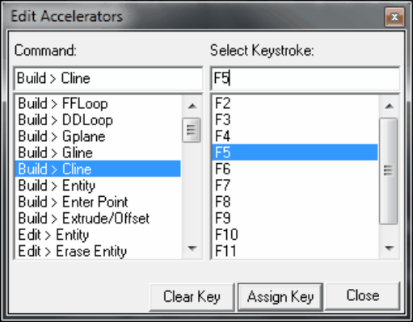

Permite seleccionar teclas de acceso rápido definidas por el usuario.

Por ejemplo, para asignar la tecla F5 a la función Build > Cline, asignaría la tecla de función de la siguiente manera:

- Tenga en cuenta que las asignaciones de teclas de función se conservan de una sesión a otra en el archivo Map3D.cfg.
