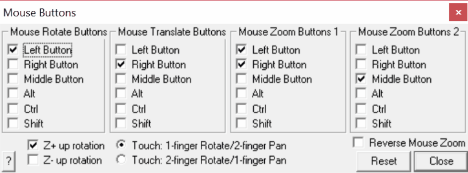

## 5.6.1.1 Botones del mouse

Permite especificar funciones personalizadas de rotación, traslación y zoom con el mouse.

Tenga en cuenta que se pueden especificar como máximo dos botones para cada función. Estos botones se guardan de una sesión a otra.

Z+ up rotation: especifica que el eje Z+ está restringido a apuntar verticalmente, de modo que cuando el eje Z+ apunta hacia arriba, arrastrar el mouse hacia la izquierda rota el modelo hacia la izquierda.

Z- up rotation: invierte el supuesto anterior. En este caso especifica que el eje Z+ está restringido a apuntar verticalmente, de modo que cuando el eje Z+ apunta hacia arriba, arrastrar el mouse hacia la izquierda rota el modelo hacia la derecha.

Touch: 1-finger Rotate/2-finger Pan: controles de pantalla táctil configurados para que arrastrar con 1 dedo rote el modelo y arrastrar con 2 dedos lo desplace.

Touch: 2-finger Rotate/1-finger Pan: controles de pantalla táctil configurados para que arrastrar con 2 dedos rote el modelo y arrastrar con 1 dedo lo desplace.

Touch Zoom: pellizcar con dos dedos hace zoom sobre el modelo.

Reverse Mouse Wheel: invierte la acción de la rueda del mouse, de modo que girarla hacia adelante acerca el modelo en vez de alejarlo.

## 5.6.1.2 Tiempo de doble clic

Especifica el tiempo (en milisegundos) entre los dos clics de un doble clic.

Los dobles clics se usan para activar las funciones de edición

CAD > Edit

## 5.6.1.3 Tiempo de espera para arrastrar

Especifica el tiempo (en milisegundos) que debe mantener presionado un botón del mouse antes de que aparezca el puntero de arrastre.

El puntero de arrastre se usa para rotar, trasladar y hacer zoom sobre el modelo.
