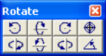
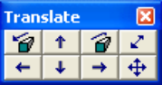
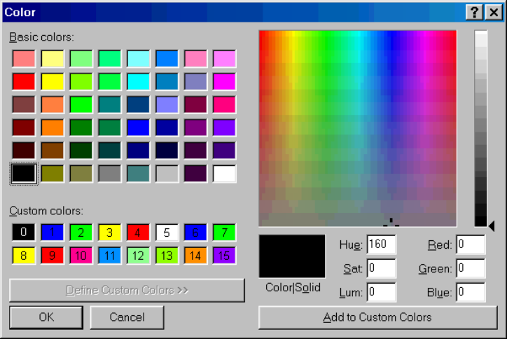

## 5.6.2.1 Barra de herramientas de rotación

Activa la barra de herramientas de rotación.

El modelo se puede rotar con estos botones o arrastrando el ícono de orientación hasta la posición deseada.

Rotate Counter clockwise (tecla Insert)

Rotate Up (tecla Home o shift+flecha arriba)

Rotate Clockwise (tecla Page Up)

Rotate Left (tecla Delete o shift+flecha izquierda)

Rotate Down (tecla End o shift+flecha abajo)

Rotate Right (tecla Page Down o shift+flecha derecha)

View > Centre of Rotation

View > Rotation Increment

Notas:

Si la barra de herramientas de rotación no está visible, se puede activar con

Tools > Rotation Toolbar

Antes de rotar el modelo, debe definir el centro de rotación deseado

View > Centre of Rotation

## 5.6.2.2 Barra de herramientas de traslación

Activa la barra de herramientas de traslación.

El modelo se puede trasladar con estos botones o arrastrándolo hasta la posición deseada.

Zoom In (tecla Enter o "+") Translate Up (flecha arriba) Zoom Out (Ctrl+Enter o tecla "-") Translate Left (flecha izquierda) Translate Down (flecha abajo) Translate Right (flecha derecha) View > Zoom Factor

View > Translation Increment

Notas:

Si la barra de herramientas de traslación no está visible, se puede activar con

Tools > Translation Toolbar

Antes de acercar con zoom

Zoom In

debe definir el centro de rotación deseado

View > Centre of Rotation

## 5.6.2.3 Barra de herramientas de contornos

Activa la barra de herramientas de contornos, después de un análisis BEM de Map3D.

La configuración por defecto de esta barra de herramientas es la siguiente:

Esta barra de herramientas ofrece acceso rápido a los parámetros de esfuerzo de uso más frecuente.

Plot > Stress > S1 Major Principal Stress

Plot > Stress > S3 Minor Principal Stress

Plot > Stress > Tmax Maximum Shear Stress

Plot > Stress activa la barra de herramientas de esfuerzos. Esta barra contiene todas las componentes de esfuerzo.

Plot > Surface Components activa la barra de herramientas de superficie. Esta barra contiene todas las componentes de superficie.

Plot > Strength Factors activa la barra de herramientas de factores de resistencia. Esta barra contiene todas las componentes de parámetros de resistencia.

Plot > Stress > User Gráfico de esfuerzos definido por el usuario.

Plot > Range define el rango de contornos (mínimo, máximo, intervalo...) del contorno graficado actualmente.

Plot > Grid Selection Activa la barra de herramientas de selección de grillas.

Plot > Surface Components > Options define las opciones del gráfico de contornos (trayectorias, líneas de contorno...).

Tools > Contouring Toolbar Configure agrega o quita botones de la barra de herramientas de contornos.

Notas:

Los botones se pueden reubicar en la barra de herramientas simplemente manteniendo presionado el botón izquierdo del mouse y arrastrando el botón a la ubicación deseada.

La barra de herramientas de contornos solo se puede activar después de la etapa de construcción del modelo (CAD)

Etapas de análisis de Map3D.

## 5.6.2.4 Configurar la barra de herramientas de contornos

Agrega o quita botones de la barra de herramientas de contornos.

Simplemente marque o desmarque el elemento deseado para agregarlo o quitarlo de la barra de herramientas.

Notas:

La barra de herramientas de contornos solo se puede activar

#### Tools > Contouring toolbar

después de la etapa de construcción del modelo (CAD)

Etapas de análisis de Map3D.

Los botones se pueden reubicar en la barra de herramientas simplemente manteniendo presionado el botón izquierdo del mouse y arrastrando el botón a la ubicación deseada.

La configuración de la barra de herramientas se guarda entre análisis en el archivo map3d.ini.

## 5.6.2.5 Barra de herramientas de solución

Activa la barra de herramientas de solución, durante el análisis BEM de Map3D.

La configuración por defecto de esta barra de herramientas es la siguiente:

Esta barra de herramientas ofrece acceso rápido a los parámetros importantes durante la etapa de solución del análisis BEM de Map3D

#### Analysis > BEM Analysis

Plot > Surface Components > Serr Stress Error Plot > Surface Components > Ferr Failure Error Plot > Surface Components > Shear Stress Plot > Surface Components > Normal Stress Plot > Surface Components > Shear Displacement (Ride)

Plot > Surface Components activa la barra de herramientas de superficie con todas las componentes de superficie. Plot > Range define el rango de contornos (mínimo, máximo, intervalo...) del contorno graficado actualmente.

Plot > Surface Components > Options define las opciones del gráfico de contornos (trayectorias, líneas de contorno...).

Tools > Solve Toolbar Configure agrega o quita botones de la barra de herramientas de solución.

Notas:

Durante el análisis, la barra de herramientas de solución se muestra cuando se suspende el análisis

#### Analysis > Suspend.

Si esta opción no está marcada, la barra de herramientas de solución no se activará al suspender el análisis BEM de Map3D.

Los botones se pueden reubicar en la barra de herramientas simplemente manteniendo presionado el botón izquierdo del mouse y arrastrando el botón a la ubicación deseada.

La barra de herramientas de solución solo se puede activar después de la etapa de construcción del modelo (CAD)

#### Etapas de análisis de Map3D.

Temas relacionados:

Analysis > Auto Plot.

Analysis > Auto Range.

## 5.6.2.6 Configurar la barra de herramientas de solución

Agrega o quita botones de la barra de herramientas de solución.

Simplemente marque o desmarque el elemento deseado para agregarlo o quitarlo de la barra de herramientas.

Notas:

La barra de herramientas de solución solo se puede activar

#### Tools > Solve toolbar

después de la etapa de construcción del modelo (CAD)

#### Etapas de análisis de Map3D

Durante el análisis, la barra de herramientas de solución se muestra cuando se suspende el análisis

#### Analysis > Suspend

Los botones se pueden reubicar en la barra de herramientas simplemente manteniendo presionado el botón izquierdo del mouse y arrastrando el botón a la ubicación deseada.

La configuración de la barra de herramientas se guarda entre análisis en el archivo map3d.ini.

## 5.6.2.7 Barra de herramientas de vista

Activa la barra de herramientas de vista.

La configuración por defecto de esta barra de herramientas es la siguiente

Esta barra de herramientas ofrece acceso rápido a diversas funciones de visualización.

View > Centre of Rotation   Define el centro de rotación. Este punto permanece fijo mientras rota y hace zoom sobre la visualización.

View > Zoom   activa una ventana de zoom gráfica. Se le pedirá que seleccione las dos esquinas de la ventana haciendo un solo clic con el mouse en cada una.

View > Pan   activa un desplazamiento gráfico. Se le pedirá que seleccione los dos extremos del vector de desplazamiento haciendo un solo clic con el mouse en cada uno.

View > Length   activa una herramienta gráfica de medición de longitudes. Se le pedirá que seleccione los dos extremos del vector de longitud haciendo un solo clic con el mouse en cada uno. Estos puntos deben seleccionarse sobre el modelo o sobre un contorno. Se informan la longitud, el manteo y la dirección de manteo del vector seleccionado. Si mantiene presionada la tecla Shift mientras selecciona los puntos, puede definir una línea compuesta por varios segmentos y obtener la longitud total. Si define una forma poligonal cerrada (manteniendo presionada la tecla Shift mientras selecciona los puntos) sobre un gráfico de contornos, se informará el valor promedio del contorno dentro del polígono (vea Plot > Polygon Box). Se pueden definir ventanas rectangulares simples manteniendo presionada la tecla Shift y arrastrando para abrir una ventana.

View > Hide activa la barra de herramientas de ocultar.

View > Hide Block Colours activa la barra de herramientas para ocultar colores de bloques.

View > Hide CLine Colours activa la barra de herramientas para ocultar colores de líneas de construcción.

File > Mining Step activa la barra de herramientas de selección de la etapa de explotación.

Tools > View Toolbar Configure agrega o quita botones de la barra de herramientas de vista.

Notas:

Los botones se pueden reubicar en la barra de herramientas simplemente manteniendo presionado el botón izquierdo del mouse y arrastrando el botón a la ubicación deseada.

## 5.6.2.8 Configurar la barra de herramientas de vista

Agrega o quita botones de la barra de herramientas de vista.

Simplemente marque o desmarque el elemento deseado para agregarlo o quitarlo de la barra de herramientas.

Notas:

Los botones se pueden reubicar en la barra de herramientas simplemente manteniendo presionado el botón izquierdo del mouse y arrastrando el botón a la ubicación deseada.

La configuración de la barra de herramientas se guarda entre análisis en el archivo map3d.ini.

## 5.6.2.9 Barra de herramientas CAD

Activa la barra de herramientas CAD.

La configuración por defecto de esta barra de herramientas es la siguiente:

Esta barra de herramientas ofrece acceso rápido a las funciones CAD que se usan en la etapa de construcción y edición del modelo del análisis BEM de Map3D

#### Analysis > Go to CAD

CAD > Build Activa la barra de herramientas de construcción para crear nuevas entidades del modelo.

CAD > Snap Activa la barra de herramientas de referencia a objetos (snap) para definir el modo de snap. CAD > Edit Activa la barra de herramientas de edición para modificar entidades del modelo. CAD > Grid Selection Activa la barra de herramientas de selección de grillas para mostrar grillas. Tools > CAD Toolbar > Configure Agrega o quita botones.

Notas:

La barra de herramientas CAD solo se muestra durante la etapa de construcción y edición del modelo del análisis

#### Analysis > Go to CAD

Si esta opción no está marcada, la barra de herramientas CAD no se activará durante la etapa de construcción y edición del modelo.

Los botones se pueden reubicar en la barra de herramientas simplemente manteniendo presionado el botón izquierdo del mouse y arrastrando el botón a la ubicación deseada.

Temas relacionados:

Map3D Analysis Stages

## 5.6.2.10 Configurar la barra de herramientas CAD

Agrega o quita botones de la barra de herramientas CAD.

Simplemente marque o desmarque el elemento deseado para agregarlo o quitarlo de la barra de herramientas.

Notas:

La barra de herramientas CAD solo se puede activar

#### Tools > CAD toolbar

durante la etapa de construcción del modelo (CAD)

#### Etapas de análisis de Map3D

Los botones se pueden reubicar en la barra de herramientas simplemente manteniendo presionado el botón izquierdo del mouse y arrastrando el botón a la ubicación deseada.

La configuración de la barra de herramientas se guarda entre análisis en el archivo map3d.ini.

## 5.6.2.11 Colores de bloques

Asigna colores personalizados para el renderizado de bloques.

Map3D usa 16 colores base para el renderizado.

El usuario puede asignar cualquier color deseado a los colores base y Map3D genera automáticamente tonalidades de estos para el renderizado.

Los colores se usan de la siguiente forma:

- Colour 0 - color de fondo de la pantalla.

- Colour 1-4 – colores de la banda elástica y de los marcadores.

- Colour 5 – color de primer plano, usado para texto, contornos de bloques, símbolos de trayectorias y líneas de grilla.

- Colour 6 – bloques con número de color 1, 11, 21, 31, ...

- Colour 7 - bloques con número de color 2, 12, 22, 32, ...

- Colour 8 - bloques con número de color 3, 13, 23, 33, ...

- Colour 9 - bloques con número de color 4, 14, 24, 34, ...

- Colour 10 - bloques con número de color 5, 15, 25, 35, ...

- Colour 11 - bloques con número de color 6, 16, 26, 36, ...

- Colour 12 - bloques con número de color 7, 17, 27, 37, ...

- Colour 13 - bloques con número de color 8, 18, 28, 38, ...

- Colour 14 - bloques con número de color 9, 19, 29, 39, ...

- Colour 15 - bloques con número de color 10, 20, 30, 40, ...

Reasignar un color es un proceso de tres pasos:

1. Elija el color que desea redefinir en uno de los "Custom Colors:".

2. Defina el nuevo color que desea eligiéndolo en "Basic Colors:", en el "Color Matrix" o ingresando "Hue: Sat: Lum: Red: Green: Blue:".

3. Presione el botón "Add to Custom Colors".

Todos los colores se pueden restablecer a los valores por defecto originales de Map3D seleccionando

#### Tools > Set Default Block Colours

Los colores personalizados se guardan entre análisis en el archivo map3d.ini.

## 5.6.2.12 Colores de contornos

Asigna colores personalizados para el renderizado de contornos.

Map3D usa 16 colores base para el contorneo.

Los colores se usan de la siguiente forma:

- Colour 0 - color de fondo de la pantalla.

- Colour 1 – color de contorno por debajo del rango.

- Colour 2 a 11 – colores de contorno.

- Colour 12 color de contorno por encima del rango.

- Colour 13 – color del límite de tracción.

- Colour 15 – color de primer plano, usado para texto, contornos de bloques, símbolos de trayectorias y líneas de grilla.

Reasignar un color es un proceso de tres pasos:

1. Elija el color que desea redefinir en uno de los "Custom Colors:".

2. Defina el nuevo color que desea eligiéndolo en "Basic Colors:", en el "Color Matrix" o ingresando "Hue: Sat: Lum: Red: Green: Blue:".

3. Presione el botón "Add to Custom Colors".

Los colores personalizados se guardan entre análisis en el archivo map3d.ini.

Los colores de contorno se pueden restablecer a los valores por defecto de Map3D seleccionando

Tools > Set Contour Colours

## 5.6.2.13 Restablecer los colores de bloques por defecto

Restablece todos los colores a los valores por defecto originales de Map3D.

Los colores personalizados se pueden definir con

Tools > Custom Colours

## 5.6.2.14 Restablecer los colores de contornos 1

Restablece todos los colores a los valores por defecto originales de Map3D.

Los colores personalizados se pueden definir con

#### Tools > Contour Colours

## 5.6.2.18 Configurar la fuente de los botones

Asigna una fuente, tamaño, color, etc. personalizados para los botones.

Map3D usa la "Windows System Font" para dibujar todos los botones.

El usuario puede redefinir esta fuente y sus características de visualización.

La fuente se puede restablecer al valor por defecto original de Map3D seleccionando

#### Tools > Reset Default Font

La fuente personalizada se guarda entre análisis en el archivo map3d.ini.

## 5.6.2.19 Restablecer la fuente por defecto

Restablece la fuente de los botones al valor por defecto original de Map3D.

Se puede definir una fuente personalizada con

Tools > Configure Button Font

## 5.6.2.20 Botones de tamaño pequeño

Permite definir el tamaño de los botones de la barra de herramientas.
