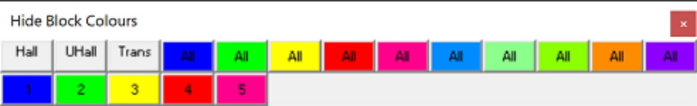

## 5.2.2.1 Ocultar todo

Permite ocultar todos los bloques con el número de color seleccionado.

Esta barra de herramientas puede cambiarse a orientación vertical arrastrándola contra el borde derecho o izquierdo de la ventana principal.

Puede volver a la orientación horizontal arrastrándola contra el borde superior o inferior de la ventana principal.

Al seleccionar el botón en la barra de herramientas de vista se activa la barra de herramientas Hide Block Colours.

View > Hide Block Colours > Hide All   Oculta todas las superficies de bloques.

View > Hide Block Colours > Unhide All   Muestra todas las superficies ocultas.

La primera fila oculta y muestra todos los bloques del color asociado.

Los botones restantes llevan el número de color de bloque asociado y sirven para ocultarlos. El nombre de bloque asociado a cada número de color se muestra en la información sobre herramientas y en la lista del menú.

Tenga en cuenta que la barra de herramientas admite desplazamiento y cambio de tamaño.

Para cambiar el tamaño, simplemente tome cualquier borde o esquina y arrástrelo hasta el tamaño y la forma deseados. Las barras de desplazamiento solo aparecen si hay demasiados botones para mostrar con el tamaño y la forma actuales.
