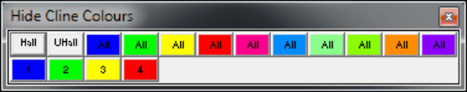

## 5.2.4.1 Ocultar todo

Permite ocultar todas las líneas de construcción con el color seleccionado.

Esta barra de herramientas puede cambiarse a orientación vertical arrastrándola contra el borde derecho o izquierdo de la ventana principal.

Puede volver a la orientación horizontal arrastrándola contra el borde superior o inferior de la ventana principal.

Al seleccionar el botón en la barra de herramientas de vista se activa la barra de herramientas Hide Cline Colours.

View > Hide Cline Colours > Hide All   Oculta todas las líneas de construcción.

View > Hide Cline Colours > Unhide All   Muestra todas las líneas de construcción ocultas.

La primera fila oculta y muestra todas las líneas de construcción del color asociado.

Los botones restantes llevan el número de color de línea de construcción asociado y sirven para ocultarlas.

Tenga en cuenta que la barra de herramientas admite desplazamiento y cambio de tamaño.

Para cambiar el tamaño, simplemente tome cualquier borde o esquina y arrástrelo hasta el tamaño y la forma deseados. Las barras de desplazamiento solo aparecen si hay demasiados botones para mostrar con el tamaño y la forma actuales.
