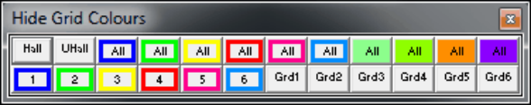

## 5.2.5.1 Ocultar todo

Permite ocultar todas las grillas con el color seleccionado.

Esta barra de herramientas puede cambiarse a orientación vertical arrastrándola contra el borde derecho o izquierdo de la ventana principal.

Puede volver a la orientación horizontal arrastrándola contra el borde superior o inferior de la ventana principal.

Al seleccionar el botón se activa la barra de herramientas Hide Grid Colours.

View > Hide Grid Colours > Hide All   Oculta todas las grillas.

View > Hide Grid Colours > Unhide All   Muestra todas las grillas ocultas.

La primera fila oculta y muestra todas las grillas del color asociado.

Los botones que llevan el número de color de grilla asociado sirven para ocultarlas. El nombre de grilla asociado a cada número de color se muestra en la información sobre herramientas y en la lista del menú.

Los botones restantes sirven para ocultar grillas individuales, igual que en Grid Selection.

Tenga en cuenta que la barra de herramientas admite desplazamiento y cambio de tamaño.

Para cambiar el tamaño, simplemente tome cualquier borde o esquina y arrástrelo hasta el tamaño y la forma deseados. Las barras de desplazamiento solo aparecen si hay demasiados botones para mostrar con el tamaño y la forma actuales.
