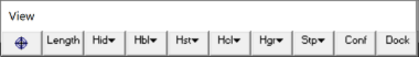
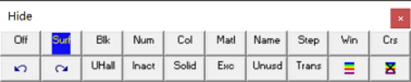

- **5.2.1.1** **Off**

Estas herramientas facilitan ocultar distintas partes de la geometría.

Al seleccionar el botón de la barra de herramientas View se activa la barra de herramientas Hide

Tenga en cuenta que, si el botón no está en la barra de herramientas View, se puede agregar usando el botón y luego seleccionando Hide > Hide More.

View > Hide > Off   Desactiva la función de ocultar.

View > Hide > Surfaces   Oculta superficies seleccionándolas de una en una.

View > Hide > Blocks   Oculta todas las superficies que componen el bloque seleccionado.

View > Hide > Numbers   Oculta todas las superficies con el número de color de bloque seleccionado.

View > Hide > Colour   Oculta todas las superficies con el color seleccionado.

View > Hide > Materials   Oculta todas las superficies con el número de material seleccionado. Un mismo bloque puede tener distintos materiales según la etapa de explotación activa en ese momento.

Al usar esta última función, asegúrese de seleccionar la etapa de explotación correspondiente

File > Mining Step

View > Hide > Names   Oculta todas las superficies con el nombre de bloque seleccionado.

View > Hide > Steps   Oculta todas las superficies que se explotan en la etapa seleccionada.

View > Hide > Window   Oculta todas las superficies dentro de la ventana seleccionada. Las entidades solo se seleccionarán si están contenidas completamente dentro de la ventana.

View > Hide > Crossing   Oculta todas las superficies dentro de la ventana de cruce. Las entidades se seleccionarán incluso si solo una parte de ellas está dentro de la ventana.

View > Hide > Undo last Hide   Deshace la última operación de ocultar (actualmente se guardan un máximo de 10).

View > Hide > Redo last Hide   Rehace la operación de ocultar anterior (actualmente se guardan un máximo de 10).

View > Hide > Unhide All   Muestra todas las superficies ocultas actualmente.

View > Hide > Inactive   Cuando está activada, se muestran los elementos inactivos. Las superficies inactivas se usan para mostrar elementos que se incluyen solo con fines de visualización y no se usan en el análisis de esfuerzos propiamente tal

#### CAD > Edit > Entity Properties

View > Hide > Solids   Cuando está activada, se ocultan los sólidos. Los sólidos son bloques 3D o planos DD que no se excavan.

A medida que avanza la secuencia de explotación

#### File > Mining Step

se excavan distintos bloques. Para mostrar solo las excavaciones, active esta opción.

View > Hide > Excavations   Cuando está activada, se ocultan las excavaciones.

View > Hide > Unused   Cuando está activada, se ocultan los elementos no usados. Los elementos no usados son superficies de bloques 3D o planos DD que no se usan en el análisis. Tales elementos existen donde una falla atraviesa una excavación, o donde un material con un número de material menor se encuentra dentro de una zona con un número de material mayor (p. ej., un dique que atraviesa una zona mineralizada).

A medida que avanza la secuencia de explotación

#### File > Mining Step

esto puede cambiar. Para ocultar las superficies no usadas, active esta opción. Para una discusión adicional, vea

Analysis > Options > Closure

#### Constructing Alternate Material Zones

View > Hide > Translucent   Cuando está activada, las superficies ocultas se muestran translúcidas.

View > Hide > Show Errors   Oculta/muestra errores (cuando está activada, muestra solo los errores de elementos). Tenga en cuenta que esta opción se puede usar junto con la opción View > Hide > Translucent.

View > Hide > Hide Errors   Oculta/muestra errores (cuando está activada, no muestra los

#### errores de elementos).

En la etapa CAD, los distintos colores indican los siguientes problemas:

- Púrpura: se encontraron vacíos y se rellenaron, con lo que el problema quedó resuelto. Este mensaje no indica un error y se entrega solo como información para el usuario.

- Verde: se encontraron bloques duplicados y se eliminaron, con lo que el problema quedó resuelto. Este mensaje no indica un error y se entrega solo como información para el usuario.

- Azul: se detectaron vacíos estrechos. Estos vacíos no indican un error y no necesariamente son un problema; sin embargo, si surgen problemas durante el análisis de intersecciones o el análisis BEM, estas ubicaciones son las causas más probables. Este mensaje no indica un error y se entrega como advertencia al usuario.

- Blanco: se detectaron aristas que se enlazan en el sentido incorrecto. Los bloques cerrados deben tener todas sus aristas enlazadas de manera consistente, de modo que el interior y el exterior de un bloque se puedan determinar sin ambigüedad. Las aristas blancas no cumplen este requisito. Este mensaje sí indica un error, que debe corregirse antes de continuar con el análisis.

- Naranja: se detectaron aristas que no se enlazan con otras aristas. Los bloques cerrados deben tener todas sus aristas enlazadas con otra arista para formar un bloque cerrado. Las aristas naranjas no cumplen este requisito. Este mensaje sí indica un error, que debe corregirse antes de continuar con el análisis.

- Amarillo: se detectaron aristas que se enlazan con más de una arista. Los bloques cerrados deben tener todas sus aristas enlazadas con una sola otra arista para formar un bloque cerrado. Las aristas amarillas no cumplen este requisito. Este mensaje sí indica un error, que debe corregirse antes de continuar con el análisis.

- Rojo: resalta las zonas visco-plásticas con formas hexaédricas no válidas. En Map3D Visco-Plastic, las zonas plásticas solo pueden tener forma de hexaedro (4 esquinas arriba y 4 esquinas abajo) o alguna degeneración de esta forma, como un tetraedro.

En la etapa INTERSECTION, los distintos colores indican los siguientes problemas:

- Púrpura: una superficie fue deshabilitada debido a un contacto irresoluble. Al analizar los contactos entre las distintas superficies de bloques, no fue posible resolver la forma en que esta superficie se relaciona con otra, por lo que la superficie se deshabilitó y no se usará en el análisis de esfuerzos BEM. La causa más probable de este problema es una forma muy extraña, como un triángulo extremadamente angosto. Aunque se trata de un error, normalmente se puede ignorar, ya que las formas extremadamente angostas aportan muy poco a los resultados del análisis.

- Verde: una superficie fue deshabilitada debido a un cierre irresoluble. Al analizar el cierre de un bloque, no fue posible resolver la forma en que esta superficie se relaciona con el bloque, por lo que la superficie se deshabilitó y no se usará en el análisis de esfuerzos BEM. La causa más probable de este problema es una forma muy extraña, como un triángulo extremadamente angosto. Aunque se trata de un error, normalmente se puede ignorar, ya que las formas extremadamente angostas aportan muy poco a los resultados del análisis.

- Azul: se detectaron vacíos estrechos. Estos vacíos no indican un error y no necesariamente son un problema; sin embargo, si surgen problemas durante el análisis de intersecciones o el análisis BEM, estas ubicaciones son las causas más probables. Este mensaje no indica un error y se entrega como advertencia al usuario.

- Blanco: se detectaron superficies no cerradas. Al analizar el cierre de un bloque se comprobó que no era posible determinar de manera consistente el interior y el exterior del bloque. Este mensaje sí indica un error, que debe corregirse antes de continuar con el análisis.

- Naranja: se detectaron aristas que no se enlazan con otras aristas. Los bloques cerrados deben tener todas sus aristas enlazadas con otra arista para formar un bloque cerrado. Las aristas naranjas no cumplen este requisito. Este mensaje sí indica un error, que debe corregirse antes de continuar con el análisis.

- Amarillo: una superficie fue deshabilitada debido a una forma irresoluble. La causa más probable de este problema es una forma muy extraña, como un triángulo extremadamente angosto. Aunque se trata de un error, normalmente se puede ignorar, ya que las formas extremadamente angostas aportan muy poco a los resultados del análisis.
