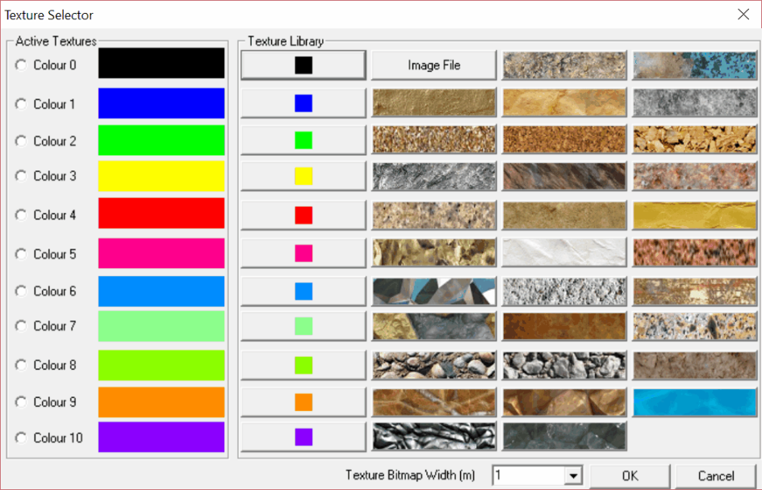

## 5.2.6.1 Block Outlines

Configura las opciones de renderizado del modelo.

View > Render > Block Outlines - los bloques se dibujan con contornos que muestran sus aristas.

View > Render > Grid Lines - los bloques se dibujan con líneas a intervalos regulares de la grilla. Al activar esta función se le pide el intervalo de la grilla.

View > Render > Block Colours - los bloques se dibujan con sombreado de color. Desactive esta función para obtener una vista de estructura alámbrica.

View > Render > Material Numbers - los bloques se colorean según la propiedad de material asignada al bloque. Un mismo bloque puede tener distintos materiales según la etapa de explotación activa en ese momento.

Al usar esta función, asegúrese de seleccionar la etapa de explotación correspondiente

#### File > Mining Step

View > Render > Mining Step Numbers - los bloques se colorean según la etapa de explotación en que se excavan.

View > Render > Dark Shading - los bloques se dibujan con un modelo de sombreado de fuente de luz oscuro. Al activar esta función se le pide un radio de arista. El radio de arista se usa para sombrear aristas y esquinas y darles una apariencia redondeada. El radio de arista debe especificarse como una fracción del espesor del bloque. El sombreado puede reducir considerablemente la velocidad de actualización.

View > Render > Bright Shading - los bloques se dibujan con un modelo de sombreado de fuente de luz brillante. Al activar esta función se le pide un radio de arista. El radio de arista se usa para sombrear aristas y esquinas y darles una apariencia redondeada. El radio de arista debe especificarse como una fracción del espesor del bloque. El sombreado puede reducir considerablemente la velocidad de actualización.

View > Render > Texture Rendering - activa o desactiva el renderizado de texturas. El renderizado de texturas permite colorear las superficies con una imagen de mapa de bits en vez de un color sólido. Vea Assign Bock Textures

View > Render > Block Numbers - los bloques se dibujan con números en sus superficies. Estos números corresponden al modo de renderizado seleccionado: Block Colours, Material Numbers o Mining Step Numbers.

View > Render > Block Names - los bloques se dibujan con los nombres de bloque en sus superficies.

View > Render > Coordinate Numbers - los bloques se dibujan con los nombres de bloque en sus superficies.

View > Render > Backfacing Surfaces - cuando está activada, se dibujan las superficies posteriores de los bloques FF 3D. Por lo general, el usuario no necesita ni desea ver estas superficies.

View > Render > Fixed With Spacing - cuando está activada, las superficies con discretización de ancho fijo especificado se renderizan mostrando la discretización.

View > Render > Discretize - alterna la visualización del modelo discretizado y no discretizado. View > Render > Perspective - alterna entre la visualización en perspectiva y la ortogonal. En modo ortogonal, todas las dimensiones se dibujan a escala real. En la vista en perspectiva, las entidades más alejadas del observador se dibujan más pequeñas.

View > Render > Clines Dot Radius - especifica el radio de los puntos que se dibujarán en todos los vértices de las líneas de construcción. Esto reduce significativamente la velocidad de dibujo y solo debe usarse si es necesario. Un valor cero indica que no se dibujarán puntos.

View > Render > Point Size - especifica el radio de los puntos que se dibujarán en todos los vértices durante la selección.

View > Render > Line Width - especifica el ancho de los contornos de bloques y de las líneas de contorno.

## 5.2.6.9 Assign Block Textures

El renderizado de texturas permite colorear las superficies con una imagen de mapa de bits en vez de un color sólido. Para lograrlo, haga lo siguiente:

1. seleccione el número de color al que desea asignar la textura (p. ej., Colour 0, Colour 1 ...)

2. seleccione uno de los mapas de bits predefinidos, o seleccione el suyo con "Image File".

3. Para aplicar la imagen de mapa de bits sobre cada superficie, debe especificar el "Texture Bitmap With". El "Texture Bitmap With" escala el mapa de bits especificado de modo que el patrón se repita con el ancho geométrico indicado.

Por ejemplo, si especifica 1 m como ancho, el mapa de bits se escalará de modo que se dibuje con un ancho de 1 m sobre las superficies de sus bloques.

## 5.2.6.10 Small Block Numbers

Configura las opciones de renderizado del modelo.

View > Render > Block Outlines - los bloques se dibujan con contornos que muestran sus aristas.

View > Render > Grid Lines - los bloques se dibujan con líneas a intervalos regulares de la grilla. Al activar esta función se le pide el intervalo de la grilla.

View > Render > Block Colours - los bloques se dibujan con sombreado de color. Desactive esta función para obtener una vista de estructura alámbrica.

View > Render > Material Numbers - los bloques se colorean según la propiedad de material asignada al bloque. Un mismo bloque puede tener distintos materiales según la etapa de explotación activa en ese momento.

Al usar esta función, asegúrese de seleccionar la etapa de explotación correspondiente

#### File > Mining Step

View > Render > Mining Step Numbers - los bloques se colorean según la etapa de explotación en que se excavan.

View > Render > Dark Shading - los bloques se dibujan con un modelo de sombreado de fuente de luz oscuro. Al activar esta función se le pide un radio de arista. El radio de arista se usa para sombrear aristas y esquinas y darles una apariencia redondeada. El radio de arista debe especificarse como una fracción del espesor del bloque. El sombreado puede reducir considerablemente la velocidad de actualización.

View > Render > Bright Shading - los bloques se dibujan con un modelo de sombreado de fuente de luz brillante. Al activar esta función se le pide un radio de arista. El radio de arista se usa para sombrear aristas y esquinas y darles una apariencia redondeada. El radio de arista debe especificarse como una fracción del espesor del bloque. El sombreado puede reducir considerablemente la velocidad de actualización.

View > Render > Texture Rendering - activa o desactiva el renderizado de texturas. El renderizado de texturas permite colorear las superficies con una imagen de mapa de bits en vez de un color sólido. Vea Assign Bock Textures

View > Render > Block Numbers - los bloques se dibujan con números en sus superficies. Estos números corresponden al modo de renderizado seleccionado: Block Colours, Material Numbers o Mining Step Numbers.

View > Render > Block Names - los bloques se dibujan con los nombres de bloque en sus superficies.

View > Render > Coordinate Numbers - los bloques se dibujan con los nombres de bloque en sus superficies.

View > Render > Backfacing Surfaces - cuando está activada, se dibujan las superficies posteriores de los bloques FF 3D. Por lo general, el usuario no necesita ni desea ver estas superficies.

View > Render > Fixed With Spacing - cuando está activada, las superficies con discretización de ancho fijo especificado se renderizan mostrando la discretización.

View > Render > Discretize - alterna la visualización del modelo discretizado y no discretizado. View > Render > Perspective - alterna entre la visualización en perspectiva y la ortogonal. En modo ortogonal, todas las dimensiones se dibujan a escala real. En la vista en perspectiva, las entidades más alejadas del observador se dibujan más pequeñas.

View > Render > Clines Dot Radius - especifica el radio de los puntos que se dibujarán en todos los vértices de las líneas de construcción. Esto reduce significativamente la velocidad de dibujo y solo debe usarse si es necesario. Un valor cero indica que no se dibujarán puntos.

View > Render > Point Size - especifica el radio de los puntos que se dibujarán en todos los vértices durante la selección.

View > Render > Line Width - especifica el ancho de los contornos de bloques y de las líneas de contorno.
