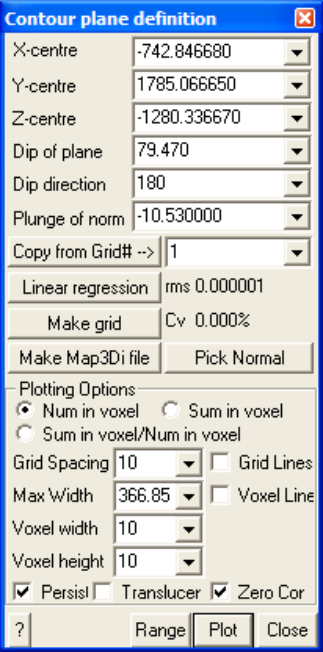
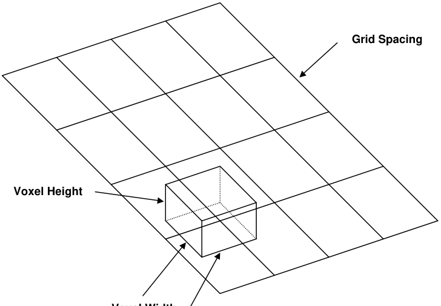
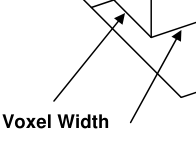

Permite configurar el plano usado para contornear los datos de puntos de visualización (vea Visualization).

**X-centre** – el valor de la coordenada x del centro del plano de contornos.

**Y-centre** – el valor de la coordenada y del centro del plano de contornos. **Z-centre** – el valor de la coordenada z del centro del plano de contornos. **Dip of plane** – el manteo del plano de contornos.

**Dip direction** – la dirección de manteo del plano de contornos.

**Dip of normal** – el manteo de la normal al plano de contornos (este valor está a 90° del manteo del plano).

**Pick Normal** - activa el cursor para seleccionar una superficie de forma interactiva. El centro, el manteo y la dirección de manteo del plano de contornos se fijarán paralelos a la superficie seleccionada.

**Copy from Grid#** – copia los parámetros de ubicación y orientación desde un plano de grilla del modelo. **Linear regression** – encuentra el plano de mejor ajuste a través de los datos sísmicos minimizando la distancia normal

de todos los puntos al plano.

**Make Grid** – crea un plano de grilla del modelo a partir del plano de contornos.

**Make Map3Di file** – genera, a partir de los datos contorneados, un archivo de datos que se usará para la carga sísmica en un análisis **Map3Di** (más detalles abajo).

#### Contour Plane Options:

**Num in voxel** – se contornea el número de puntos dentro de cada vóxel. **Sum in voxel** – se contornea la suma de los valores de la ecuación de graficación de todos los puntos ubicados en el vóxel.

**Sum/Num in voxel** – se contornea el cociente de los dos valores.

- **Grid spacing** – el espaciamiento de grilla usado para contornear los datos sísmicos. Como el vóxel está centrado en cada esquina de la grilla, este parámetro controla la densidad de los vóxeles. Tenga en cuenta que si el espaciamiento de la grilla es menor que el ancho del vóxel, los vóxeles adyacentes se traslaparán.

**Voxel width** – el ancho del vóxel se mide paralelo a los bordes del plano de la grilla.

**Voxel height** – la altura del vóxel se mide perpendicular al plano de la grilla. Esto permite al usuario

limitar la distancia al plano de la grilla dentro de la cual se incluirán datos en el contorneo.

**Outlines** – dibuja los contornos reales de los vóxeles.

- **Persist** – cuando está marcada, los puntos se vuelven a graficar cada vez que el modelo se reorienta, se traslada o se le aplica zoom. Como esto puede tardar bastante en modelos grandes, no siempre es deseable esta opción.

**Translucent** - dibuja los puntos como esferas translúcidas.

**Zero Contour** - cuando no está marcada, no se dibujan los contornos por debajo del mínimo del rango de contornos. Esto

es útil para mostrar contornos en los que solo importa la parte superior del rango. **Range** – especifica el mínimo, el máximo y el intervalo para el escalado del radio y los contornos.

- Plot regenera el gráfico. Este botón se puede colocar en la barra de herramientas de vista (Tools >

- View Toolbar Configure) o en la barra de herramientas de contornos (Tools > Contour Toolbar Configure).

#### Linear Regression:

La regresión lineal se realiza encontrando el plano que tiene el valor **_rms_** mínimo (la raíz cuadrática media, o distancia media de todos los puntos al plano ajustado).

La teoría estándar del coeficiente de correlación no es adecuada como medida de la bondad de ajuste en este caso. Esto se debe a que no nos interesa la "medida del grado de asociación entre variables", sino una medida de qué tan bien el plano ajustado representa nuestros datos. Tenga en cuenta que, si todos los datos están en un único plano horizontal, el ajuste del plano es perfecto. Sin embargo, por definición la correlación es cero

(y por lo tanto el coeficiente de correlación es igual a cero), porque el valor de z no depende de los valores de x ni de y. Esto no es lo que queremos.

Aquí se define un parámetro similar a un coeficiente de variación (una medida de la variabilidad dividida por la magnitud). **_Cv_** se define simplemente como el valor **_rms_** (la distancia media de todos los puntos al plano ajustado) dividido por la distancia media de todos los puntos al centroide. Esto mide qué tan bien el plano representa los datos. Esta razón suele expresarse como porcentaje. Definido así, los datos aleatorios dan un **Cv** =100% (100% de variabilidad). Un ajuste perfecto da un **_Cv_** =0 (0% de variabilidad). Tenga en cuenta que es posible que **_Cv_** supere el 100%. Puede pensar en este parámetro como la razón entre la variabilidad en torno al plano y el ancho físico del conjunto de datos.

Esto es muy similar a la definición formal del coeficiente de variación, que es la desviación estándar dividida por la media. La mayoría de los materiales geológicos tienen propiedades con un **_Cv_** del orden de 20 a 30%. **_Cv_** podría convertirse en un coeficiente de correlación equivalente usando

**_r_ = (1-** **_Cv_ ²)****½**

pero este no es realmente el parámetro correcto y existen problemas de definición en los casos en que **_Cv_** supera 1.

Tanto **rms** como **_Cv_** se muestran para el plano actual cada vez que se grafican datos.

#### Make Map3Di file:

Para crear un archivo de carga Map3Di se debe determinar la distribución del desplazamiento de corte (ride) indicada por la sismicidad. Esto requiere varios supuestos (consulte A. McGarr, "Some Applications of Seismic Source Mechanism Studies to Assessing Underground Hazard", Proc. 1st International Symposium on Rockbursts and Seismicity in Mines, SAIMM, Johannesburg, 1984, pp. 199-208, y Hoffman, G, R. Sewjee and G. van Aswegan, "First steps in the integration of numerical modelling and seismic monitoring", 5th International Symposium on Rockburst and Seismicity in Mines, SAIMM, Johannesburg, 2000, pp. 397-404.) que se describen aquí:

1) Suponer un modelo de deslizamiento. Aquí se puede considerar un modelo de fisura elíptica (Brune) o un modelo de asperidad con bordes blandos debido a la fluencia (Walsh, J.J. and J. Waterson, "Distribution of cumulative displacements and seismic slip on a single normal fault surface", J. Struct. Geol., V. 9, 1987, pp. 1039-1046). En general se usará una forma circular (tipo moneda) a menos que el usuario tenga alguna forma de definir una forma alternativa.

2) El valor promedio del deslizamiento se puede determinar a partir del momento sísmico **_Mo_ =** m **_AD_**, donde m es el módulo de rigidez, **_A_** es el área de la fuente (determinada a partir del radio de la fuente) y **_D_** es el deslizamiento promedio a través de la falla. Esto también se puede determinar a partir de la "caída de deformación sísmica" (Seismic Strain Drop).

3) El radio de la superficie de deslizamiento se puede estimar a partir del radio de Brune, siendo b la velocidad de la onda de corte y **_fo_** la frecuencia de esquina. Para un modelo de asperidad, el radio **_a_ = 2.34** b **/(2** p **_fo_ )**, donde b se determina a partir del radio del "volumen aparente" (Apparent Volume), es probablemente más apropiado.

4) La orientación del deslizamiento se puede determinar a partir del tensor de momento sísmico, si está disponible, o a partir del estado de esfuerzos obtenido del modelamiento.

A partir de estos 4 elementos se puede determinar el perfil de deslizamiento indicado por el evento sísmico.

Para un perfil elíptico, la distribución del desplazamiento de corte (ride) está dada por

**1.50** **_D_ (1-** **_r_ ²/** **_a_ ²)****½**

Para un perfil de asperidad, la distribución del desplazamiento de corte (ride) está dada por

#### 2.89 _D_ (1- _r_ / _a_ )(1+2 _r_ / _a_ -3 _r_ ²/ _a_ ²)½

Se puede generar un archivo de carga sísmica para Map3Di de la siguiente forma:

- 1) Construya un archivo de datos sísmicos como una serie de puntos:

**x1 y1 z1 f1 f2 … x2 y2 z2 f1 f2 … x3 y3 z3 f1 f2 … ...**

donde **xi yi zi** representan las coordenadas de cada punto,

**f1** indica el deslizamiento promedio **_D_** y **f2** indica el radio de la fuente **_a_** .

- 2) Con la rutina Visualization, para un perfil elíptico especifique la ecuación de graficación como

   - **1.50*f1*sqrt(1-rip^2/f2^2)**

Para un perfil de asperidad use

#### 2.89*f1*(1-rip/f2)*sqrt(1+2*rip/f2-3*rip^2/f2^2)

3) Elija el plano deseado y el espaciamiento de grilla, y fije la altura y el ancho de vóxel deseados. La altura del vóxel se puede usar para recortar los eventos fuera del plano. Es importante elegir un ancho de vóxel igual al mayor radio de evento deseado, para distribuir el desplazamiento de corte (ride) sobre todos los vóxeles afectados.

- 4) Fije las opciones de graficación en "Sum in Voxel" y grafique (Plot).

- 5) Make Map3Di file.

- 6) Vea el archivo Map3Di con CAD > Properties > Map3Di Setup y revise el parámetro f2.

Para detalles sobre el formato de los datos, vea **CAD > Properties > Map3Di**.
