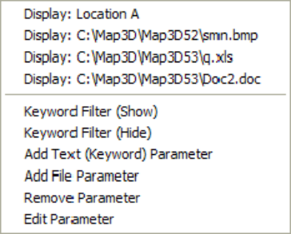

Esta función permite mostrar una base de datos con información geológica útil, como leyes, calidad del macizo rocoso, etc.

Cada punto puede etiquetarse con una serie de:

- valores numéricos (p. ej., color, magnitud, orientación, etc.)

- palabras clave

- mensajes de texto

- nombres de archivo (p. ej., archivos gráficos, documentos, planillas de cálculo, etc.)

Para activar esta función, haga clic derecho sobre un punto de datos de visualización (vea Visualization).

Si no hay puntos de visualización, se puede crear uno con Make Point, que agrega un punto nuevo.

Al hacer clic derecho se muestra un menú emergente con las siguientes opciones:

Los elementos "Display" de la sección superior de este menú son datos asociados al punto de datos (respectivamente, una cadena de texto, un mapa de bits, una planilla de cálculo y un documento). Al seleccionar cualquiera de ellos se muestra ese elemento.

Los elementos de la sección inferior del menú son funciones que acceden a la base de datos:

- **Keyword Filter (Show)** – se usa para especificar una serie de filtros de palabras clave de visualización. Solo serán visibles los datos de puntos que tengan asociada alguna de estas palabras clave; todos los demás quedarán ocultos. Esto permite filtrar la visualización de las entradas de la base de datos que interesan.

- **Keyword Filter (Hide)** – se usa para especificar una serie de filtros de palabras clave de ocultamiento. Los datos de puntos que tengan asociada alguna de estas palabras clave quedarán ocultos; todos los demás serán visibles. Esto permite filtrar la visualización de las entradas de la base de datos que no interesan.

- **Add Text (Keyword) Parameter** - se usa para agregar una cadena de texto a un punto de datos. Este texto se usa para el filtrado por palabras clave y se agregará a la lista de visualización.

- **Add File Parameter** - se usa para agregar un parámetro de archivo a un punto de datos. El nombre del archivo se usa para el filtrado por palabras clave y el archivo se agregará a la lista de visualización. Aquí se puede especificar cualquier nombre de archivo (p. ej., archivos gráficos, planillas de cálculo, documentos, etc.). Si el tipo de archivo está asociado a una aplicación, esa aplicación se iniciará automáticamente para mostrar el archivo especificado.

**Remove Parameter** - se usa para eliminar un parámetro del punto de datos.

**Edit Parameter** - se usa para editar o modificar un parámetro.
