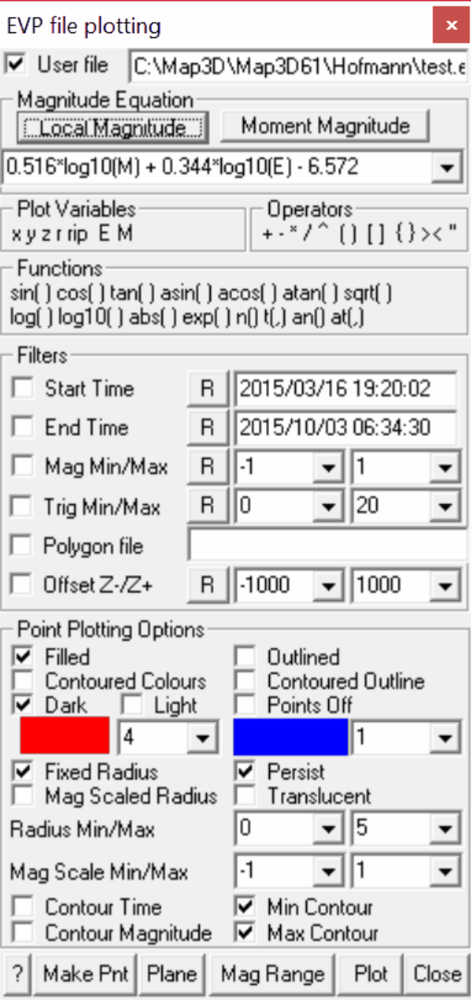

Esta opción permite visualizar datos de puntos en formato de archivo EVP (de los sistemas sísmicos IMS). Los puntos se pueden mostrar como esferas con sombreado de fuente de luz, cuyo diámetro y/o color varían según la magnitud, y se pueden contornear sobre un plano para mostrar densidad, etc.

Map3D también admite la visualización de archivos con formato de texto.

Cada punto puede etiquetarse con una serie de:

- valores numéricos (p. ej., color, magnitud, orientación, etc.)

- mensajes de texto

- nombres de archivo (p. ej., archivos gráficos, documentos, planillas de cálculo, etc.)

Al hacer clic izquierdo sobre un punto, la ubicación, la magnitud y el mensaje de texto se muestran en la barra de estado.

Al hacer clic derecho sobre un punto se activa la base de datos visual (Visual Database). Esta función permite mostrar una base de datos con información geológica útil, como leyes, calidad del macizo rocoso, etc. Cada punto puede etiquetarse con una serie de:

- valores numéricos (p. ej., color, magnitud, orientación, etc.)

- mensajes de texto

- nombres de archivo (p. ej., archivos gráficos, documentos, planillas de cálculo, etc.)

#### Event File:

El archivo de eventos tiene el formato de archivo *.EVP.

Los archivos de eventos EVP son producidos por los sistemas sísmicos IMS.

Los datos sísmicos se almacenan como una serie de puntos de la siguiente forma:

**date time le x1 y1 z1 M  E Mp Ep Ms Es trigs... "text message" "file name"... date time le x2 y2 z2 M  E Mp Ep Ms Es trigs... "text message" "file name"... date time le x3 y3 z3 M  E Mp Ep Ms Es trigs... "text message" "file name"...**

donde **xi yi zi** representan las coordenadas de cada punto,

**M** representa el momento sísmico, **E** representa la energía radiada, **trigs** representa el número de disparos (triggers),

**text message** indica una serie opcional de cadenas de texto que deben ir entre comillas dobles. **file name** indica una serie opcional de nombres de archivo que deben ir entre comillas dobles.

- El mensaje de texto y el nombre de archivo se muestran en la barra de estado, en la parte inferior de la pantalla, al seleccionar un evento con el botón izquierdo del mouse.

- También se pueden editar al seleccionar un evento con el botón derecho del mouse.

- Al seleccionar con el botón derecho del mouse también se puede mostrar el archivo, si el nombre del archivo está asociado a una aplicación (consulte la documentación de Windows sobre cómo "Asociar un archivo con un programa").

#### Fusionar varios archivos en una sola base de datos

Puede seleccionar varios archivos a la vez manteniendo presionadas las teclas estándar de Windows "shift" o "ctrl" para hacer selecciones múltiples.

Estos archivos se fusionarán en una sola base de datos.

Esto le permite mantener partes separadas de sus datos de visualización en distintos archivos y luego fusionarlas fácilmente en una sola base de datos.

#### Magnitude Equation:

Define el parámetro que se graficará, p. ej., **(0.516*log10(M) + 0.344*log10(E) - 6.572**

La ventana desplegable permite almacenar hasta 20 ecuaciones distintas. Estas se conservan entre sesiones de Map3D en el archivo map3d.ini.

#### Plot Variables:

**E M** campos de datos del archivo de eventos.

#### Functions:

**sin() cos() tan()** funciones trigonométricas seno, coseno y tangente **asin() acos() atan()** funciones trigonométricas inversas **sqrt()** función raíz cuadrada

**log()** función logaritmo natural **log10()** función logaritmo en base 10 **abs()** valor absoluto **exp()** función exponencial (antilogaritmo) **n() t(,)** distribución normal y distribución t **an() at(,)** distribución normal inversa y distribución t inversa

#### Location:

**x y z** coordenada del punto de la grilla.

#### Operators:

- **+ - * /** ^   operadores de suma, resta, multiplicación, división y exponenciación. Tenga en cuenta que primero se calculan las exponenciales, luego las multiplicaciones y divisiones, y por último las sumas y restas.

- **() [] &#123;&#125;** tipos de paréntesis. Los pares de paréntesis deben coincidir.

- valor máximo. Por ejemplo, si la ecuación de graficación se especifica como f1 > 10, se graficará el mayor entre f1 y 10.

- **&lt;** valor mínimo. Por ejemplo, si la ecuación de graficación se especifica como f1 &lt; 10, se graficará el menor entre f1 y 10.

#### Filters:

**Start/End Time** – los límites inferior y superior del filtro de fecha/hora. **Mag Min/Max** – los límites inferior y superior del filtro de magnitud. **Trig Min/Max** – los límites inferior y superior del filtro del n.º de disparos.

**Polygon File** – el nombre del archivo que contiene el filtro poligonal. Este archivo debe estar en formato de archivo *.pnt. Para facilitar la creación de este archivo, la función **Plane** permite fijar el UDCS (sistema de coordenadas definido por el usuario) en el plano de mejor ajuste.

**Offset Z-/Z+** – los límites inferior y superior del desfase en Z respecto del filtro poligonal.

#### Point Plotting Options:

**Filled** – los puntos se rellenan con el color especificado, con color de contorno y/o con sombreado. **Contoured Colours** – el color de relleno se ajusta según la magnitud determinada a partir de **Plot Equation** .

- **Dark** – el color de relleno se sombrea para que parezca una esfera con sombreado de fuente de luz, usando un esquema de colores oscuros y intensos.

- **Light** – el color de relleno se sombrea para que parezca una esfera con sombreado de fuente de luz, usando un esquema de colores claros y brillantes.

**Outlined** – los puntos se delinean con el color especificado o con color de contorno.

**Contoured Outline** – los puntos se dibujan con colores de contorno ajustados según la magnitud determinada a partir de **Plot Equation** .

**Contour Plane** – habilita o deshabilita la visualización de un plano de contornos (vea **Plane** ).

**Fixed Radius** – los puntos se graficarán como esferas con el parámetro **Radius:** especificado.

**Magnitude Scaled Radius** – los puntos se graficarán como esferas con un radio escalado según la magnitud (determinada a partir de **Magnitude Equation** ), de modo que si la magnitud es menor que el mínimo del rango de contornos, la esfera se dibuja con el radio mínimo especificado por el parámetro **Radius:**. Si la magnitud supera el máximo del rango de contornos, el vector se dibuja con el radio máximo especificado por el parámetro **Radius:**.

#### Other:

- **Persist** – cuando está marcada, los puntos se vuelven a graficar cada vez que el modelo se reorienta, se traslada o se le aplica zoom. Como esto puede tardar bastante en modelos grandes, no siempre es deseable esta opción.

**Translucent** - dibuja los puntos como esferas translúcidas.

**Min Contour** - cuando no está marcada, no se dibujan los contornos por debajo del mínimo del rango de contornos. Esto es útil para mostrar contornos en los que solo importa la parte superior del rango.

**Max Contour** - cuando no está marcada, no se dibujan los contornos por encima del máximo del rango de contornos. Esto

es útil para mostrar contornos en los que solo importa la parte inferior del rango. **Make Point** - agrega un nuevo punto.

**Plane** – permite configurar el plano de contornos.

**Range** – especifica el mínimo, el máximo y el intervalo para el escalado del radio y los contornos.

Plot regenera el gráfico. Este botón se puede colocar en la barra de herramientas de vista (Tools > View Toolbar Configure) o en la barra de herramientas de contornos (Tools > Contour Toolbar Configure).
