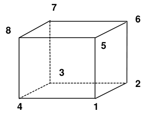
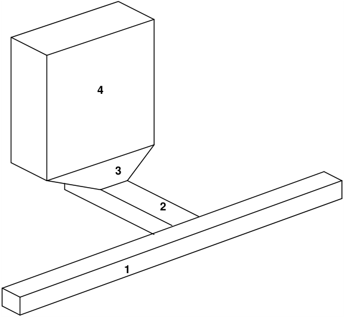

En muchos problemas, los detalles de la forma exacta de las superficies de excavación no son importantes, ya que se busca una evaluación más global de la estabilidad, por ejemplo de las condiciones de pilares, estribos o caja techo. Como resulta muy tedioso describir la ubicación y las conexiones de cada superficie, en Map3D los modelos también pueden ensamblarse a partir de bloques tridimensionales.

CAD > Build > Block

CAD > Build > DD Loop CAD > Build > FF Loop

#### CAD > Build > Tunnel

Estos bloques se utilizan para construir excavaciones tridimensionales, zonas de materiales alternativos y zonas rellenadas. Se definen mediante una cara superior y una inferior, cada una con 4 esquinas. Las esquinas pueden ingresarse en sentido horario o antihorario, siempre que las caras superior e inferior queden alineadas entre sí (es decir, la esquina 5 debe estar frente a la esquina 1, la 2 frente a la 6, etc.). Los lados no tienen por qué ser paralelos ni planos, y cualquiera de las esquinas puede repetirse para definir formas de 3 lados y cuñas.

Estos bloques pueden apilarse para crear formas de excavación complejas o contornos de zonas de mineral. Se vinculan entre sí compartiendo esquinas comunes o por el hecho de intersectarse. Los lados comunes a más de un bloque o que penetran en otros bloques se recortan y eliminan automáticamente. El volumen contenido en la estructura de bloques define una excavación, una zona de mineral, una zona de fluencia, zonas rellenadas, etc.

Para ilustrarlo, considere una configuración simple de punto de extracción ensamblada a partir de 4 bloques. El bloque 1 representa la galería de extracción, el bloque 2 la estocada, el bloque 3 el punto de extracción y el bloque 4 el caserón. El preprocesador de Map3D identifica las conexiones entre estos bloques, los recorta y elimina las superficies comunes a bloques adyacentes.
