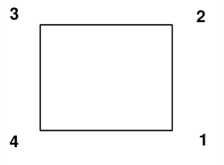
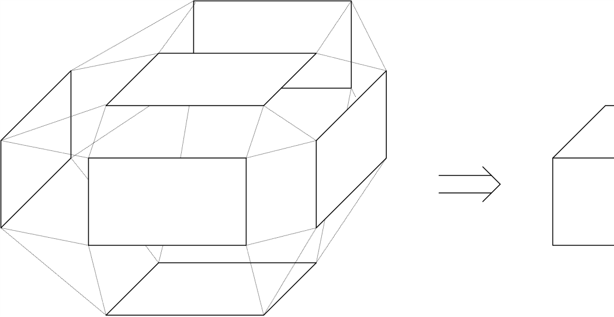
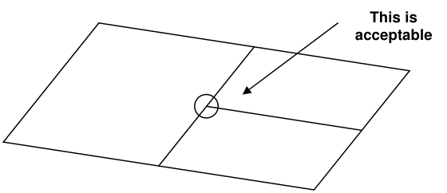

Los modelos pueden construirse a partir de parches de superficie individuales.

CAD > Build > Block

#### CAD > Build > DD Loop

Estos se definen mediante polígonos de 3 o 4 lados que no necesitan ser planos. Las esquinas pueden ingresarse en sentido horario o antihorario. Cualquiera de las esquinas puede repetirse para definir formas de 3 lados y cuñas.

Si se desea, los parches de superficie también pueden utilizarse para construir superficies de excavación y contornos de mineral complejos. La rutina

#### CAD > Build > FF Loop

puede ayudarle a construir con facilidad diseños as-built complejos. La rutina funciona trazando el contorno de múltiples planos de nivel o secciones y vinculándolos luego automáticamente.

A menudo este es el mejor enfoque, sobre todo al intentar construir modelos as-built de estructuras cuya forma exacta se conoce bien. Este enfoque es útil para el análisis muy detallado de muchas estructuras de tipo civil, en las que las concentraciones de esfuerzos y la evaluación de inestabilidades locales son la principal preocupación.

Estas formas pueden construirse con las funciones CAD integradas en Map3D o importarse desde otros paquetes CAD en alguno de los siguientes formatos:

- Formato AutoCAD-DXF. Es un formato popular de intercambio de dibujos con la extensión ".DXF".

- El formato de archivo de puntos es un archivo de datos ASCII universal con la extensión ".PNT".

Incluso para formas simples, este procedimiento de construcción puede volverse rápidamente inmanejable. Como es necesario crear una serie de parches de superficie que, en conjunto, formen una piel continua, sin costuras ni superposiciones, no pueden dejarse huecos ni agujeros.

Cuando los modelos se construyen de esta manera, Map3D verifica que se formen superficies cerradas

#### Analysis > Options > Closure

Además, todas las superficies se renumeran de manera coherente para garantizar que generen volúmenes positivos

#### Analysis > Options > Renumber

Esta renumeración puede fallar si las superficies no están cerradas, es decir, si hay agujeros en la excavación debido a partes faltantes.

A diferencia de otros programas de análisis (métodos de elementos de contorno isoparamétricos y métodos de elementos finitos o de diferencias finitas), no es necesario que estas placas compartan puntos de esquina comunes. Los usuarios pueden definir elementos con subdivisiones a mitad de sus bordes, siempre que no existan huecos. Aunque los modelos pueden construirse con esta técnica de modelamiento de superficies, una técnica más sencilla y confiable es el modelamiento sólido

Construcción de modelos a partir de bloques
