En esta sección se describen algunos errores de construcción comunes, junto con sugerencias para evitarlos y corregirlos.

#### Conexión de una estocada a una galería recta

En este ejemplo, la estocada se construye fácilmente ajustando sus esquinas al borde de la galería de acceso. Para seleccionar los puntos indicados debe usarse el modo de ajuste "arista más cercana"

#### CAD > Snap > Nearest Edge

Las capacidades de intersección booleana integradas en Map3D crearán automáticamente la intersección entre ambos bloques durante la etapa 2 del análisis. Esta construcción funcionará bien.

Aunque esto funciona bien con geometrías simples, en muchas situaciones la conexión no es tan sencilla.

Consideremos una geometría más compleja, en la que los segmentos de la galería de acceso de la caja piso no coinciden con las ubicaciones deseadas de las estocadas.

#### Conexión de una estocada a una galería compleja

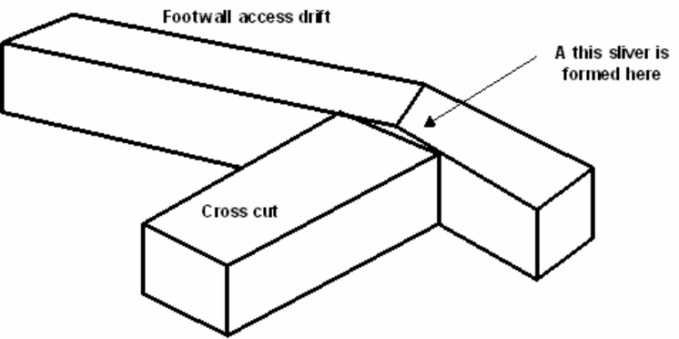

En este ejemplo, la estocada no se une correctamente a la galería de acceso de la caja piso. Se forma un pilar delgado en el extremo de la estocada. Map3D detectará este pilar e intentará analizarlo, probablemente sin éxito. Así como esta geometría sería físicamente inestable en la realidad, también es numéricamente inestable. Map3D puede analizarla con éxito, pero solo si las caras adyacentes del pilar se discretizan con elementos de contorno de tamaño similar al espesor del pilar. Sin embargo, este enfoque no es deseable, ya que requeriría un gran número de elementos y este pilar en realidad no existe.

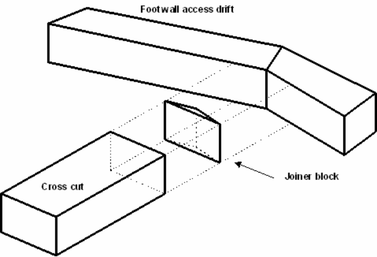

Para evitar este problema, puede construirse un bloque de unión adicional, como se muestra en la vista explosionada adyacente. Debe usarse el modo de ajuste "esquina más cercana" para que este nuevo bloque se una correctamente a la galería y a la estocada. Este bloque de unión extrae efectivamente el pilar no deseado, con lo que conecta correctamente la estocada con la galería de acceso de la caja piso.

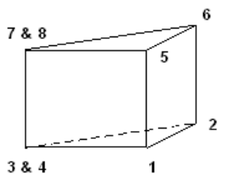

Observe que el bloque de unión tiene solo tres puntos en sus caras superior e inferior. Esto se construye fácilmente seleccionando dos veces una de las esquinas en la misma ubicación (por ejemplo, los puntos 3 y 4 y los puntos 7 y 8).

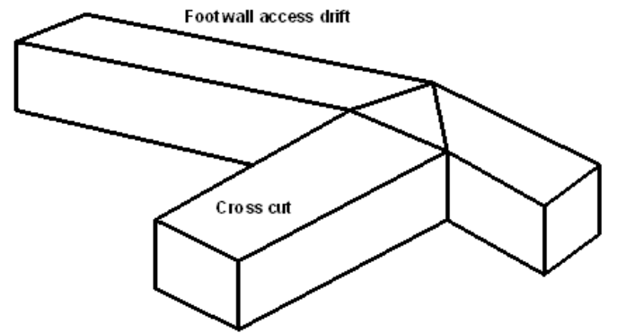

Este problema puede evitarse por completo si se construyen los segmentos de la galería de acceso de la caja piso de modo que coincidan con las ubicaciones deseadas de las estocadas. Esto se logra fácilmente subdividiendo la galería de acceso como se muestra. A menudo, un poco de planificación previa ayuda a simplificar la construcción.

#### Conexión de bloques de caserón desajustados

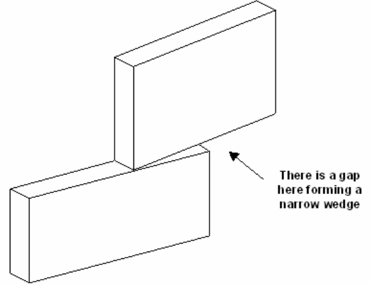

Con frecuencia se presenta la situación de tener que unir varios bloques de caserón a lo largo de sus aristas comunes.

En este ejemplo, si la base del bloque superior y el techo del bloque inferior estuvieran a la misma cota, las capacidades de intersección booleana integradas en Map3D crearían automáticamente la intersección entre ambos bloques durante la etapa 2 del análisis. Esta construcción funcionará bien.

El problema surge durante la construcción, cuando se intenta ajustar las esquinas de un bloque para unirlas al lado del otro. En este ejemplo, el bloque superior se ha ajustado a la arista superior del bloque inferior, lo que deja un hueco.

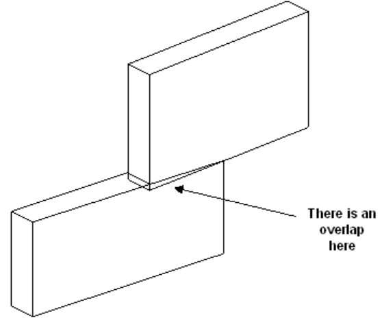

Para eliminar este hueco, podrían ajustarse las esquinas del bloque inferior a la arista inferior del bloque superior mediante la función de estiramiento. Pero esto crearía una superposición y, por lo tanto, no resuelve el problema.

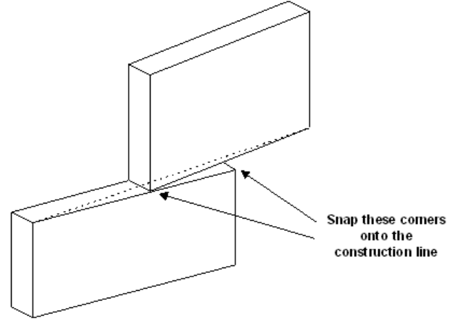

La alternativa es crear un bloque de unión como se describió anteriormente. Sin embargo, una alternativa más sencilla es crear líneas de construcción que abarquen la zona problemática y ajustar a ellas las esquinas de los bloques superior e inferior. Este procedimiento debería realizarse tanto en la cara posterior como en la frontal de los bloques de caserón.

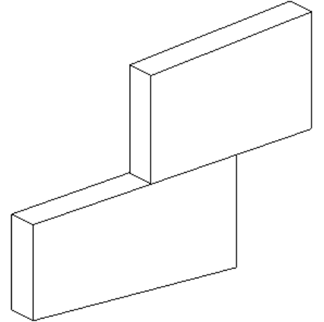

Este método tiene el inconveniente de que altera la forma de los bloques de caserón, posiblemente de manera no deseada.

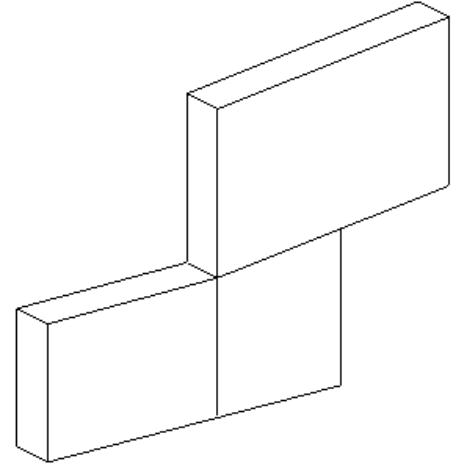

Probablemente la mejor alternativa sea subdividir uno o ambos bloques de caserón. Es la técnica más eficaz para eliminar huecos y unir bloques desajustados.

#### Conexión de bloques de caserón desplazados

Con frecuencia se presenta la situación en que la forma de un bloque de caserón no coincide con la del bloque adyacente.

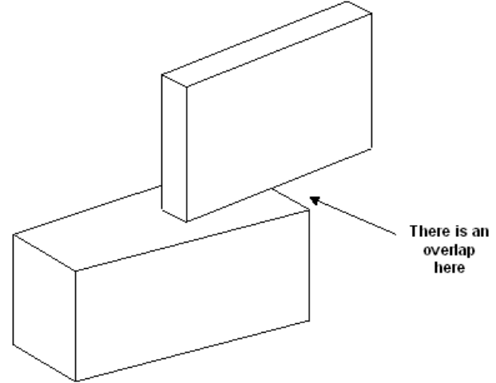

Esta situación se resuelve fácilmente con las capacidades de intersección booleana integradas en Map3D. El programa creará automáticamente la intersección entre ambos bloques durante la etapa 2 del análisis.

Estas rutinas funcionan mejor si todos los puntos de la cara inferior del bloque superior y todos los puntos de la cara superior del bloque inferior están a la misma cota. Esto puede lograrse con

#### CAD > Edit > Move Vertices to Z

Las rutinas funcionan incluso si la cara inferior del bloque superior y la cara superior del bloque inferior no son planas y están a cotas distintas, siempre que efectivamente se intersecten. Sin embargo, en este último caso la intersección resultante puede contener muchos elementos complejos. Aunque estas formas funcionarán bien, podrían ralentizar el análisis debido a su gran número y a que a menudo deben discretizarse de forma muy fina.

#### Conexión de una galería a un bloque de caserón

Con frecuencia se desea intersectar una galería con un bloque de caserón.

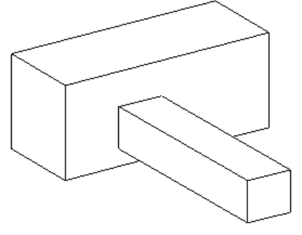

Como en el caso anterior, esta situación se resuelve fácilmente con las capacidades de intersección booleana integradas en Map3D. El programa creará automáticamente la intersección entre la galería y el bloque de caserón durante la etapa 2 del análisis.

Estas rutinas funcionan mejor si las caras que se intersectan son planas y paralelas. Funcionan incluso si no son planas ni paralelas, siempre que efectivamente se intersecten. Sin embargo, en este último caso la intersección resultante puede contener muchos elementos complejos. Aunque estas formas funcionarán bien, podrían ralentizar considerablemente el análisis debido a su gran número y a que a menudo deben discretizarse de forma muy fina.
