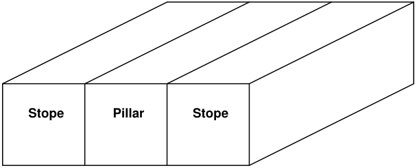
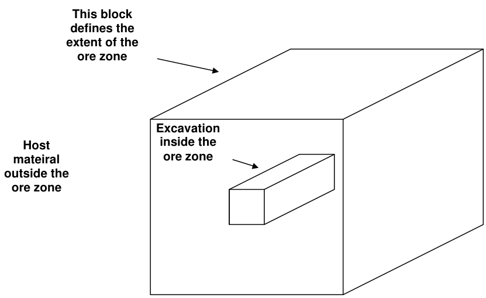
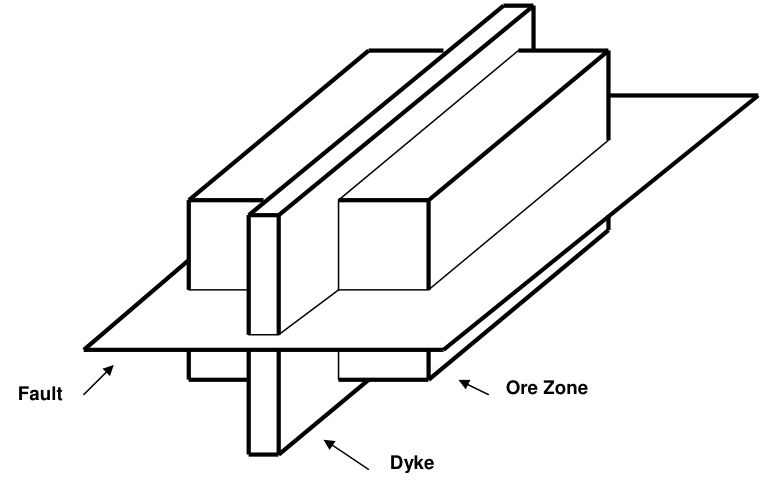

Los modelos que utilizan múltiples materiales se construyen con principios similares a los de los modelos de excavación normales. En lugar de definir el interior de un bloque como excavado (es decir, con código de material cero), basta con especificar el número del material que existe dentro del bloque.

Por defecto, la roca encajante es el material número 1. Cualquier región con un conjunto distinto de propiedades (esfuerzo inicial, respuesta elástica o resistencia) debe definirse igual que se definiría una excavación, utilizando elementos de contorno de tipo fuerza ficticia. En lugar de asignar a estos bloques un código de material cero (para indicar esfuerzos superficiales nulos) o negativo (para indicar un estado de esfuerzos especificado), simplemente se les asigna un código de material positivo que indica las propiedades asociadas a cada grupo de bloques.

Recuerde que las formas de excavación complejas se construyen combinando varios bloques con el mismo número de bloque para formar la forma deseada. Exactamente de la misma manera, las regiones independientes, cada una con un conjunto distinto de propiedades de material, se forman construyendo la forma deseada a partir de muchos bloques con el mismo número de bloque.

Un aspecto importante es que debe utilizarse el menor número posible de números de bloque, ya que todas las superficies entre grupos de bloques con números de bloque distintos se mantendrán en la base de datos.

Hay dos métodos para definir regiones a las que se asignará el material número 2 o superior (es decir, un número de material distinto del de la roca encajante).

En el primer método, las regiones con números de material distintos se construyen a partir de bloques que aparecen exactamente igual que las excavaciones.

Esta técnica es útil para definir detalles como, por ejemplo, zonas de módulo bajo alrededor de la periferia de las excavaciones. También es el mejor método para definir rasgos aislados, como diques rígidos o pilares dañados por tronadura.

El segundo método es un enfoque más global, en el que todo un sistema de excavaciones (o parte de él) queda envuelto en un conjunto de bloques que definen, por ejemplo, la zona de mineral. Se permite encerrar una envolvente dentro de otra (como las capas de una cebolla) y superponer envolventes. Por ejemplo, las galerías pueden sobresalir de la zona de mineral hacia la roca encajante. Map3D construye las intersecciones necesarias.

Ambos métodos pueden usarse simultáneamente. Se permite utilizar bloques que definan una región global con el segundo método. Estos bloques pueden envolver total o solo parcialmente otras excavaciones definidas con el primer método.

La única consideración que debe observarse estrictamente al definir múltiples zonas de material es la convención de que los números de material más altos tienen prioridad sobre los más bajos. Esta convención se adoptó para resolver la ambigüedad al considerar la intersección de dos rasgos distintos, como una falla con un dique. Cuando una falla y un dique se intersectan, no está claro si debe suponerse que la falla atraviesa el dique o viceversa. Otro ejemplo es el caso en que un dique intersecta una zona de mineral. ¿Debe suponerse que el dique es continuo y corta el mineral, o que el mineral es continuo y corta el dique?

En cualquiera de estos casos, el rasgo continuo es el que tiene asignado el número de material más alto. Si a la falla se le asignara el material número 4, al dique el número 3 y al mineral el número 2, la falla sería continua en todo el modelo. Como tiene el número de material más alto, la falla sería continua a través del mineral y del dique, aunque por supuesto no a través de las excavaciones. Como el mineral tiene el número de material más bajo, no cortaría el dique, sino que sería el dique el que cortaría el mineral.

Puede usar las siguientes funciones de ocultación para determinar qué material corta a los demás:

#### View > Hide > Solids

#### View > Hide > Unused

Se ha incorporado lógica para admitir la intersección simultánea de hasta cinco rasgos (es decir, la intersección de bloques con cinco números de bloque distintos). Puede intersectarse un número ilimitado de bloques, pero solo un máximo de cinco en una misma ubicación. Esto permite especificar, por ejemplo, zonas de mineral de varias capas, con excavaciones a ambos lados del contacto y una falla que recorre el contacto. Map3D detecta automáticamente los bloques que están parcial o totalmente contenidos dentro de otros bloques, así como los bloques adyacentes a otros bloques, lo que permite considerar en cualquier análisis un número prácticamente ilimitado de regiones con distintos tipos de material.

Al visualizar la geometría de excavación en modo gráfico, el usuario puede mover el cursor del ratón sobre un bloque de interés. Al presionar un botón del ratón, se mostrarán el número y el nombre del bloque. También se mostrarán el código de material asignado a ese bloque y el código de material de la región adyacente o que envuelve esa superficie del bloque. Por ejemplo, para las superficies de bloque adyacentes a la roca encajante, el "código de material adyacente" será uno (recuerde que el material uno representa el macizo rocoso encajante). Si la superficie del bloque es adyacente a una excavación a la que se ha asignado el código de material 2, el "código de material adyacente" será 2.

Durante el análisis, los resultados se generan en grillas de puntos de campo. Map3D detecta automáticamente si los puntos de la grilla se encuentran dentro de excavaciones o dentro de regiones con propiedades de material distintas. Cuando se muestran los resultados de contornos, el usuario puede mover el cursor del ratón sobre el punto de campo de interés. Al presionar un botón del ratón, se mostrará el código de material asignado a la región donde se encuentra ese punto de campo, junto con las coordenadas, los desplazamientos y la información del estado de esfuerzos. Tenga en cuenta que los factores de resistencia se calcularán con las propiedades de material especificadas para esa región. Esta función permite evaluar una resistencia que puede variar de una región a otra.
