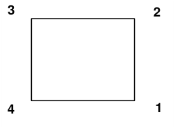
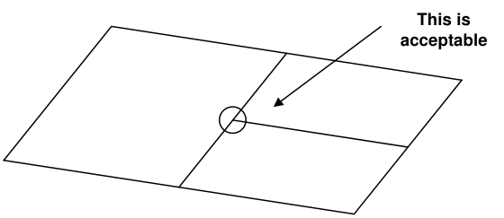
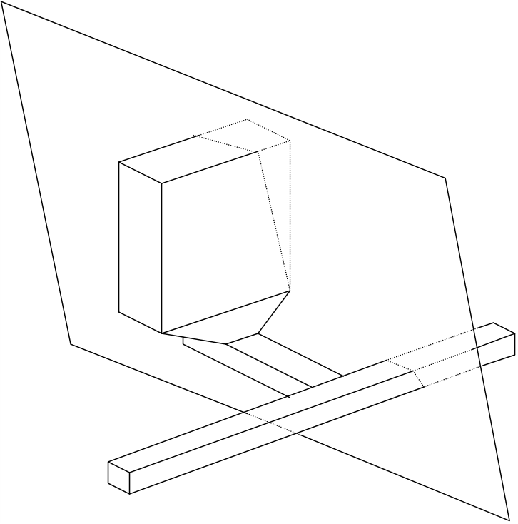
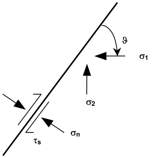

Los modelos pueden construirse a partir de parches de superficie individuales. Estos se definen mediante polígonos de 3 o 4 lados que no necesitan ser planos. Las esquinas pueden ingresarse en sentido horario o antihorario. Cualquiera de las esquinas puede repetirse para definir formas de 3 lados y cuñas.

#### CAD > Build > DD Loop

Estas formas pueden construirse con las funciones CAD integradas en Map3D o importarse desde otros paquetes CAD en alguno de los siguientes formatos:

- Formato AutoCAD-DXF. Es un formato popular de intercambio de dibujos con la extensión ".DXF".

- El formato de archivo de puntos es un archivo de datos ASCII universal con la extensión ".PNT".

A diferencia de otros programas de análisis (métodos de elementos de contorno isoparamétricos y métodos de elementos finitos o de diferencias finitas), no es necesario que estas placas compartan puntos de esquina comunes. Los usuarios pueden definir elementos con subdivisiones a mitad de sus bordes, siempre que no existan huecos.

Los planos de falla y la minería tabular se construyen con los mismos principios que los modelos de excavación normales. Estos rasgos se especifican simplemente junto con otras excavaciones y múltiples zonas de material, y pueden utilizarse simultáneamente con todas las demás funciones de Map3D.

Los planos de falla y las zonas de minería tabular se definen mediante elementos de discontinuidad de desplazamiento. Estos solo pueden especificarse mediante definiciones de placas. Las cuatro esquinas de la placa definen los extremos de la discontinuidad de desplazamiento. Las discontinuidades de desplazamiento pueden intersectar excavaciones en cualquier ubicación, ya que Map3D construye internamente las intersecciones de aristas.

Como en la sección anterior, la única consideración que debe observarse estrictamente al definir planos de falla es la convención de que los números de material más altos tienen prioridad sobre los más bajos. Al considerar la intersección de dos rasgos distintos, como una falla con un dique, el rasgo al que se haya asignado el número de material más alto es el que se mantiene a través del otro.

Un aspecto que debe abordarse al usar modelamiento no lineal (ya sea deslizamiento de fallas o fluencia generalizada en Map3D Non-Linear) es que el esfuerzo de campo lejano no debe superar la resistencia. Si los esfuerzos de campo lejano superan la resistencia del macizo rocoso, el propio macizo será inestable. Aunque esto puede ser admisible en algunos problemas de fluencia, en general no es aceptable, y no es posible obtener soluciones en régimen permanente (es decir, sin fluencia).

Esta limitación es más severa al simular fallas. Cualquier falla puede encontrarse en equilibrio estático, o muy cerca de él (es decir, con esfuerzos iguales a la resistencia), con el estado de esfuerzos de campo lejano. En fallas débiles sometidas a razones de esfuerzo altas, los esfuerzos principales deben estar orientados casi perpendiculares o paralelos al plano de falla; de lo contrario, la falla será inestable y deslizará incluso sin minería. En general, esta condición no es aceptable, ya que no es posible obtener soluciones en régimen permanente (es decir, sin fluencia).

Para el caso en que s1 forma el ángulo J con el plano de falla, el esfuerzo de corte y el esfuerzo normal que actúan sobre la falla vienen dados por

ts = ( s1 - s2 ) sin(J) cos(J)

sn = s1 sin² (J) +  s2 cos² (J)

sustituyendo estas expresiones en la relación de resistencia al corte

|ts| = Cohesion + sn tan(j)

se obtiene que el estado de esfuerzos debe cumplir

|( s1 - s2 ) sin(J) cos(J)| = Cohesion + [ s1 sin² (J) +  s2 cos² (J) ] tan(j)

Por ejemplo, con

s1 = 32 MPa s2 = 16 MPa Cohesion = 0 j = 10°

J debe ser inferior a 11° o estar entre 69° y 90°.

Con

s1 = 60 MPa s2 = 16 MPa Cohesion = 0 j = 30°

J debe ser inferior a 15° o estar entre 45° y 90°.
