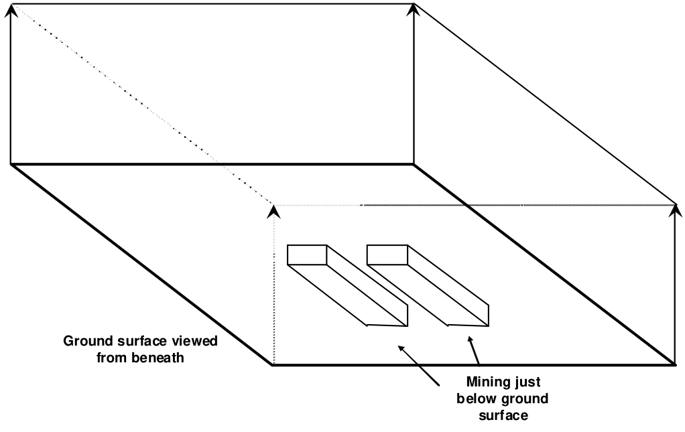

La mejor forma de definir la superficie del terreno es mediante una gran zona FF cuya superficie inferior sea la superficie del terreno. Al asignar un código de material cero a estos elementos, Map3D garantiza esfuerzos normales y de corte nulos a lo largo de estas superficies, con lo que simula una superficie libre.

Solo es necesario definir la superficie del terreno cuando las excavaciones mineras son bastante someras (es decir, cuando la profundidad de la minería es inferior a aproximadamente el doble de su extensión lateral). En estos casos, la superficie libre debe extenderse al menos el doble de la extensión lateral de la minería en todas las direcciones.

No extienda las grillas de puntos de campo cerca de la superficie libre ni a través de ella a menos que sea absolutamente necesario, ya que esto provocará la discretización de la superficie libre en un gran número de elementos de contorno.
