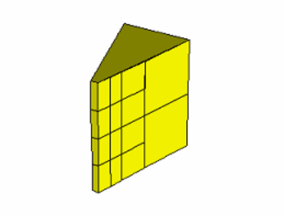
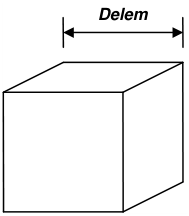
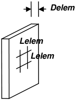
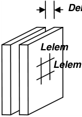
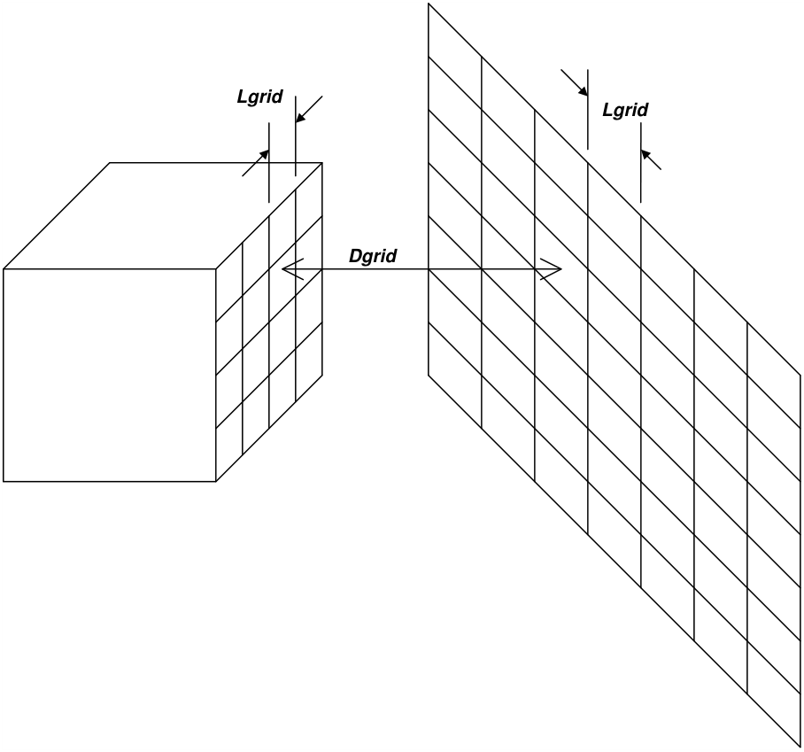
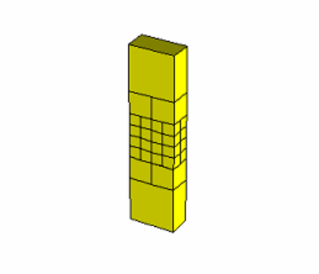
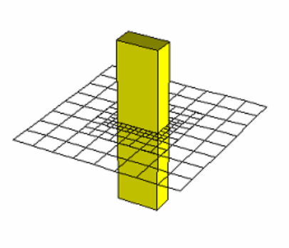
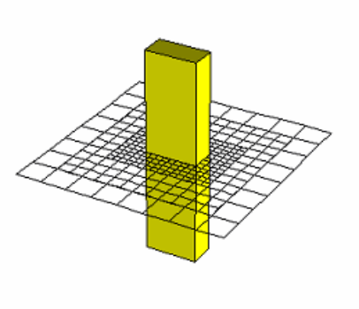
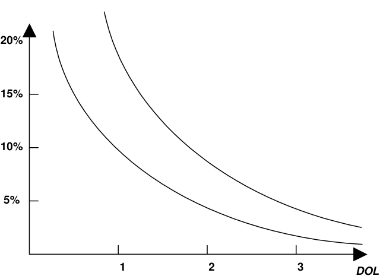
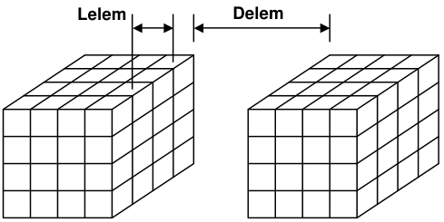

Map3D utiliza varias estrategias distintas, pero complementarias, para permitir el análisis de problemas de gran tamaño. La discretización se controla de modo que los elementos de contorno solo se utilicen donde son necesarios. Luego se emplean varias formas de agrupamiento para reducir el tiempo de análisis y el espacio en disco requerido. En conjunto, estas funciones permiten a Map3D abordar problemas muy grandes (más de 2.000.000 de elementos) en computadores personales.

Sin agrupamiento, un problema de 64000 elementos ocuparía 147 GB de espacio en disco. Con agrupamiento, esto puede reducirse a menos de 1 GB. El tiempo de análisis se reduce aproximadamente en la misma proporción. Esto permite especificar en detalle la geometría minera existente y añadir nueva minería según sea necesario. Así se reduce en gran medida el esfuerzo necesario para preparar y ejecutar los análisis, y es posible considerar toda la mina cuando sea necesario.

Todos los parámetros de discretización y agrupamiento se expresan como una razón entre distancia y longitud. En todos los casos, la distancia se mide entre dos puntos de interés (por ejemplo, de un elemento a otro, o de un elemento al punto de grilla más cercano). En esta razón, la longitud es el tamaño del elemento o el espaciado de la grilla en uno de los puntos de interés.

Los valores sugeridos para los parámetros de discretización y agrupamiento son los siguientes:

- _AL_ debe fijarse en el doble del ancho del pilar o caserón más pequeño. Use las mismas unidades que para las coordenadas (por ejemplo, metros o pies).

- _AG_ debe fijarse en la dimensión de interés más pequeña. Use las mismas unidades que para las coordenadas (por ejemplo, metros o pies).

- _DON_ =0.5, _DOL_ = _DOC_ =1, _DOE_ = _DOG_ =2 para un error del 10-20%

- _DON_ =0.5, _DOL_ = _DOC_ =2, _DOE_ = _DOG_ =4 para un error del 5-10%

- _DON_ =1.0, _DOL_ = _DOC_ =4, _DOE_ = _DOG_ =8 para un error &lt; 5%

Estos parámetros se configuran en el cuadro de diálogo CAD > Properties > Control Parameters.

A continuación se describe en detalle el uso de estos parámetros para controlar la discretización y el agrupamiento.

**_DON_ y** **_AL_: condicionamiento de la matriz**

Durante el proceso de discretización, todas las superficies del modelo (superficies de bloques FF y planos DD) se subdividen en elementos de contorno con longitud de lado

_Lelem_ = _Delem_ / _DON_

donde _Delem_ es la distancia mínima entre superficies adyacentes del modelo, determinada por Map3D. Como en algunos lugares la distancia _Delem_ puede ser cero, debe especificarse la longitud mínima de lado de los elementos _AL_.

_AL_ debe fijarse en el doble del ancho del pilar o caserón más pequeño. Deben usarse las mismas unidades que para las coordenadas (por ejemplo, metros o pies).

Un valor de _DON_ de 0,5 suele ser adecuado para todos los problemas, excepto aquellos con excavaciones o pilares muy estrechos. En este último caso se recomienda un valor de _DON_ de 1,0.

Aunque valores más altos de _DON_ generan más elementos de contorno y, por lo tanto, tiempos de ejecución más largos, esto es necesario para obtener un problema bien condicionado y resoluble cuando hay excavaciones o pilares muy estrechos.

_DON_ controla la forma en que las superficies de los bloques se discretizan en elementos de contorno. Este parámetro, junto con _AL_, se utiliza para garantizar que el análisis de elementos de contorno genere una matriz de coeficientes bien condicionada y resoluble.

El condicionamiento de la matriz está directamente relacionado con la magnitud de _DON_. Usando valores grandes de _DON_ (cercanos a uno) se puede garantizar una matriz bien condicionada y fácil de resolver.

_DON_ = 0.5

#### _DON_ = 1.0

Estos parámetros controlan cuán fina será la discretización de las superficies que pasan cerca unas de otras. Por ejemplo, al comparar los ejemplos con _DON_ de 0,5 y 1,0, se observa que los valores más altos de _DON_ producen elementos de contorno más pequeños en la zona donde se ubica el caserón.

Desde el punto de vista del análisis, hay tres tipos básicos de problemas. Los más fáciles de resolver son los que usan formas tridimensionales voluminosas, cuyas superficies están bien separadas.

En este tipo de problema siempre se generará una matriz de coeficientes bien condicionada, y el efecto de _DON_ y _AL_ no es importante.

El siguiente tipo de problema, más difícil de resolver, es aquel en que se definen caserones estrechos. En este caso, la distancia _Delem_ (la distancia mínima de un elemento a otro) es simplemente el ancho del caserón. Como la longitud de lado del elemento _Lelem_ puede calcularse a partir de la razón _DON_ como

#### _Lelem_ = _Delem_ / _DON_

de modo que _Lelem_ no sea inferior a _AL_, los valores pequeños de _DON_ generarán elementos pequeños solo cerca de los lugares donde los caserones son estrechos. Al alejarse de estas zonas, el tamaño de los elementos aumentará muy rápidamente. El uso de elementos de fuerza ficticia para crear este tipo de excavación tabular puede producir una matriz mal condicionada, a menos que se use un valor de _DON_ de aproximadamente la mitad. Por supuesto, esto debe ir acompañado de un valor de _AL_ suficientemente pequeño para permitir la generación de elementos pequeños.

Normalmente, _AL_ debe fijarse en el ancho del pilar o caserón más estrecho, o en la menor distancia entre caja techo y caja piso. Esto permitirá que la rutina de discretización use elementos tan pequeños como sea necesario para garantizar un condicionamiento adecuado de la matriz.

El tipo de problema más difícil de resolver es aquel en que se definen pilares estrechos o se utilizan diaclasas poco espaciadas. Como en el caso anterior, _Delem_ es el ancho del caserón o del pilar. La longitud de lado del elemento también puede calcularse a partir de la razón _DON_; sin embargo, en este tipo de problema, en que las excavaciones están muy próximas entre sí y crean pilares estrechos, se generará una matriz mal condicionada e irresoluble a menos que se use un valor de _DON_ de aproximadamente uno. Por supuesto, esto debe ir acompañado de un valor de _AL_ suficientemente pequeño para permitir la generación de elementos pequeños.

El valor recomendado de _DON_ es 0,5 para problemas de caserones estrechos y 1 para problemas de pilares estrechos.

Normalmente, _AL_ debe fijarse en el ancho del pilar más estrecho o en la menor distancia entre caja techo y caja piso. Esto permitirá que la rutina de discretización use elementos tan pequeños como sea necesario para garantizar un condicionamiento adecuado de la matriz.

En resumen, _AL_ debe fijarse en el ancho del pilar más estrecho o en la menor distancia entre caja techo y caja piso. Pueden ser necesarios valores mayores si se generan demasiados elementos. _DON_ debe fijarse en 0,5 para problemas normales y en 1,0 para problemas en que se definen pilares estrechos.

Durante la discretización, Map3D intentará cumplir la razón _DON_ especificada para todos los elementos. Al discretizar, el número máximo de elementos de contorno en que puede dividirse cualquier arista de bloque o placa es 256. Si se alcanza este número de subdivisiones y aún no se ha logrado la razón _DON_ especificada, Map3D emitirá un mensaje de advertencia indicando al usuario que subdivida el bloque o la placa en partes más pequeñas.

Una vez completada la discretización, la distancia _Delem_ puede graficarse mediante

Plot > Miscellaneous > Delem Distance to nearest element on surfaces

La razón _Delem/Lelem_ puede graficarse mediante

Plot > Miscellaneous > Delem/Lelem _DON_ ratio on surfaces

Los lugares donde _DON_ es pequeño (menor que 0,5) podrían provocar un proceso de solución que no converja.

Tenga en cuenta que, si lo desea, este comportamiento puede anularse elemento por elemento especificando el ancho máximo de cada elemento

#### CAD > Edit > Entity Properties > Maximum Width

#### _DOL_ y _AG_: precisión de la solución

Durante el proceso de discretización, los bloques y planos DD se subdividen en elementos de contorno con longitud de lado _Lgrid_. El tamaño del elemento se determina a partir de la distancia mínima _Dgrid_ al plano de grilla de puntos de campo más cercano según la relación

_Lgrid_ = _Dgrid_ / _DOL_

Como en algunos lugares la distancia _Dgrid_ puede ser cero, también debe especificarse una longitud mínima de lado de los elementos _AG_.

Esta misma relación se usa también para subdividir los planos de grilla en puntos donde se calculan los esfuerzos, deformaciones y desplazamientos de campo. Se utilizará un espaciado mínimo de grilla igual a la mitad de _AG_.

El parámetro _AG_ debe fijarse en la dimensión de interés más pequeña. Para obtener resultados razonablemente precisos, _AG_ debe fijarse en aproximadamente un cuarto del ancho del caserón o del pilar. Por ejemplo, si el usuario desea ver la distribución de esfuerzos a lo largo de un pilar de 2 m de ancho, un valor de 0,5 para _AG_ proporcionaría un número suficiente de puntos de campo para un trazado de contornos preciso.

Deben usarse las mismas unidades que para las coordenadas (por ejemplo, metros o pies).

Se recomienda un valor de _DOL_ de 1,0 para todos los problemas, excepto aquellos en que se requiere mayor precisión. Con un valor de 1,0 cabe esperar un error del 10-20%. Un valor de 2,0 debería dar un error del 5-10%. Un valor de 4,0 debería dar un error inferior al 2%.

Aunque valores más altos de _DOL_ generan más elementos, esto es necesario para obtener mayor precisión.

_DOL_ controla la forma en que se subdividen las grillas y las superficies de los bloques. Este parámetro, junto con _AG_, se usa para controlar el grado de precisión de detalle que se requiere en los resultados.

_AG_ debe elegirse de modo que refleje el tamaño de interés. Por ejemplo, si solo se requieren detalles de la distribución de esfuerzos con una resolución de un metro respecto de las superficies de excavación, _AG_ debe fijarse en un metro.

El espaciado de los puntos de campo y la longitud de lado de los elementos _Lgrid_ se determinan a partir de la razón _DOL_ especificada. _Dgrid_ se determina como la distancia mínima desde un elemento dado hasta la grilla más cercana. Como _Lgrid_ puede calcularse a partir de la razón _DOL_ como

_Lgrid_ = _Dgrid_ / _DOL_

de modo que _Lgrid_ no sea inferior a _AG_, los valores pequeños de _DOL_ generarán elementos y espaciados de grilla pequeños solo cerca de los lugares donde las grillas pasan cerca de los caserones. Al alejarse de estas zonas, el tamaño de los elementos aumentará muy rápidamente.

_DOL_ = 1

_DOL_ = 2

_DOL_ = 1

#### _DOL_ = 2

Los valores pequeños de _DOL_ (uno o menos) generarán espaciados de puntos de campo y elementos pequeños solo cerca de los lugares donde la grilla intersecta el bloque o pasa muy cerca de él. Al alejarse de estas zonas, el espaciado de los puntos de campo y la longitud de lado de los elementos aumentarán muy rápidamente. Los valores mayores de _DOL_ (dos o más) aumentarán la distancia en la que el espaciado de los puntos de campo y la longitud de lado de los elementos se mantienen pequeños.

#### Error

La precisión de los resultados está directamente relacionada con la magnitud de _DOL_. Los errores se limitan a aproximadamente un 10-20% para _DOL_ cercano a uno, y a un 5-10% para _DOL_ cercano a dos. Estos valores son solo aproximados, por lo que se recomienda usar valores de _DOL_ cercanos a cuatro en problemas que requieren alta precisión. En problemas en que basta una precisión baja, un _DOL_ cercano a uno es adecuado. No se recomienda fijar _DOL_ en un valor inferior a uno.

Tenga en cuenta que los valores grandes de _DOL_ y los valores pequeños de _AG_ aumentan el número de elementos y los tiempos de ejecución, pero también la precisión.

En resumen, _AG_ debe fijarse en la resolución de interés (una fracción del ancho del caserón). _DOL_ debe fijarse en 1 para resultados de análisis gruesos, en 2 para resultados detallados y en 4 cuando se requiere una precisión muy alta.

Durante la discretización, Map3D intentará cumplir la razón _DOL_ especificada para todos los elementos y grillas. Al discretizar, el número máximo de elementos de contorno en que puede dividirse cualquier arista de bloque o placa es 256. El número máximo de puntos de campo en que puede dividirse cualquier arista de grilla también es 256. Si se alcanza este número de subdivisiones y aún no se ha logrado la razón _DOL_ especificada, Map3D emitirá un mensaje de advertencia indicando al usuario que subdivida el bloque, la placa o la grilla en partes más pequeñas.

Una vez completada la discretización, la distancia _Dgrid_ puede graficarse sobre las superficies del modelo mediante

Plot > Miscellaneous > Dgird Distance to nearest grid on surfaces

o sobre las grillas mediante

Plot > Miscellaneous > Dgrid Distance to nearest element on grids

La razón _Dgrid_ / _Lgrid_ puede graficarse sobre las superficies del modelo mediante

Plot > Miscellaneous > Dgrid/Lgrid _DOL_ ratio on surfaces

o sobre las grillas mediante

Plot > Miscellaneous > Dgrid/Lgrid _DOL_ ratio on grids

Tenga en cuenta que, si lo desea, este comportamiento puede anularse grilla por grilla especificando el ancho máximo de cada grilla

CAD > Edit > Entity Properties > Maximum Width

#### _DOR_: razón de aspecto de los elementos

_DOR_ controla la razón de aspecto máxima de los elementos. Si se determina que la razón entre las longitudes de lado de un elemento supera _DOR_, ese elemento se subdivide. El valor recomendado de _DOR_ es 5. Si se detectan resultados erráticos, _DOR_ debe reducirse a 2. Tenga en cuenta que los valores más pequeños de _DOR_ generan más elementos y tiempos de ejecución más largos, pero mayor precisión.

Durante la discretización, Map3D intentará cumplir la razón _DOR_ especificada para todos los elementos. Al discretizar, el número máximo de elementos de contorno en que puede dividirse cualquier arista de bloque o placa es 256. Si se alcanza este número de subdivisiones y aún no se ha logrado la razón _DOR_ especificada, Map3D emitirá un mensaje de advertencia indicando al usuario que subdivida el bloque o la placa en partes más pequeñas.

#### _DOC_: agrupamiento de la matriz

Durante el ensamblaje de la matriz, se examina la distancia _Delem_ entre grupos de bloques y planos DD para ver si pueden agruparse con fines de cálculo y almacenamiento. El grado de agrupamiento depende de cuántos elementos caben en una zona con longitud de lado _Lelem_, determinada por la relación

#### _Lelem_ = _Delem_ / _DOC_

Se recomienda un valor de _DOC_ de 1,0 para todos los problemas, excepto aquellos en que se requiere mayor precisión. Con un valor de 1,0 cabe esperar un error del 10-20%. Un valor de 2,0 debería dar un error del 5-10%. Un valor de 4,0 debería dar un error inferior al 5%.

Aunque valores más altos de _DOC_ dan lugar a problemas de mayor tamaño, esto es necesario para obtener mayor precisión.

_DOC_ controla la forma en que se agrupan los elementos durante el ensamblaje de la matriz. Los elementos con longitud de lado combinada _Lelem_ se agrupan si la distancia _Delem_ al elemento afectado supera la razón _DOC_ requerida. Si las distancias entre caserones son grandes, pueden agruparse muchos elementos.

Los valores pequeños de _DOC_ (uno o menos) proporcionarán el máximo agrupamiento; sin embargo, la precisión de los esfuerzos cerca de las superficies de excavación se deteriorará y el condicionamiento de la matriz se reducirá. Los valores mayores de _DOC_ (dos o más) proporcionarán menos agrupamiento, pero se mantendrán la precisión y un buen condicionamiento de la matriz.

_DOC_ debe fijarse en 1 para resultados de análisis gruesos, en 2 para resultados detallados y en 4 cuando se requiere una precisión muy alta. Tenga en cuenta que los valores grandes de _DOC_ aumentan el tamaño de la matriz y los tiempos de ejecución, pero también la precisión.

#### _DOE_: agrupamiento de elementos

Durante el cálculo de los puntos de campo (es decir, el ensamblaje de las grillas), se examina la distancia _Dgrid_ entre estos puntos y los grupos de bloques y planos DD para ver si dichos grupos pueden agruparse con fines de cálculo. El grado de agrupamiento depende de cuántos elementos caben en una zona con longitud de lado _Lgrid_, determinada por la relación

#### _Lgrid_ = _Dgrid_ / _DOE_

Se recomienda un valor de _DOE_ de 2,0 para todos los problemas, excepto aquellos en que se requiere mayor precisión. Con un valor de 2,0 cabe esperar un error del 10-20%. Un valor de 4,0 debería dar un error del 5-10%. Un valor de 8,0 debería dar un error inferior al 5%.

Aunque valores más altos de _DOE_ dan lugar a tiempos de análisis más largos, esto es necesario para obtener mayor precisión.

_DOE_ controla la forma en que se agrupan los elementos durante el cálculo de los puntos de campo. Los elementos con longitud de lado combinada _Lgrid_ se agrupan si la distancia _Dgrid_ al punto de campo supera la razón _DOE_ requerida. Los valores pequeños de _DOE_ (dos o menos) proporcionarán el máximo agrupamiento; sin embargo, la precisión de las distribuciones de esfuerzos cerca de las superficies de excavación se deteriorará y se volverán erráticas. Los valores mayores de _DOE_ (cuatro o más) proporcionarán menos agrupamiento, pero garantizarán la precisión y distribuciones de esfuerzos suaves.

_DOE_ debe fijarse en 2 para resultados de análisis gruesos, en 4 para resultados detallados y en 8 cuando se requiere una precisión muy alta. Tenga en cuenta que los valores grandes de _DOE_ aumentan el tamaño de la matriz y los tiempos de ejecución, pero también la precisión.

#### _DOG_: agrupamiento de grillas

Durante el cálculo de los puntos de campo (es decir, el ensamblaje de las grillas), se examina la distancia _Dgrid_ entre estos puntos y los grupos de bloques y planos DD para ver si estos puntos de campo pueden agruparse con fines de cálculo. El grado de agrupamiento depende de cuántos puntos de campo caben en una zona con longitud de lado _Lgrid_, determinada por la relación

_Lgrid_ = _Dgrid_ / _DOG_

Se recomienda un valor de _DOG_ de 2,0 para todos los problemas, excepto aquellos en que se requiere mayor precisión. Con un valor de 2,0 cabe esperar un error del 10-20%. Un valor de 4,0 debería dar un error del 5-10%. Un valor de 8,0 debería dar un error inferior al 5%.

Aunque valores más altos de _DOG_ dan lugar a tiempos de análisis más largos, esto es necesario para obtener mayor precisión.

_DOG_ controla la forma en que se agrupan los puntos de campo durante su cálculo. Los puntos de campo con longitud de espaciado combinada _Lgrid_ se agrupan si la distancia _DOG_ al elemento que los afecta supera la razón _DOG_ requerida. Los valores pequeños de _DOG_ (dos o menos) proporcionarán el máximo agrupamiento; sin embargo, la precisión de las distribuciones de esfuerzos cerca de las superficies de excavación se deteriorará y se volverán erráticas. Los valores mayores de _DOG_ (cuatro o más) proporcionarán menos agrupamiento, pero garantizarán la precisión y distribuciones de esfuerzos suaves.

_DOG_ debe fijarse en 2 para resultados de análisis gruesos, en 4 para resultados detallados y en 8 cuando se requiere una precisión muy alta. Tenga en cuenta que los valores grandes de _DOG_ aumentan el tamaño de la matriz y los tiempos de ejecución, pero también la precisión.
