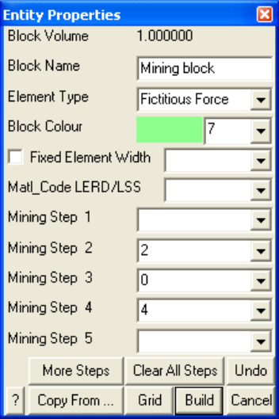

La secuencia de etapas de minado se especifica simplemente asignando los códigos de material adecuados en la etapa de minado deseada. El código de material representa el número del material que existe dentro del bloque. Por defecto, la roca encajante es el material número 1. A cualquier región cuyas propiedades (esfuerzo inicial, respuesta elástica o resistencia) difieran de las de la roca encajante debe asignársele simplemente un código de material positivo que indique las propiedades asociadas a cada grupo de bloques.

El código de material 0 especifica que el elemento tendrá esfuerzos superficiales nulos. Es el valor por defecto y se usa normalmente para superficies de excavación, la superficie del terreno y las paredes de rajo.

El código de material -M (por ejemplo, -2) especifica que el elemento tendrá esfuerzos superficiales iguales al estado de esfuerzos asociado al material número M. Esto es útil para modelar excavaciones presurizadas o esfuerzos que varían con la profundidad (por ejemplo, relleno).

El código de material +M (por ejemplo, 2) especifica que la región encerrada se comportará con las propiedades asociadas al material número M. Este código se usa para especificar regiones con propiedades distintas de las de la roca encajante (por ejemplo, mineral, dique, relleno, etc.).

Los códigos de material se asignan durante la construcción del modelo mediante

CAD > Build > Block CAD > Build > DD Loop CAD > Build > FF Loop

Los códigos de material pueden asignarse en cualquier momento mediante

CAD > Edit > Entity Properties

Se le mostrará lo siguiente

En este ejemplo, el bloque seleccionado no se utiliza en la etapa 1. En la etapa de minado 2 se le asignan las propiedades del material número 2. En la etapa de minado 3 el bloque se excava. Por último, en la etapa de minado 4 el bloque se rellena con el material número 4.

Este procedimiento puede utilizarse con elementos de tipo fuerza ficticia para definir zonas tridimensionales con distintos esfuerzos y propiedades de material (por ejemplo, diques rígidos, zonas de mineral blandas o zonas cedentes). También puede utilizarse con elementos de tipo discontinuidad de desplazamiento para definir zonas planas con distintos esfuerzos y propiedades de material (por ejemplo, fallas con relleno o pilares cedentes en minería tabular).

Puede especificarse un código de material distinto en cada etapa de minado. Si no se asigna ningún código de material (es decir, si se deja en blanco), el bloque permanecerá inactivo.

Es importante recordar la convención de que los números de material (códigos de material) más altos tienen prioridad sobre los más bajos. Esta convención se adoptó para resolver la ambigüedad al considerar la intersección de varios rasgos distintos, como una falla con un dique o un relleno colocado en parte de un caserón. Para evitar problemas, se recomienda usar los números de material más altos para el relleno.

Al simular sistemas de soporte rígidos como arcos, marcos de acero, puntales, revestimientos gruesos, chocos, relleno resistente, etc., es necesario modelar el movimiento del terreno hasta el momento de la colocación del soporte y luego insertar los elementos de soporte, ya sea en un estado libre de esfuerzos y deformaciones o con un preesfuerzo prescrito. Para ello, primero debe excavar el elemento de soporte deseado (un bloque FF 3D o un plano DD) hasta el estado de preesfuerzo deseado (use un código de material cero para esfuerzos nulos o un número de material negativo para un estado de esfuerzos prescrito) y luego, en una etapa de minado posterior, insertar el material de soporte (use un número de material positivo para ello). Con la opción Analysis > Options > Zero Strain Support Placement activada, Map3D realiza los cálculos necesarios para colocar los elementos de soporte en un estado libre de esfuerzos y deformaciones o con un preesfuerzo prescrito en la etapa de minado actual. La acción de excavar hasta un estado de esfuerzos nulo o prescrito seguida de la inserción de un material alternativo indica a Map3D que debe realizar los cálculos necesarios.

Este procedimiento es especialmente útil para simular elementos de soporte estructural y permite su colocación, la modificación de sus propiedades y su posterior retiro si se desea. Esta opción está habilitada para bloques FF 3D y/o planos DD.

Sin esta opción, todos los materiales se colocan en el estado de deformación premineral. Esto puede provocar esfuerzos erróneamente altos, sobre todo en los elementos de soporte rígidos.

La secuencia de minado obtenida puede verse en el modo gráfico de Map3D simplemente cambiando entre etapas de minado con

File > Mining Step
