Para mostrar cómo construir un modelo a partir de planos de mina digitalizados, construiremos una geometría simple de minería masiva VRM.

Las líneas de construcción se utilizan para definir la ubicación detallada de elementos subterráneos como excavaciones, contactos, estructuras, etc. Normalmente, un modelo de Map3D se construye sobre estos datos de líneas de construcción.

Los planos de mina se digitalizaron previamente con Map3D

#### CAD > Digitizer Setup

o con otro programa CAD. Estos planos pueden guardarse en alguno de los siguientes formatos:

El formato de archivo de puntos es un archivo de datos ASCII universal con la extensión ".PNT". Este formato es útil para intercambiar datos brutos de líneas de construcción con otros programas CAD.

El formato AutoCAD-DXF es un formato popular de intercambio de dibujos con la extensión ".DXF". Este formato es útil para intercambiar datos de líneas de construcción con otros programas CAD.

Queremos empezar desde cero, así que seleccionaremos

#### File > New (Model)

Antes de comenzar, tenga en cuenta que puede situar el cursor sobre cualquier botón para ver una información sobre herramientas que identifica su función. Además, puede hacer clic con el botón derecho en cualquier elemento para obtener ayuda detallada sobre esa función.

#### Importación de planos de mina digitalizados

Primero debemos abrir un archivo que contenga los planos de mina digitalizados. Esto se hace con

#### File > Open (Construction Lines)

En este caso, las líneas de construcción se guardaron en formato DXF, así que cambie "Files of Type" a *.dxf

El archivo "BULK.dxf" se incluye con la instalación de Map3D y debería estar disponible para importar.

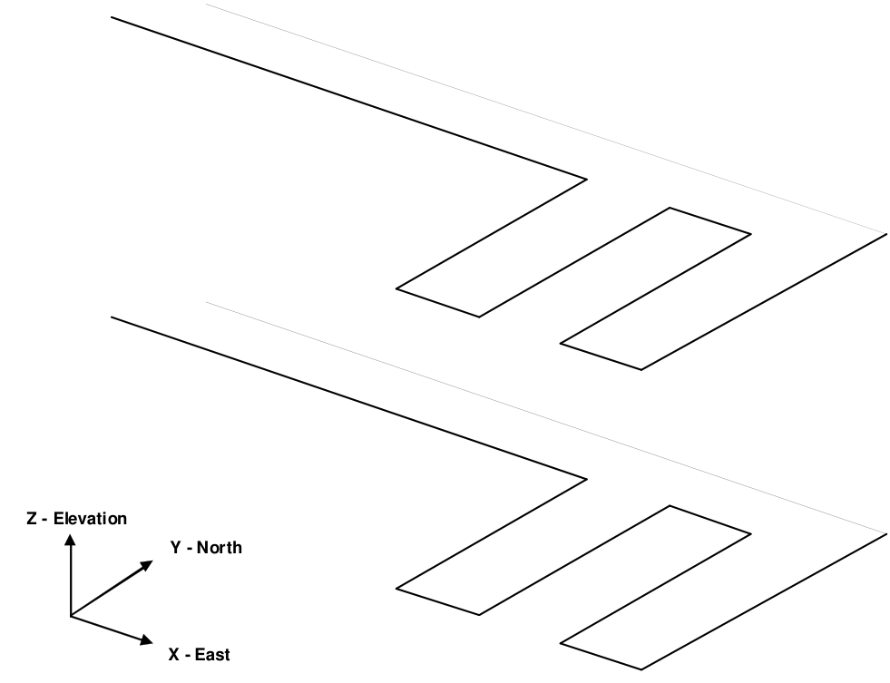

Las galerías de acceso miden aproximadamente 5 m de ancho por 5 m de alto, y la distancia entre niveles es de 25 m.

#### Reposicionamiento de la vista

Durante la construcción de bloques, o en cualquier otro momento, puede reposicionar (trasladar, rotar o hacer zoom) la geometría para facilitar la visualización. Esto se logra fácilmente de varias formas (consulte Rotación del modelo y Traslación del modelo). La forma más sencilla de rotar es mantener presionado el botón izquierdo del ratón mientras arrastra el cursor por la pantalla. La traslación se logra manteniendo presionado el botón derecho. Para acercar o alejar el modelo, mantenga presionados ambos botones del ratón.

Coloque la vista de modo que las líneas de construcción se vean con claridad.

#### Construcción de galerías de acceso de la caja piso y estocadas

Hay numerosos métodos para construir estas entidades. En este tutorial se mostrarán algunas técnicas distintas.

#### Construcción de bloques uno a uno

El método más sencillo (aunque el que más tiempo consume) es construir una serie de bloques de 8 esquinas, uno a la vez.

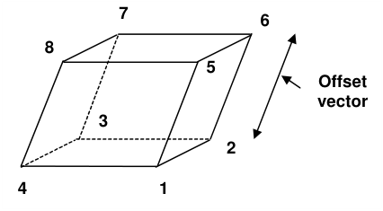

Para construir el primer bloque, use CAD > Build > FFLoop. Esta función puede seleccionarse desde la barra de herramientas CAD de la siguiente manera (si la barra de herramientas CAD no está visible, actívela con Tools > CAD Toolbar):

Seleccione CAD > Build en la barra de herramientas CAD

Se mostrará el submenú de funciones de construcción

Ahora seleccione

#### CAD > Build > FFLoop

Como queremos ajustar a las líneas de construcción, debemos configurar el modo de ajuste. Esto se hace con CAD > Snap > Nearest Edge. Esta función puede seleccionarse desde la barra de herramientas Build Entity

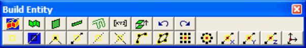

Para activar el ajuste a la arista más cercana, seleccione

#### CAD > Snap > Nearest Edge

(esto solo es necesario si el botón de ajuste a la arista más cercana no está ya resaltado).

En este modo, se mostrará una caja de selección en la intersección de la cruz de referencia.

**Se seleccionará el punto más cercano de esta arista**

Aunque las coordenadas de la ubicación actual del cursor se indican en la barra de estado, si la caja de selección está sobre la esquina de una línea de construcción, se seleccionará esa esquina; de lo contrario, se seleccionará el punto más cercano de la arista de la línea de construcción que esté bajo la caja de selección. En ambos casos, los 3 valores de coordenadas (x, y, z) quedan especificados de forma única.

Verá que la rutina de construcción FFLoop le pide en la barra de estado que ingrese la primera esquina del bloque

Input: Select Point 1

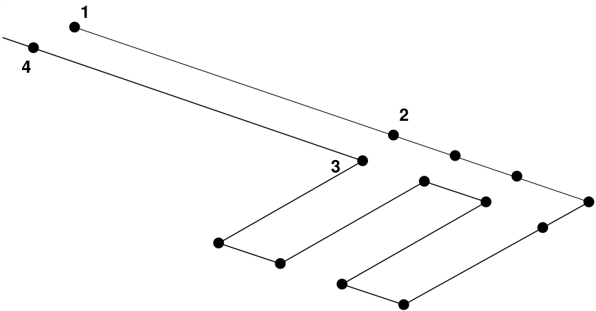

Mueva el cursor hasta encontrar el punto n.º 1. Selecciónelo haciendo clic una vez con el botón izquierdo del ratón.

A continuación se le pedirá la siguiente esquina del bloque

#### Input: Select Point 2

Al mover el cursor, verá que en la esquina inferior izquierda de la pantalla se indica no solo la ubicación actual del cursor, sino también el desplazamiento del punto actual respecto del último seleccionado (es decir, el vector de desplazamiento del punto 1 al punto 2). Seleccione el punto n.º 2. Repita este proceso de selección para los puntos n.º 3 y n.º 4.

Si selecciona una ubicación incorrecta para un punto, simplemente deshaga esa selección con el botón deshacer

CAD > Build > Undo Point y vuelva a intentarlo.

Por último, vuelva a seleccionar el primer punto (es decir, el punto n.º 1).

Al volver a seleccionar el primer punto, la base del bloque queda completamente formada. Se mostrará el mensaje

Loop complete: Start next loop.

Para terminar de construir el bloque, generaremos los 4 puntos restantes a partir de las 4 primeras esquinas añadiéndoles un desplazamiento. Para usar este procedimiento, seleccione la función de desplazamiento en la barra de herramientas Build Entity

#### CAD > Build > Extrude/Offset Remaining

Se le pedirá el vector de desplazamiento de la siguiente manera

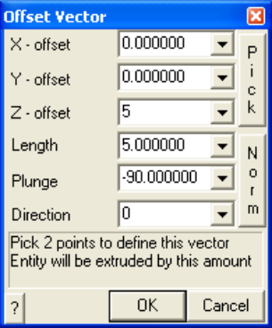

Ingrese el desplazamiento como:

X-offset > 0 Y-offset > 0 Z-offset > 5

Los puntos 5, 6, 7 y 8 se generarán a partir de los puntos 1, 2, 3 y 4, respectivamente, sumando los valores de desplazamiento a sus coordenadas.

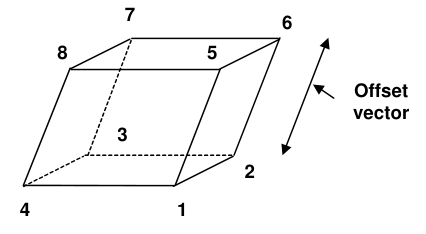

Al completar la construcción del bloque, se le pedirá automáticamente que ingrese las propiedades del bloque (CAD > Build > FFLoop)

Ingrese lo siguiente:

Block Name: Intersection Element Type: Fictitious Force Block Colour: 1

Este bloque de intersección debe excavarse en la etapa de minado 1. Esto se indica especificando Mining Step 1: 0

Hemos terminado y podemos construir este bloque presionando el

botón.

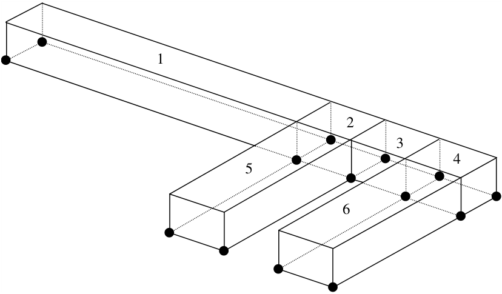

Repitiendo el procedimiento de construcción FFLoop anterior, puede construirse todo el nivel como una serie de bloques.

#### Construcción de bloques complejos

Construyamos ahora bloques de forma más compleja.

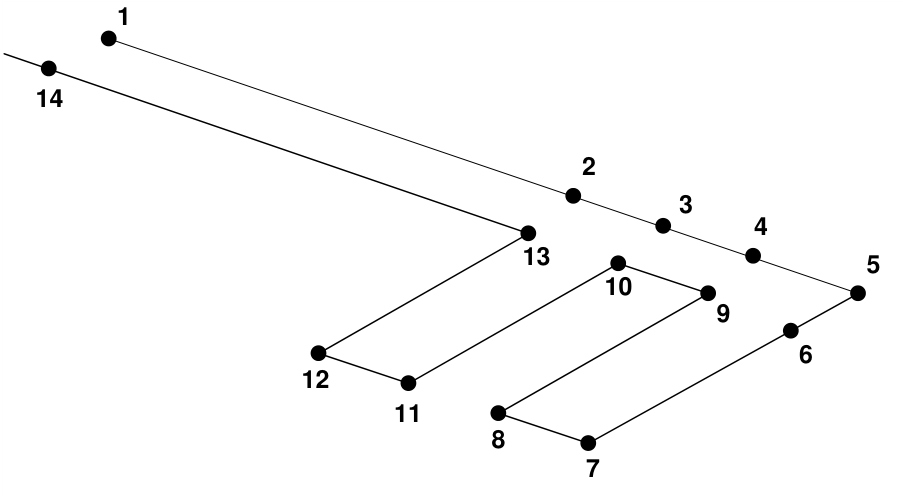

Esto puede hacerse con la misma técnica de construcción FFLoop descrita anteriormente, salvo que seleccionaremos los 14 puntos como plano de planta. Una vez seleccionado el punto n.º 14, debe volver a seleccionar el punto n.º 1 para completar la base del bloque. Se mostrará el mensaje

#### Loop complete: Start next loop.

Para terminar de construir el bloque, seleccione la función de desplazamiento en la barra de herramientas Build Entity, como antes.

#### CAD > Build > Extrude/Offset Remaining

Este procedimiento creará un gran bloque continuo que cubre todo el plano de planta. Si lo desea, puede construir un bloque con la secuencia de puntos 1-2-3-4-5-6-9-10-13-14-1 para la galería de la caja techo y luego 13-10-11-12 y 9-6-7-8 para construir las estocadas como bloques independientes. Este último procedimiento sería conveniente si las estocadas fueran a minarse en una etapa de minado distinta de la galería de la caja techo.

Ahora construya las galerías de acceso del nivel inferior con el mismo procedimiento.

#### Construcción de paneles VRM

Ahora pueden construirse los paneles VRM. Se construirán con bloques FFLoop de 8 esquinas.

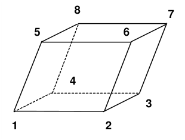

Para comenzar la construcción, seleccione

#### CAD > Build > FFLoop

Como queremos ajustar a las esquinas de bloques construidos previamente, debemos configurar el modo de ajuste en CAD > Snap > Nearest Corner. Esta función puede seleccionarse desde la barra de herramientas Build Entity

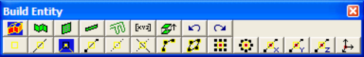

Para activar el ajuste a la esquina más cercana, seleccione

#### CAD > Snap > Nearest Corner

(esto solo es necesario si el botón de ajuste a la esquina más cercana no está ya resaltado).

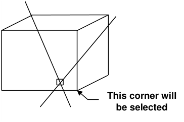

En el modo de ajuste a esquinas, se mostrará una caja de selección en la intersección de la cruz de referencia. Se seleccionará (ajustará) la esquina más cercana de la entidad o línea de construcción que esté bajo la caja de selección, de modo que los 3 valores de coordenadas (x, y, z) quedan especificados de forma única.

En realidad, aquí podríamos usar el modo de ajuste a aristas

#### CAD > Snap > Nearest Edge

ya que de todos modos se seleccionarían las esquinas de los bloques (siempre que la esquina esté dentro de la caja de selección). Sin embargo, el ajuste a esquinas permite ser menos preciso al seleccionar, ya que solo se seleccionan esquinas.

Seleccione los 4 primeros puntos como se muestra a continuación. Recuerde volver a seleccionar el punto n.º 1 para completar el lazo del plano inferior.

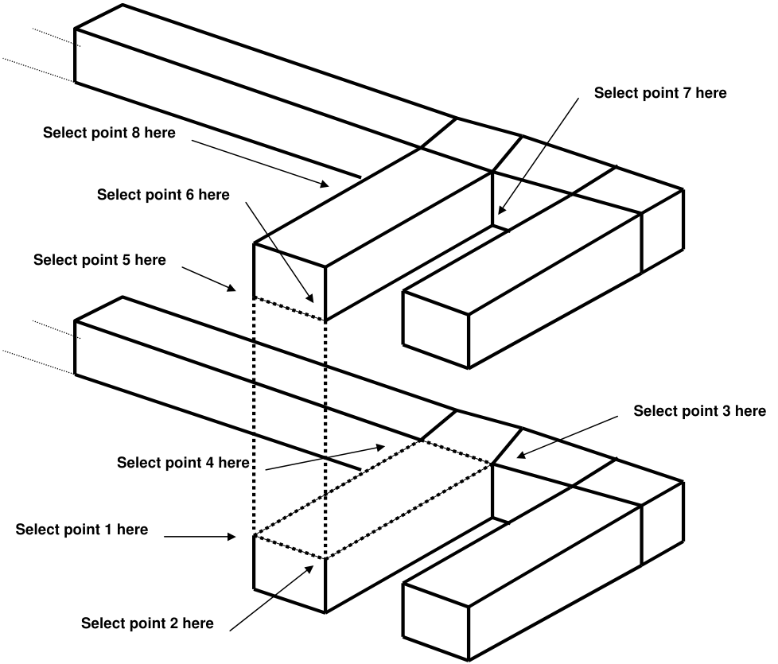

Para seleccionar los puntos 5 a 8 tendremos que rotar el modelo para mirarlo desde abajo. Esto se hace fácilmente manteniendo presionado el botón izquierdo del ratón mientras arrastra el cursor hacia arriba en la pantalla.

Seleccione los puntos 5 a 8 como se muestra a continuación. Recuerde volver a seleccionar el punto n.º 5 para completar el lazo del plano superior.

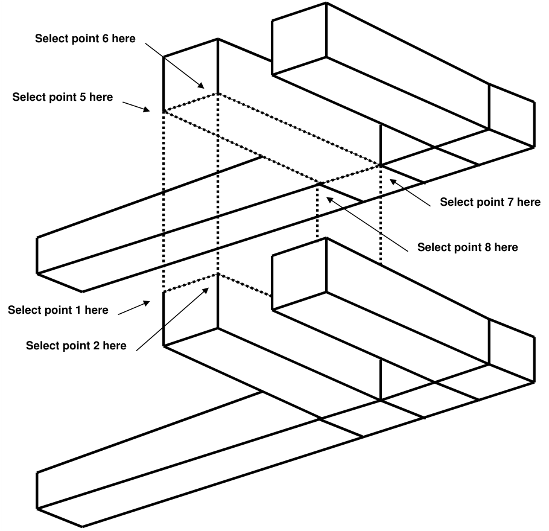

Como antes, se mostrará el mensaje

Loop complete: Start next loop.

Para terminar de construir el bloque, seleccione el botón de construcción en la barra de herramientas Build Entity

Al completar la construcción del bloque, se le pedirá automáticamente que ingrese las propiedades del bloque (CAD > Build > FFLoop)

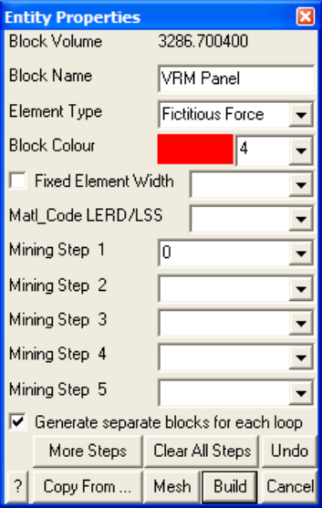

Ingrese lo siguiente:

Block Name: VRM Panel Element Type: Fictitious Force Block Colour: 4

Dejaremos este bloque sin minar en la etapa 1 y excavado en la etapa 2. Esto se indica dejando

Mining Step 1: (deje este campo en blanco) Mining Step 2: 0

Hemos terminado y podemos construir este bloque. El panel adyacente puede construirse con el mismo procedimiento, lo que da la geometría final.

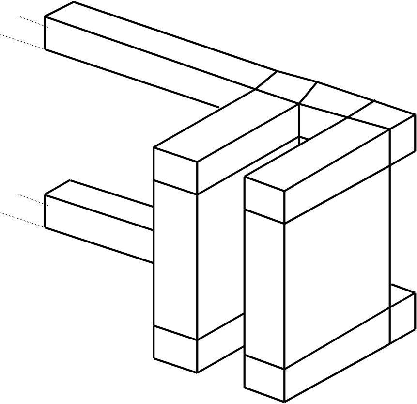

#### Guardar la geometría

En este punto hemos construido las galerías de acceso de la caja piso y dos paneles VRM. Antes de continuar, conviene guardar el modelo construido hasta ahora. Para ello seleccionamos

File > Save Model As

Guardémoslo con el nombre "VRM.INP"

#### Construcción de planos de grilla

Ahora debemos decidir dónde queremos que se calculen los resultados. En este ejemplo nos interesa el esfuerzo en el pilar formado entre los dos paneles VRM. Por lo tanto, definiremos un plano de grilla horizontal que pase por la mitad de la altura del pilar.

Usaremos la función de grilla de ajuste. Puede configurarse ahora o después de iniciar la función de construcción del plano de grilla. Para configurarla ahora, seleccione el botón en la barra de herramientas CAD

Como vamos a dibujar a mano alzada, debemos configurar la grilla de ajuste. Esto se hace con CAD > Snap > Rectangular Grid Snap. Esta función puede seleccionarse desde la barra de herramientas Snap

Para activar la grilla de ajuste, seleccione

#### CAD > Snap > Rectangular Grid Snap

(esto solo es necesario si el botón de ajuste a grilla no está ya resaltado).

Las coordenadas de la ubicación actual del cursor se indican en la barra de estado. Observará que los valores x e y cambian al mover el cursor, pero no el valor z. Para fijar el valor z actual, haga clic en CAD > Snap > Cursor/Grid Setup; se le mostrará lo siguiente:

Seleccionemos esta ubicación gráficamente con la función Pick.

Como queremos que la base de ajuste esté a media altura de los paneles VRM, cambie el modo de ajuste al punto medio de línea

#### CAD > Snap > Midpoint of Line

Antes de continuar, asegúrese de haber configurado el modo de ajuste correcto, comprobando que el elemento de menú CAD > Snap > Midpoint of Line esté marcado o que el botón de ajuste al punto medio esté resaltado

Seleccione el origen de la base de ajuste del cursor (Cursor/Snap Base Origin) en la arista vertical del panel VRM.

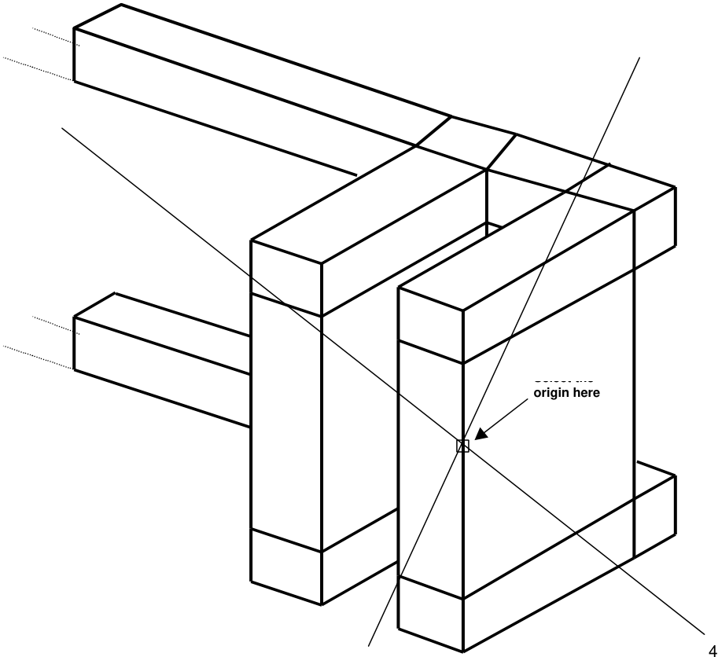

Se seleccionará el punto a media altura de esta arista. El valor z debería ser

Z Origin: 1012.5

También deberíamos fijar

Snap Spacing: 10

para facilitar la selección de puntos.

Si la cruz de referencia del cursor no se mueve en el plano x-y, seleccione el

botón.

Antes de comenzar a construir el plano de grilla, primero debemos reorientar la geometría a una vista en planta. Esto puede hacerse con

#### View > View XY Plane

Ahora construyamos el plano de grilla.

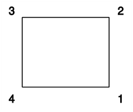

Se construirá con un plano de 4 esquinas. Para construirlo, seleccione la función de menú de construcción de grillas

#### CAD > Build > Grid Plane

Esta función también puede seleccionarse desde la barra de herramientas CAD de la siguiente manera:

Seleccione CAD > Build en la barra de herramientas CAD

Se mostrará el submenú de funciones de construcción

Ahora seleccione

#### CAD > Build > Grid Plane

Como vamos a dibujar a mano alzada, debemos asegurarnos de que CAD > Snap > Rectangular Grid Snap esté activado. Esta función puede seleccionarse desde la barra de herramientas Build Entity

Para activar la grilla de ajuste, seleccione

#### CAD > Snap > Rectangular Grid Snap

(esto solo es necesario si el botón de ajuste a grilla no está ya resaltado).

Verá que la rutina de construcción del plano de grilla le pide que ingrese la primera esquina del plano

Input: Select Point 1

Seleccione las cuatro esquinas del plano.

**3**

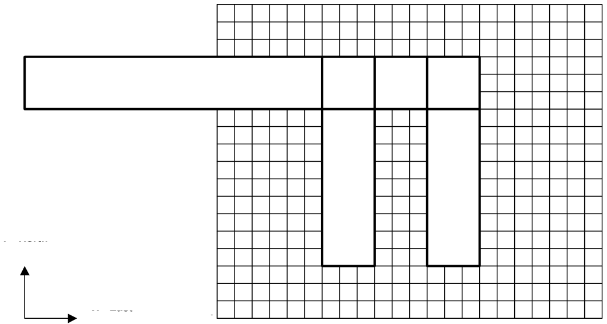

Al seleccionar el 4.º punto, se le pedirá automáticamente que especifique las propiedades del plano de grilla (

#### CAD > Build > Grid Plane).

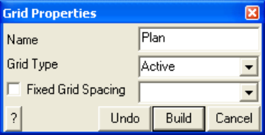

Ingrese un nombre descriptivo (Name) para el plano de grilla, asegúrese de que Grid Type sea Active y deje sin marcar la casilla Fixed Grid Spacing.

#### Especificación de las propiedades de material de la roca encajante

Ahora debemos especificar las propiedades del material encajante. Se ingresan con la función de propiedades de material

#### CAD > Properties > Material Properties

Al seleccionar este elemento se abre un submenú de elementos relacionados con la edición de las propiedades de material. Tenga en cuenta que el material número 1 es, por definición, el material encajante. Los demás números de material se usan para definir zonas de materiales alternativos, como mineral, relleno de falla, relleno, etc. Primero se le pedirá que ingrese el número de material que desea editar. Definamos primero las propiedades del material encajante

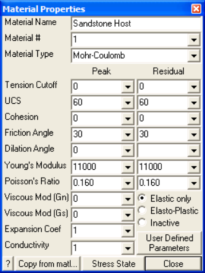

Ingrese lo siguiente:

Material Name: Sandstone Host Material # : 1 Young's (deformation) Modulus: 60000 MPa Poisson's Ratio: 0.25

Los módulos viscosos pueden fijarse en cero, ya que solo se usan para simular la respuesta de fluencia en el análisis no lineal.

Aquí queremos usar el criterio de Mohr-Coulomb. Para ello, fije

Material Type: Mohr-Coulomb UCS: 60 MPa

En este caso no se usa el parámetro de cohesión, por lo que puede fijarse en cero.

Friction Angle: 30°

En este caso no se usa el ángulo de dilatancia, por lo que puede fijarse en cero.

Ahora puede especificarse el estado de esfuerzos premineral

CAD > Properties > Material Properties > Stress State

El estado de esfuerzos de campo lejano adecuado para este modelo es

sa constant:  30 MPa sb constant:  20 MPa sc constant:  20 MPa

Fijaremos la variación de los esfuerzos con la profundidad en

Dsa variation:  -0.027 MPa/m Dsb variation:  -0.013 MPa/m Dsc variation:  -0.013 MPa/m

Además, las orientaciones de los esfuerzos (rumbo e inclinación) deben fijarse en cero, con lo que sa y sb quedan definidos como horizontales y sc como vertical.

El datum puede fijarse en 1000 metros para definir la variación con la profundidad como

s + Ds ( _z_ - _Datum_ )

Definido así, el esfuerzo sa es igual a 30 MPa a una profundidad z de 1000 m y aumenta a razón de 0,027 MPa por metro de profundidad.

#### Especificación de los parámetros de control

Ahora debemos especificar los parámetros que controlan la discretización y la solución del modelo. Se ingresan con la función de parámetros de control

#### CAD > Properties > Control Parameters

Al seleccionar este elemento se abre un cuadro de diálogo con los elementos relacionados con los parámetros de control

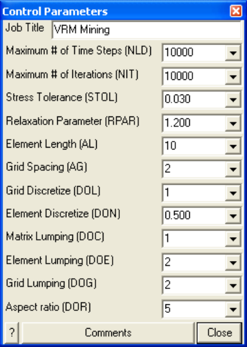

Ingrese lo siguiente:

Job Title: VRM Mining

Todos los parámetros pueden dejarse en sus valores por defecto, excepto la tolerancia de esfuerzos, la longitud de elemento y el espaciado de grilla.

Stress Tolerance: 0.03 MPa

debe fijarse en aproximadamente el 0,1% del estado de esfuerzos de campo lejano. Esto garantiza que, durante la solución, los esfuerzos superficiales se calculen con una precisión numérica de 0,03 MPa.

#### Element Length: 10

debe fijarse en el doble de la altura de la galería o el doble del ancho del pilar. Este parámetro controla el tamaño mínimo de los elementos de contorno que se usarán donde haya mantos o pilares estrechos. Esto garantiza que se formule un problema bien condicionado y fácil de resolver.

#### Grid Spacing: 2

debe fijarse en aproximadamente la mitad del ancho del pilar. Este parámetro controla el tamaño mínimo de los elementos de contorno y el espaciado mínimo en el plano de grilla que se usarán donde este pase cerca del modelo o lo intersecte. Pueden obtenerse resultados precisos hasta a la mitad de este espaciado de las superficies del modelo. Este parámetro también garantiza que se calcule un número suficiente de puntos de esfuerzo dentro del pilar para generar contornos suaves.

El usuario puede elegir un valor mayor para el espaciado de grilla. Esto dará un problema más pequeño y, por lo tanto, tiempos de ejecución más cortos. Sin embargo, con elementos de contorno más grandes los resultados serán menos precisos, sobre todo cerca de las superficies del modelo; además, con un espaciado de grilla mayor no pueden generarse contornos suaves.

Los valores sugeridos para los parámetros de discretización y agrupamiento son los siguientes:

_DON_ =0.5, _DOL_ = _DOC_ =1, _DOE_ = _DOG_ =2 para un error del 10-20%

_DON_ =0.5, _DOL_ = _DOC_ =2, _DOE_ = _DOG_ =4 para un error del 5-10% _DON_ =1.0, _DOL_ =DOC=4, _DOE_ = _DOG_ =8 para un error &lt; 5%

Se recomiendan los ajustes para resultados de análisis gruesos en todos los problemas, excepto en aquellos que requieren mayor precisión. Con estos ajustes cabe esperar errores numéricos del 10-20% en las predicciones de esfuerzos. Los ajustes para resultados detallados proporcionan un error numérico del 5-10%. Los ajustes de alta precisión proporcionan un error numérico inferior al 5%. El usuario puede especificar ajustes de mayor precisión para estos parámetros, pero esto dará problemas más grandes y, por lo tanto, tiempos de ejecución más largos.

#### Ejecución de un análisis en Map3D

En este punto hemos completado la construcción del modelo y estamos listos para comenzar un análisis. Si usa Map3D Fault-Slip, obtendrá una solución elástica de este problema. Si usa Map3D NonLinear, se realizará un análisis no lineal completo.

El análisis se ejecuta desde el menú principal.

Puede ejecutar el análisis completo seleccionando

#### BEM Analysis

Aquí lo haremos por etapas. Así que primero seleccione

#### Discretization

Si ha modificado el modelo de cualquier forma desde la última vez que lo guardó, se le pedirá que guarde las modificaciones.

Cuando hayan terminado los análisis de intersecciones y discretización, seleccione

#### Analysis > Graphics

En el modo gráfico, debe seleccionar la opción de vista discretizada

#### View > Render > Discretize

Esto le permitirá ver cómo se han discretizado las superficies de los bloques en elementos de contorno. Debe tener activados los contornos de bloque para ver los elementos individuales

#### View > Render > Block Outlines

Para ver cómo se ha discretizado la grilla (si la barra de herramientas de contornos no está visible, actívela con Tools > CAD Toolbar), debe seleccionar

#### Plot > Grid Selection > Grid #1

en la barra de herramientas de contornos

El análisis de discretización puede repetirse tantas veces como se desee con distintos valores de espaciado de grilla y de los parámetros de discretización y agrupamiento, hasta lograr la densidad deseada de elementos de contorno y puntos de grilla.

Una vez satisfecho, puede pasar al análisis BEM (ensamblaje y solución de la matriz) seleccionando

#### Analysis

en el menú principal y luego

#### BEM Analysis

Cuando termine el análisis, seleccione

#### Analysis > Graphics

En el modo gráfico, puede representar mediante contornos cualquier parámetro deseado. Por ejemplo, para mostrar los contornos del esfuerzo principal mayor, seleccione

#### Plot > Stress > S1 Major Principal Stress

Esto generará un gráfico de contornos sobre el plano de grilla.

La interpretación de los resultados no se trata aquí.
