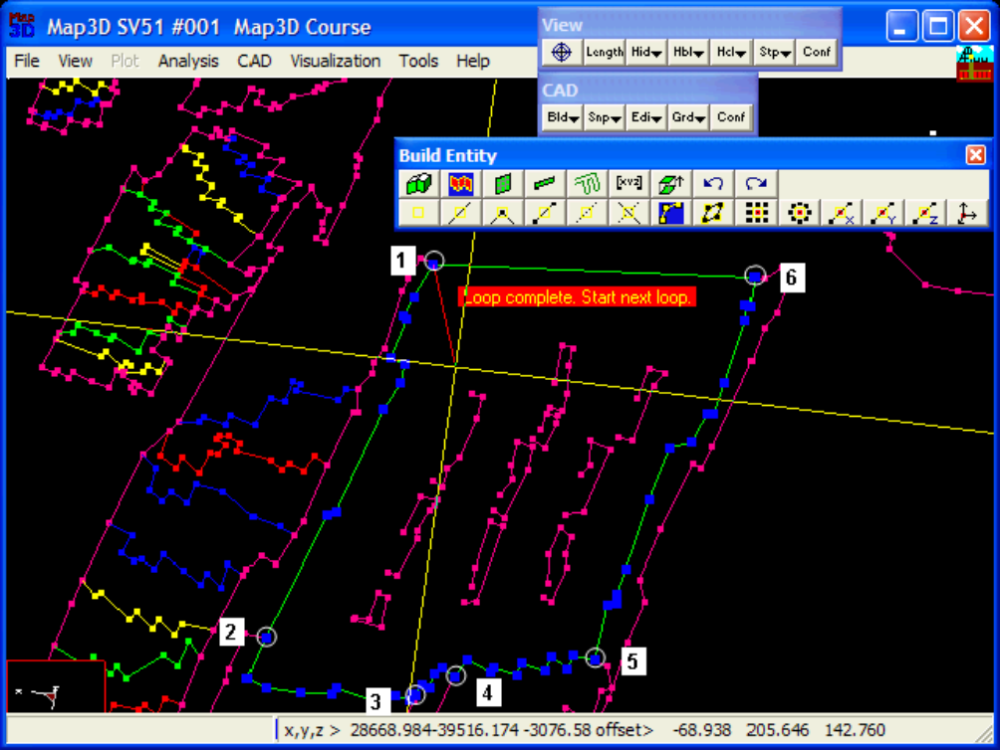
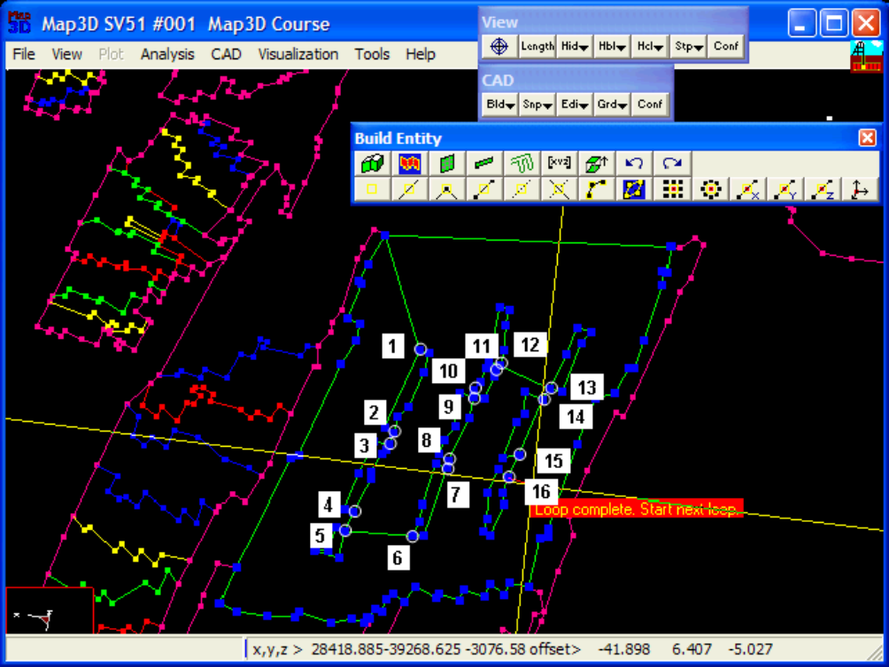
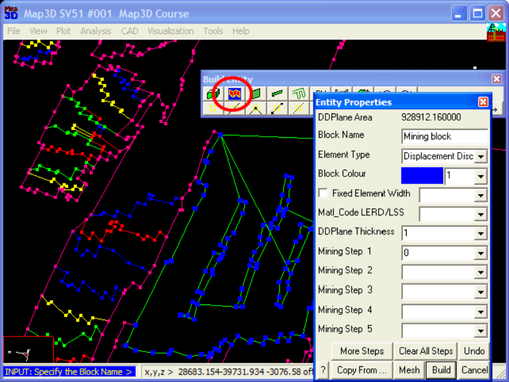
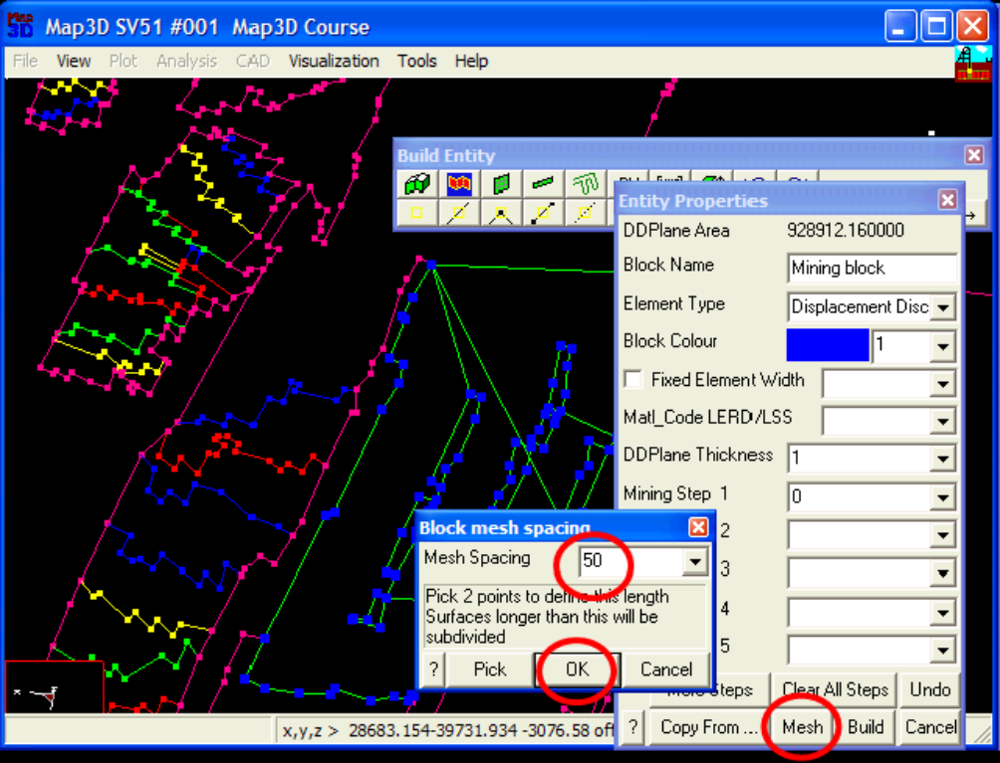
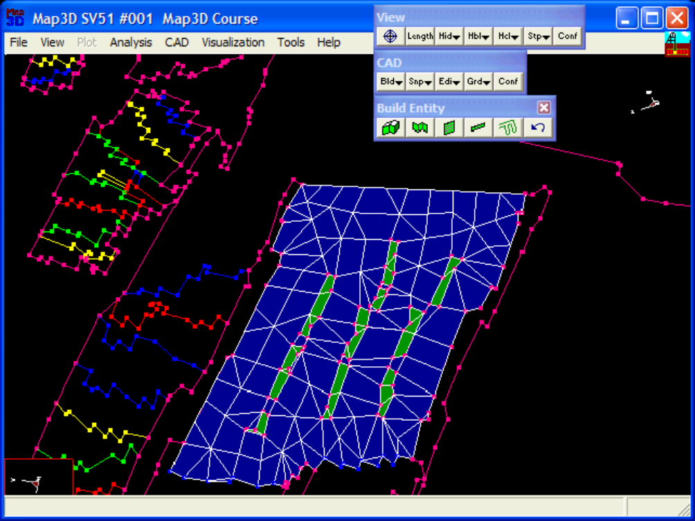

**Paso 1: Importar los planos de mina digitalizados.**

- Los planos de este ejemplo están en un archivo llamado "t.pnt".

- Se importan con el comando File > Open Construction Lines.

**Paso 2: A continuación, inicie la rutina DDLoop y configure el modo de ajuste Cline.**

- DDLoop se inicia seleccionando (CAD > Build > DDLoop).

- El modo de ajuste Cline se configura seleccionando (CAD > Snap > Trace Cline).

**Paso 3: Construir el lazo exterior.**

- El lazo exterior se construye seleccionando los extremos de los segmentos de línea de construcción deseados.

- Aquí seleccionamos los puntos 1-2-3-4-5-6-1

- El punto 1 se selecciona al final de esta secuencia para cerrar el lazo, con lo que se completa la construcción del lazo exterior.

**Paso 4: Configurar el modo de ajuste CLoop y construir los lazos interiores.**

- El modo de ajuste CLoop se configura seleccionando (CAD > Snap > Trace CLoop).

- Los lazos interiores se definen seleccionando los puntos de entrada y salida de cada lazo.

- El 1.er lazo se define con los puntos 1 y 2.

- El 2.º lazo se define con los puntos 3 y 4.

- El 3.er lazo se define con el punto 5.

- El 4.º lazo se define con los puntos 6 y 7.

- El 5.º lazo se define con los puntos 8 y 9.

- El 6.º lazo se define con los puntos 10 y 11.

- El 7.º lazo se define con el punto 12.

- El 8.º lazo se define con el punto 13.

- El 9.º lazo se define con los puntos 14 y 15.

- El 10.º lazo se define con el punto 16.

**Paso 5: Indicar el fin de la construcción.**

- Una vez definidos todos los lazos, seleccione de nuevo (CAD > Build > DDLoop) para indicar el fin de la construcción.

- También puede indicarse seleccionando el último punto (es decir, el punto 16) por segunda vez.

**Paso 6: Construir los DDLoops.**

- Aunque podríamos construir los DDLoops con la función, aquí usaremos la función.

- Esta última función genera elementos de mejor forma.

- Se le pedirá el espaciado de malla deseado.

- Fíjelo en 50 metros.

#### Paso 7: Construcción completada.

- Con esto se completa la construcción de la minería tabular con sus pilares.

- Probablemente querrá editar las propiedades de entidad de los pilares para asignarles las propiedades y la secuencia de minado adecuadas.

