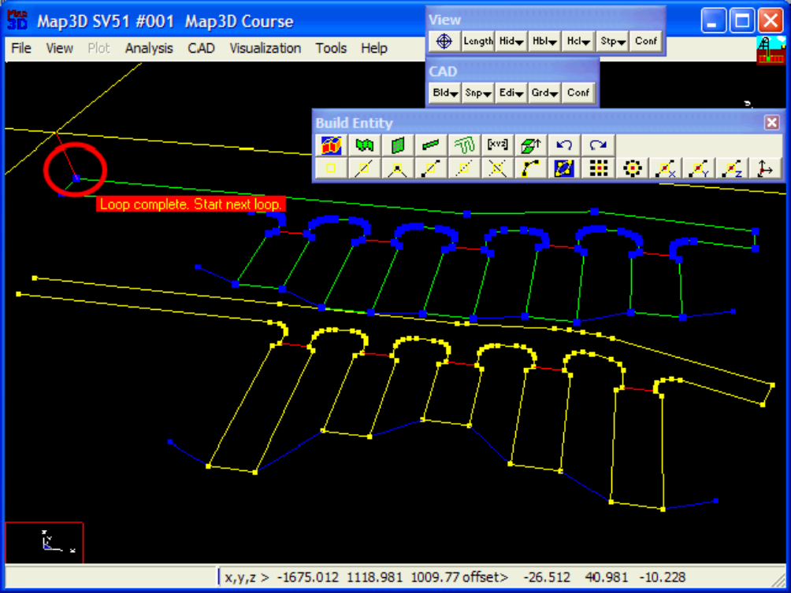
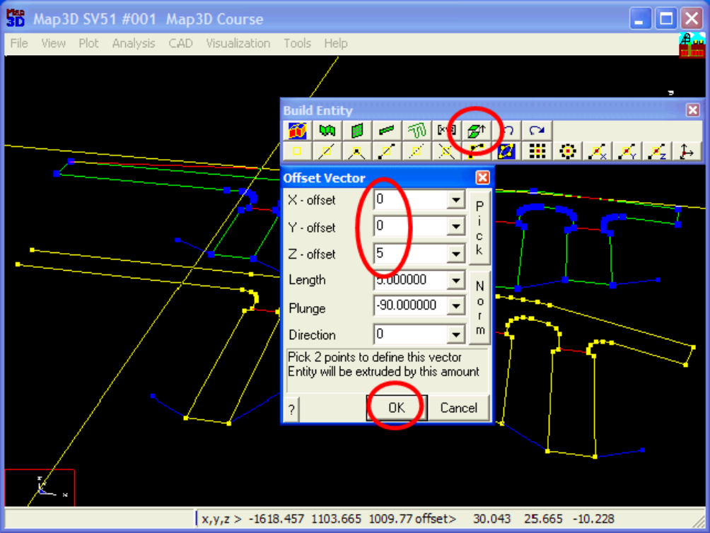
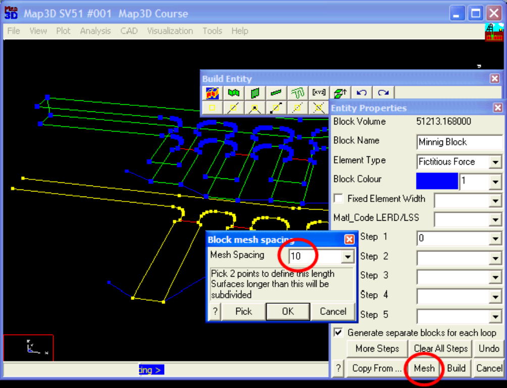
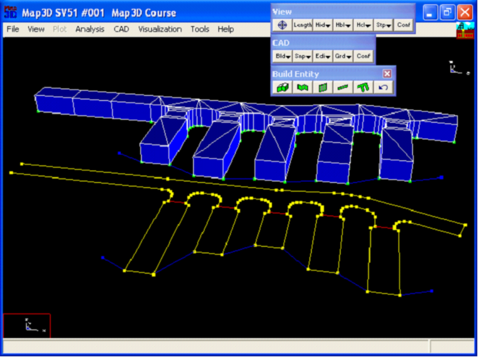

#### Paso 1: Importar los planos de mina digitalizados.

- Los planos de este ejemplo están en un archivo llamado "bulk.dxf".

- Se importan con el comando File > Open Construction Lines.

#### Paso 2: A continuación, inicie la rutina FFLoop y configure el modo de ajuste CLoop.

- FFLoop se inicia seleccionando (CAD > Build > FFLoop).

- El modo de ajuste CLoop se configura seleccionando (CAD > Snap > Trace CLoop).

**Paso 3: Construir el FFLoop.**

- El FFLoop se construye seleccionando uno de los puntos de la línea de construcción deseada.

**Paso 4: Extruir el plano de planta en una galería 3D.**

- En este punto hemos construido el plano de planta de la galería.

- Ahora puede extruirse en una forma 3D seleccionando (CAD > Build > Offset/Extrude).

- Fije el vector de desplazamiento en (0 0 5).

**Paso 5: Construir la galería.**

- Ahora el FFLoop puede construirse con la función.

- Especifique 10 como espaciado de malla (Mesh Spacing) y presione OK.

**Paso 6: Construcción completada.**

- Con esto se completa la construcción de la galería.

