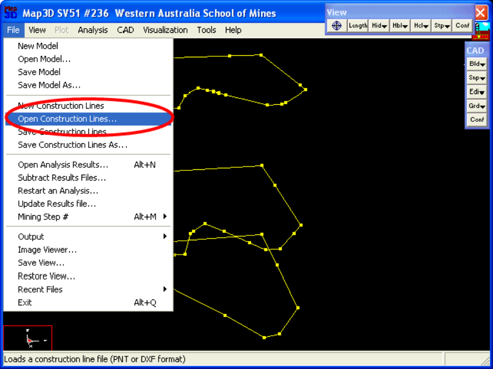
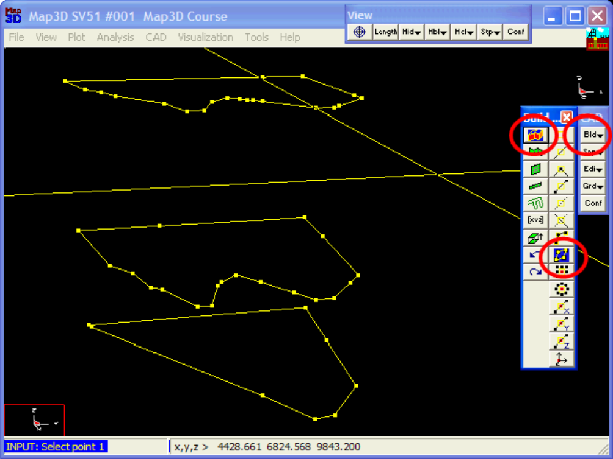
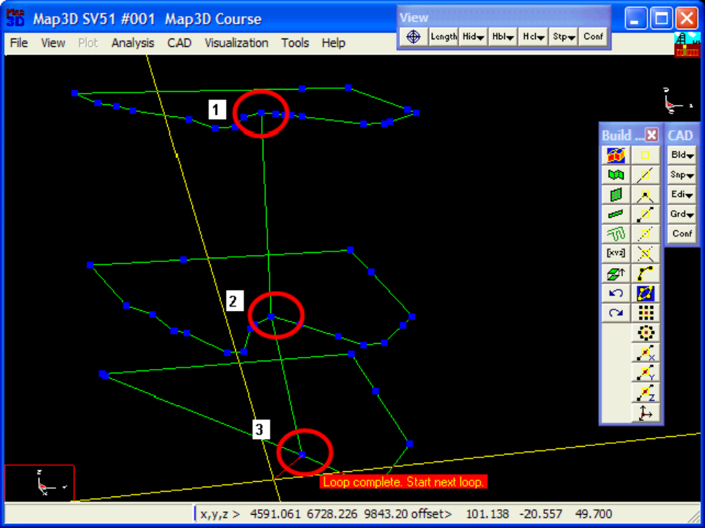
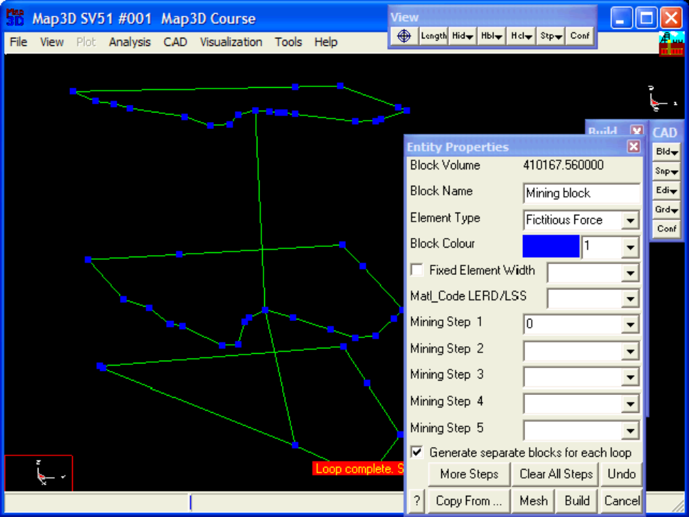
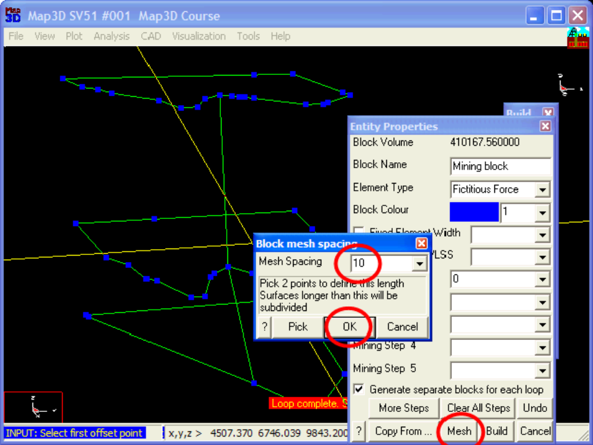
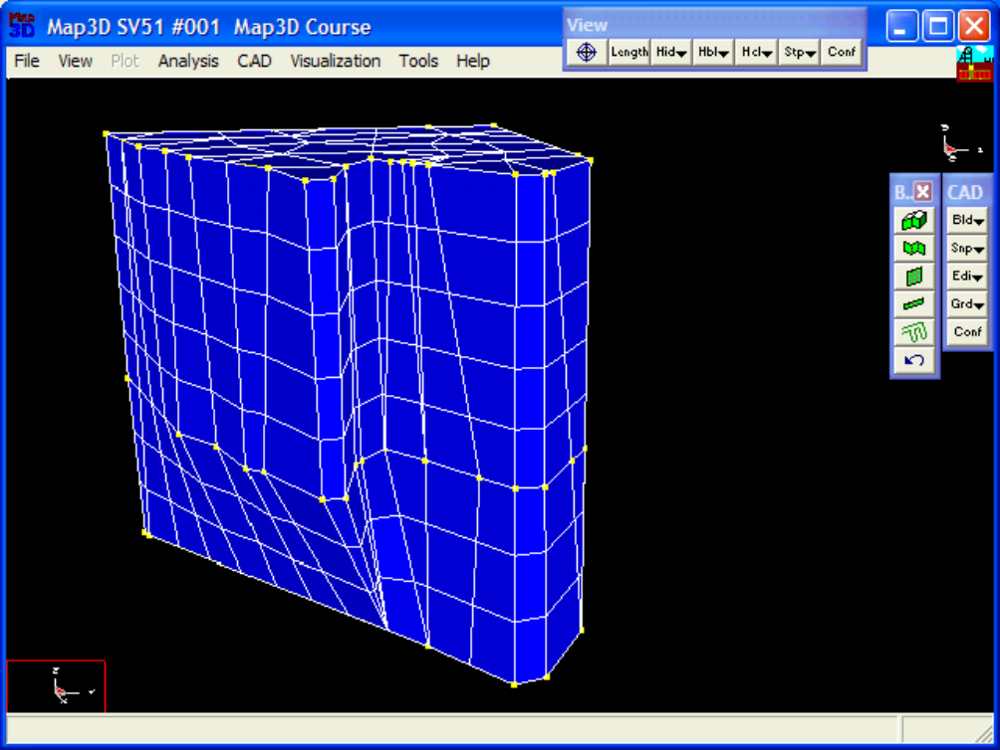

#### Paso 1: Importar los planos de mina digitalizados.

- Los planos de este ejemplo están en un archivo llamado "bulk.dxf".

- Se importan con el comando File > Open Construction Lines.

**Paso 2: A continuación, inicie la rutina FFLoop y configure el modo de ajuste CLoop.**

- FFLoop se inicia seleccionando (CAD > Build > FFLoop).

- El modo de ajuste CLoop se configura seleccionando (CAD > Snap > Trace CLoop).

#### Paso 3: Construir el FFLoop.

- El FFLoop se construye seleccionando un punto en cada línea de construcción.

- Observe que se generan puntos automáticamente a intervalos de 10 m a lo largo de los lados largos

- Es mejor seleccionar puntos situados en esquinas o quiebres pronunciados, ya que la línea entre los lazos guiará el proceso de construcción.

#### Paso 4: Indicar el fin de la construcción.

- Una vez definidos todos los lazos, seleccione de nuevo (CAD > Build > FFLoop) para indicar el fin de la construcción.

- También puede indicarse seleccionando el último punto (es decir, el punto 3) por segunda vez.

**Paso 5: Construir el caserón.**

- Ahora el FFLoop puede construirse con la función.

- Especifique 10 como espaciado de malla (Mesh Spacing) y seleccione OK.

**Paso 6: Construcción completada.**

- Con esto se completa la construcción del caserón.

