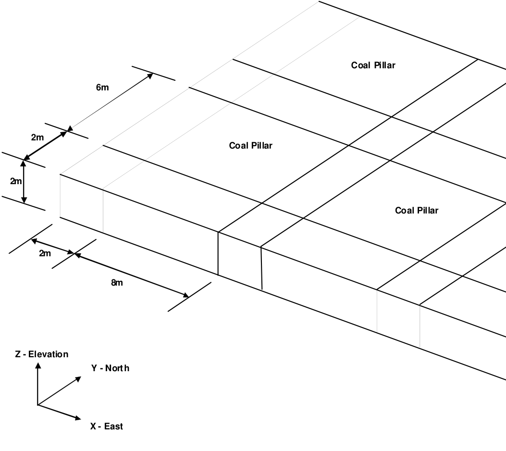

Para mostrar la técnica de dibujo a mano alzada, comencemos construyendo una geometría simple de minería de carbón por cámaras y pilares. Las galerías miden 2 m de ancho por 2 m de alto, y los pilares de carbón miden 6 m hacia el este y 4 m hacia el oeste.

Queremos empezar desde cero, así que seleccionaremos

File > New Model

Antes de comenzar, tenga en cuenta que puede situar el cursor sobre cualquier botón para ver una información sobre herramientas que identifica su función. Además, puede hacer clic con el botón derecho en cualquier elemento para obtener ayuda detallada sobre esa función.

#### Construcción de la intersección

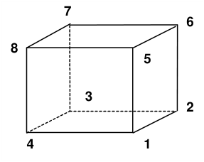

Primero construyamos una intersección. Se construirá con bloques de 8 esquinas. Para construir el primer bloque, use CAD > Build > FFLoop. Esta función puede seleccionarse desde la barra de herramientas CAD de la siguiente manera (si la barra de herramientas CAD no está visible, actívela con Tools > CAD Toolbar):

#### Seleccione CAD > Build en la barra de herramientas CAD

Se mostrará el submenú de funciones de construcción

Ahora seleccione

#### CAD > Build > FFLoop

Como vamos a dibujar a mano alzada, debemos configurar la grilla de ajuste. Esto se hace con CAD > Snap > Rectangular Grid Snap. Esta función puede seleccionarse desde la barra de herramientas Build Entity

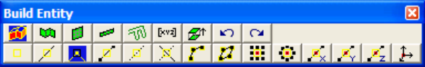

Para activar la grilla de ajuste, seleccione

#### CAD > Snap > Rectangular Grid Snap

(esto solo es necesario si el botón de ajuste a grilla no está ya resaltado).

Las coordenadas de la ubicación actual del cursor se indican en la barra de estado. Observará que los valores x e y cambian al mover el cursor, pero no el valor z. Para fijar el valor z actual, haga clic en CAD > Snap > Cursor/Grid Setup; se le mostrará lo siguiente:

Fije el origen y el espaciado de ajuste de la siguiente manera:

X-Origin > 0 Y-Origin > 0 Z-Origin > 0 Snap spacing > 1

Si la cruz de referencia del cursor no se mueve en el plano x-y, seleccione el

botón.

Esto configura el modo de ajuste a grilla. En este modo no se muestra ninguna caja de selección en la intersección de la cruz de referencia, y el movimiento del cursor queda restringido al espaciado de grilla especificado. Al mover el cursor por la pantalla, este saltará de una ubicación a otra según el espaciado de grilla (1 metro en este caso).

Verá que la rutina de construcción FFLoop le pide en la barra de estado que ingrese la primera esquina del bloque

Input: Select Point 1

Mueva el cursor hasta encontrar el primer punto

x,y,z >  0  0  0

Selecciónelo haciendo clic una vez con el botón izquierdo del ratón.

A continuación se le pedirá la siguiente esquina del bloque

Input: Select Point 2

Al mover el cursor, verá que en la esquina inferior izquierda de la pantalla se indica no solo la ubicación actual del cursor, sino también el desplazamiento del punto actual respecto del último seleccionado (es decir, el vector de desplazamiento del punto 1 al punto 2). Seleccione el punto 2 en

x,y,z >  2  0  0

Repita este proceso de selección para el punto 3

x,y,z >  2  2  0

y el punto 4

x,y,z >  0  2  0

Si selecciona una ubicación incorrecta para un punto, simplemente deshaga esa selección con el botón deshacer

#### CAD > Build > Undo Point y vuelva a intentarlo.

Por último, vuelva a seleccionar el primer punto

x,y,z >  0  0  0

Al volver a seleccionar el primer punto, la base del bloque queda completamente formada. Se mostrará el mensaje

Loop complete: Start next loop.

Para terminar de construir el bloque, puede cambiar la cota y seleccionar los 4 puntos restantes (es decir, los puntos 5, 6, 7 y 8), o generarlos a partir de las 4 primeras esquinas añadiéndoles un desplazamiento. Para usar este último procedimiento, seleccione la función de desplazamiento en la barra de herramientas Build Entity

#### CAD > Build > Extrude/Offset Remaining

Se le pedirá el vector de desplazamiento de la siguiente manera

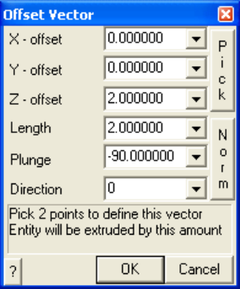

Ingrese el desplazamiento como:

X-offset > 0 Y-offset > 0 Z-offset > 2

Los puntos 5, 6, 7 y 8 se generarán a partir de los puntos 1, 2, 3 y 4, respectivamente, sumando los valores de desplazamiento a sus coordenadas.

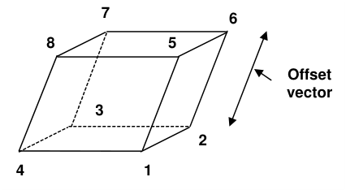

Al completar la construcción del bloque, se le pedirá automáticamente que ingrese las propiedades del bloque (CAD > Build > FFLoop)

Ingrese lo siguiente:

Block Name: Intersection Element Type: Fictitious Force Block Colour: 1

Este bloque de intersección debe excavarse en la etapa de minado 1. Esto se indica especificando

Mining Step 1: 0

Hemos terminado y podemos construir este bloque presionando el

botón.

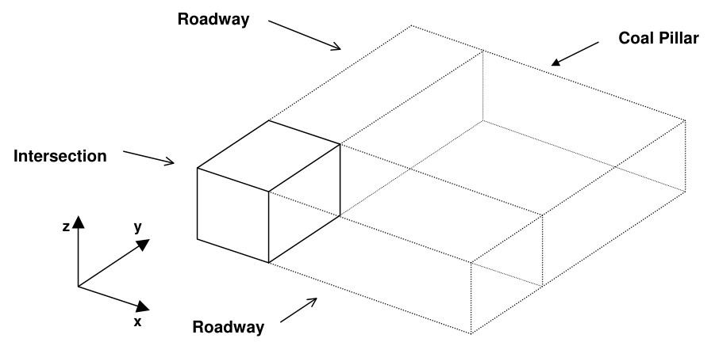

#### Reposicionamiento de la vista

Durante la construcción de bloques, o en cualquier otro momento, puede reposicionar (trasladar, rotar o hacer zoom) la geometría para facilitar la visualización. Esto se logra fácilmente de varias formas (consulte Rotación del modelo y Traslación del modelo).

#### Construcción de la galería 1

Ahora pueden construirse bloques adicionales seleccionando de nuevo la función de construcción FFLoop

#### CAD > Build > FFLoop

Construyamos el siguiente bloque junto al primero. Seleccione el punto 1 en

x,y,z >  2  0  0

Queremos seleccionar el punto 2 en

x,y,z >  8  0  0

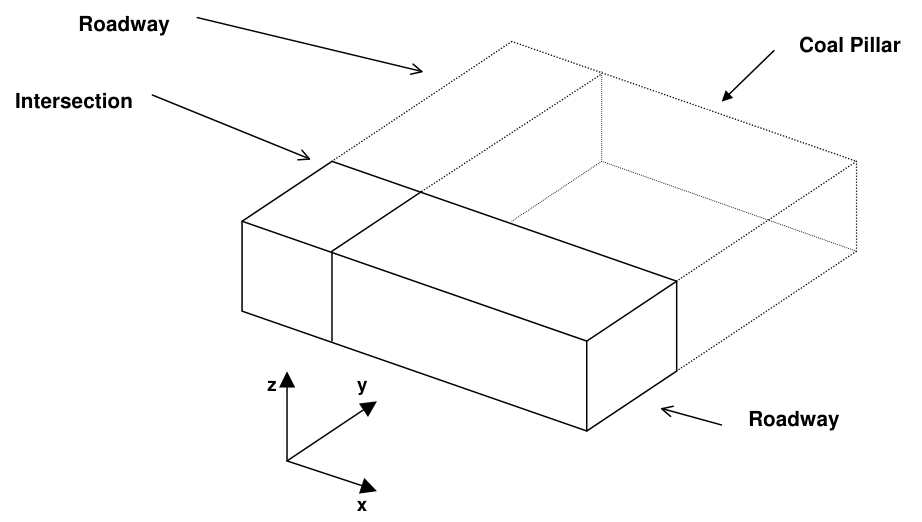

pero esta ubicación está fuera de los límites de la pantalla. Para resolverlo, simplemente aleje la vista (Traslación del modelo).

Ahora el punto 2 puede seleccionarse fácilmente.

Seleccione el punto 3 en

x,y,z >  8  2  0

Seleccione el punto 4 en

x,y,z >  2  2  0

Por último, vuelva a seleccionar el primer punto

x,y,z >  2  0  0

Al volver a seleccionar el primer punto, la base del bloque queda completamente formada. Como antes, se mostrará el mensaje

Loop complete: Start next loop.

Ahora desplace los puntos restantes de este bloque con la función de desplazamiento

#### CAD > Build > Extrude/Offset Remaining

Se le pedirá el vector de desplazamiento de la siguiente manera

Ingrese el desplazamiento como:

X-offset > 0 Y-offset > 0 Z-offset > 2

Al completar la construcción del bloque, se le pedirá automáticamente que ingrese las propiedades de la entidad (CAD > Build > FFLoop)

Ingrese lo siguiente:

Block Name: Roadway

Element Type: Fictitious Force Block Colour: 1

Este bloque de galería debe excavarse en la etapa de minado 1. Esto se indica especificando Mining Step 1: 0

Hemos terminado y podemos construir este bloque presionando el botón.

#### Construcción de la galería 2

Construyamos un tercer bloque

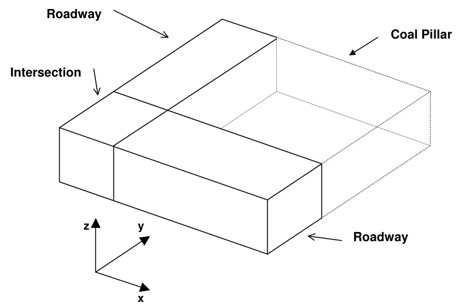

seleccionando el punto 1 en

x,y,z >  2  2  0

Seleccione el punto 2 en

x,y,z >  2  6  0

Seleccione el punto 3 en

x,y,z >  0  6  0

Seleccione el punto 4 en

x,y,z >  0  2  0

Vuelva a seleccionar el primer punto para completar la construcción de la base

x,y,z >  2  0  0

y luego desplace los puntos restantes como antes

CAD > Build > Extrude/Offset Remaining

Con esto se completa la construcción de la galería.

#### Construcción del pilar de carbón

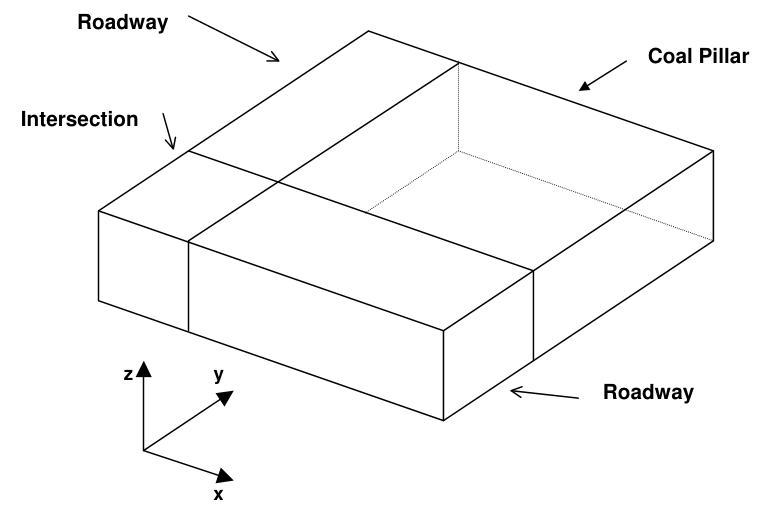

Ahora debería haber completado la construcción de una intersección y dos galerías. Construyamos ahora un pilar de carbón.

#### CAD > Build > FFLoop

seleccionando el punto 1 en

x,y,z >  2  2  0

Seleccione el punto 2 en

x,y,z >  8  2  0

Seleccione el punto 3 en

x,y,z >  8  6  0

Seleccione el punto 4 en

x,y,z >  2  6  0

Vuelva a seleccionar el primer punto para completar la construcción de la base

x,y,z >  2  2  0

y luego desplace los puntos restantes como antes

CAD > Build > Extrude/Offset Remaining

Con esto se completa la construcción del pilar de carbón.

Al completar la construcción del bloque, se le pedirá automáticamente que ingrese las propiedades del bloque (CAD > Build > FFLoop). Debemos especificar que este bloque será un pilar de carbón y no una excavación (el valor por defecto). Se le mostrará lo siguiente:

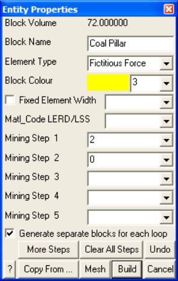

Ingrese lo siguiente:

Block Name: Coal Pillar Element Type: Fictitious Force Block Colour: 3

Debemos especificar que este bloque tiene las propiedades de material del carbón. Esto se hace definiendo el material número 2 para el carbón en la etapa de minado 1. Esto se indica especificando

Mining Step 1: 2

Este mismo pilar podría excavarse en la etapa 2 especificando el código de material

Mining Step 2: 0

Hemos terminado y podemos construir este bloque.

#### Guardar la geometría

En este punto hemos construido una pequeña esquina de la geometría minera deseada. Antes de continuar, conviene guardar el modelo construido hasta ahora. Para ello seleccionamos

#### File > Save Model As

Guardémoslo con el nombre "COAL.INP"

#### Ampliación de la geometría

El modelo construido representa solo una pequeña parte del modelo final. Es fácil repetir este patrón copiándolo varias veces. Para ello debemos seleccionar la función de copia

CAD > Edit > Copy Entities

Esta función también puede seleccionarse desde la barra de herramientas CAD de la siguiente manera:

Seleccione CAD > Edit en la barra de herramientas CAD

Se mostrará el submenú de funciones de edición

Para activar la función de copia, seleccione

#### CAD > Edit > Copy Entities

En este punto se le pedirá que cree una lista de entidades para copiar

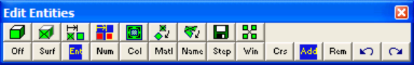

Mantenga presionada la tecla Mayús y arrastre una ventana de selección (también puede seleccionar la función de ventana de cruce).

**Segunda esquina de la ventana**

Todas las entidades dentro de la ventana de selección (es decir, la intersección, las galerías y el pilar de carbón) deberían quedar resaltadas.

Ahora puede copiar las entidades seleccionadas haciendo clic en el botón de copia

Se le pedirá que ingrese el vector de desplazamiento de la copia de la siguiente manera:

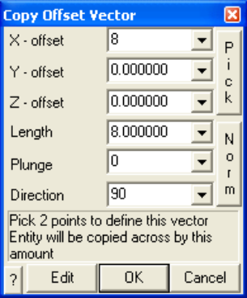

Hay muchas formas de seleccionar el vector de desplazamiento de la copia. Puede escribir el desplazamiento deseado como (8  0 0).

También es fácil hacerlo gráficamente, seleccionando dos puntos que definan el vector. Primero configure el modo de ajuste en

#### CAD > Snap > Rectangular Grid Snap

(esto solo es necesario si el botón de ajuste a grilla no está ya resaltado).

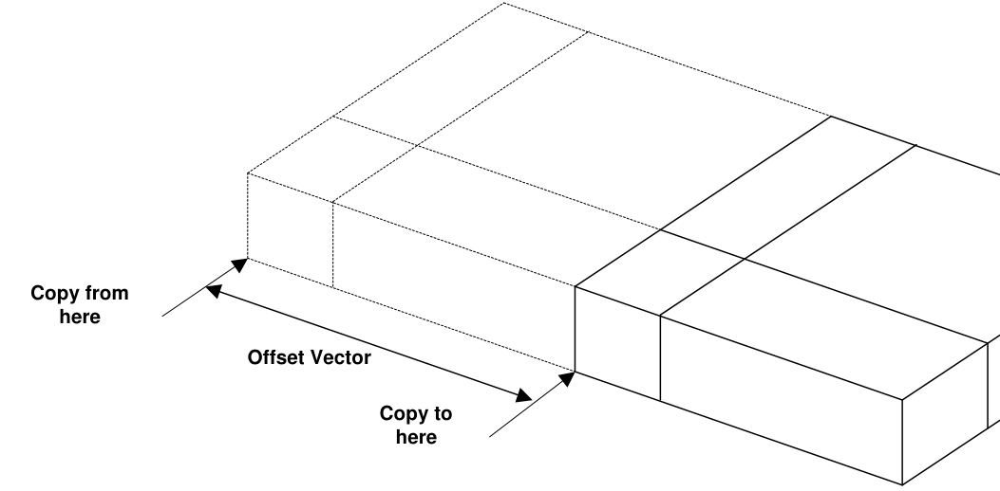

Se le pedirá (en la parte superior de la pantalla) que seleccione el primer extremo del vector de desplazamiento

INPUT: Select first offset point

Seleccione este punto en

x,y,z >  0  0  0

A continuación se le pedirá que seleccione el otro extremo del vector de desplazamiento

INPUT: Select second offset point

Seleccione este punto en

x,y,z >  8  0  0

El desplazamiento (8  0  0) se mostrará ahora en el cuadro de diálogo.

Presione OK y las entidades seleccionadas se copiarán sumando el vector de desplazamiento a todas sus coordenadas.

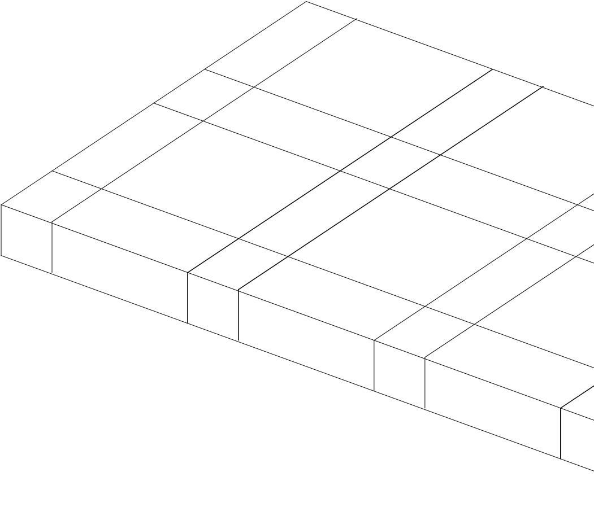

Para repetir esta operación de copia, vuelva a crear el conjunto de selección o restaure el conjunto de selección anterior, y luego copie las entidades seleccionadas seleccionando de nuevo la función de copia

#### CAD > Edit > Copy Entities

Si lo desea, este procedimiento de copia puede repetirse tantas veces como quiera para duplicar el patrón minero en las direcciones x e y.

En este punto la geometría puede considerarse completa. Ahora debemos definir la ubicación de los planos de grilla donde se calcularán los resultados y especificar las propiedades de material.

#### Construcción de planos de grilla

**3 2 4 1**

Ahora debemos decidir dónde queremos que se calculen los resultados. En este ejemplo nos interesa el esfuerzo en los pilares de carbón. Por lo tanto, definiremos un plano de grilla en sección transversal que pase por el centro de uno de los pilares. Se construirá con un plano de 4 esquinas. Para construirlo, seleccione la función de menú de construcción de grillas

#### CAD > Build > Grid Plane

Esta función también puede seleccionarse desde la barra de herramientas CAD de la siguiente manera:

Seleccione CAD > Build en la barra de herramientas CAD

Se mostrará el submenú de funciones de construcción

Ahora seleccione

#### CAD > Build > Grid Plane

Como vamos a dibujar a mano alzada, debemos configurar la grilla de ajuste. Esto se hace con CAD > Snap > Rectangular Grid Snap. Esta función puede seleccionarse desde la barra de herramientas Build Entity

Para activar la grilla de ajuste, seleccione

#### CAD > Snap > Rectangular Grid Snap

(esto solo es necesario si el botón de ajuste a grilla no está ya resaltado).

Las coordenadas de la ubicación actual del cursor se indican en la barra de estado. Para fijar el valor z actual, haga clic en CAD > Snap > Cursor/Grid Setup; se le mostrará lo siguiente:

Fije el origen y el espaciado de ajuste de la siguiente manera:

X-Origin > 0 Y-Origin > 0 Z-Origin > -2 Snap spacing > 1

Si la cruz de referencia del cursor no se mueve en el plano x-y, seleccione el

botón.

Verá que la rutina de construcción del plano de grilla le pide que ingrese la primera esquina del plano

INPUT: Select point 1

Mueva el cursor hasta encontrar el punto deseado

x,y,z >  9  4  -2

Selecciónelo haciendo clic una vez con el botón izquierdo del ratón.

A continuación se le pedirá la siguiente esquina

INPUT: Select point 2

Seleccione el punto 2 en

x,y,z >  17  4  -2

Si selecciona una ubicación incorrecta para un punto, simplemente deshaga esa selección

CAD > Build > Undo Point

y vuelva a intentarlo.

Una vez seleccionado el punto 2, queda completamente formado un borde del plano. Para terminar de construir el plano, puede cambiar la cota y seleccionar los 2 puntos restantes (es decir, los puntos 3 y 4), o generarlos a partir de las 2 primeras esquinas añadiéndoles un desplazamiento. Para usar este último procedimiento, seleccione la función de desplazamiento en la barra de herramientas Build Entity

CAD > Build > Offset Remaining

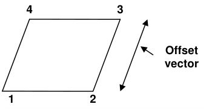

Se le pedirá el vector de desplazamiento de la siguiente manera

Ingrese el desplazamiento como:

X-offset > 0 Y-offset > 0 Z-offset > 6

Los puntos 3 y 4 se generarán a partir de los puntos 2 y 1, respectivamente, sumando los valores de desplazamiento a sus coordenadas.

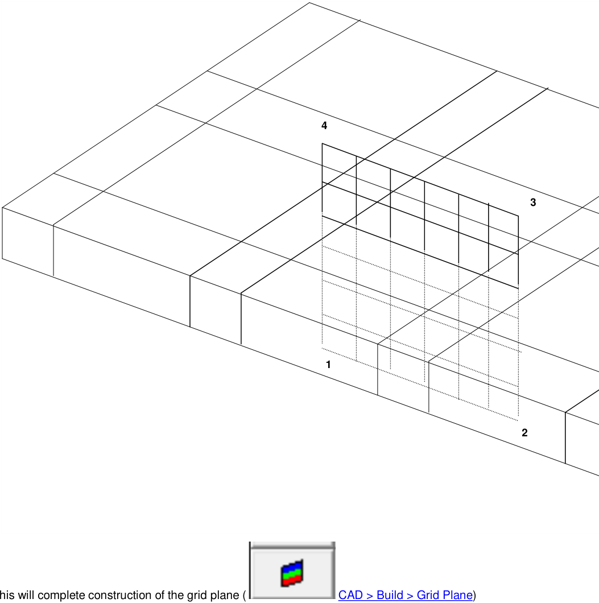

Con esto se completa la construcción del plano de grilla (

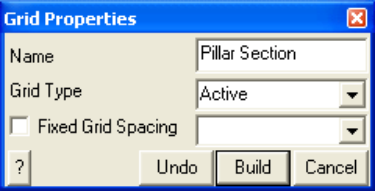

Ingrese un nombre descriptivo para el plano de grilla y deje sin marcar la casilla Fixed Grid Spacing.

#### Especificación de las propiedades de material de la arenisca encajante

Ahora debemos especificar las propiedades del material encajante. Se ingresan con la función de propiedades de material

#### CAD > Properties > Material Properties.

Al seleccionar este elemento se abre un submenú de elementos relacionados con la edición de las propiedades de material. Tenga en cuenta que el material número 1 es, por definición, el material encajante. Los demás números de material se usan para definir zonas de materiales alternativos, como el carbón, el relleno de falla, el relleno, etc. Primero se le pedirá que ingrese el número de material que desea editar. Definamos primero las propiedades del material encajante

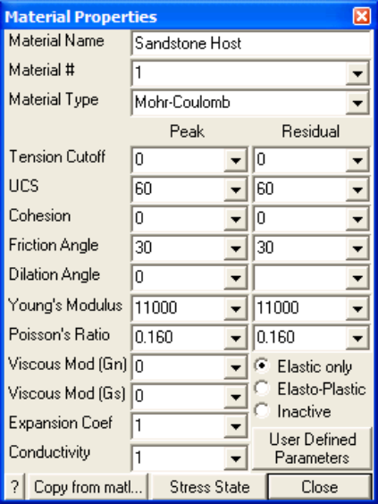

Ingrese lo siguiente:

Material Name: Sandstone Host Material # : 1 Young's (deformation) Modulus: 11000 MPa Poisson's Ratio: 0.16

Los módulos viscosos pueden fijarse en cero, ya que solo se usan para simular la respuesta de fluencia en el análisis no lineal.

Aquí queremos usar el criterio de Mohr-Coulomb. Para ello, fije

Material Type: Mohr-Coulomb UCS: 60 MPa

En este caso no se usa el parámetro de cohesión, por lo que puede fijarse en cero.

Friction Angle: 30°

En este caso no se usa el ángulo de dilatancia, por lo que puede fijarse en cero.

Ahora puede especificarse el estado de esfuerzos premineral

CAD > Properties > Material Properties > Stress State

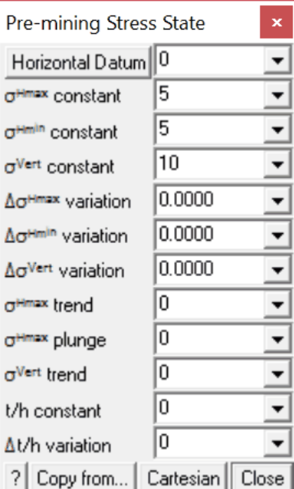

El estado de esfuerzos de campo lejano adecuado para este modelo es

sHmax constant:  5 MPa sHmin constant:  5 MPa sVert constant: 10 MPa

Fijaremos en cero la variación de los esfuerzos con la profundidad

DsHmax variation:  0 MPa/m DsHmin variation:  0 MPa/m DsVert variation:  0 MPa/m

Además, las orientaciones de los esfuerzos (rumbo e inclinación) deben fijarse en cero, con lo que sa y sb quedan definidos como horizontales y sc como vertical.

El datum también puede fijarse en cero, ya que solo se usa para definir la variación con la profundidad.

#### Especificación de las propiedades de material del manto de carbón

Ahora debemos especificar las propiedades del manto de carbón. Se ingresan con la función de propiedades de material

#### CAD > Properties > Material Properties

Al seleccionar este elemento se abre un submenú de elementos relacionados con la edición de las propiedades de material. Recuerde que, al construir el pilar de carbón, especificamos que para ese bloque se usaría el material número 2.

Fijemos Material # en 2.

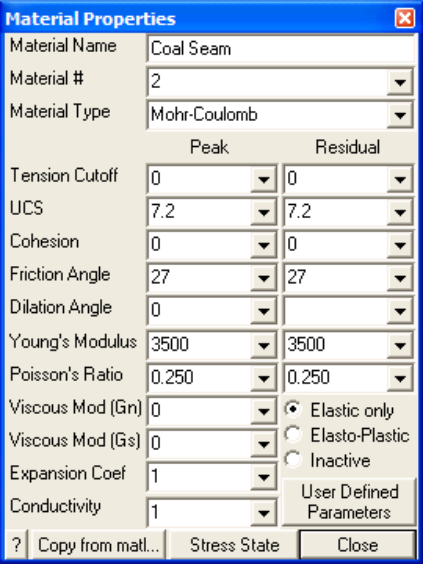

Ingrese lo siguiente:

Material Name: Coal Seam Young's  (deformation) Modulus: 3500 MPa Poisson's Ratio: 0.25

Los módulos viscosos pueden fijarse en cero, ya que solo se usan para simular la respuesta de fluencia en el análisis no lineal.

Aquí queremos usar el criterio de Mohr-Coulomb. Para ello, fije

Material Type: Mohr-Coulomb UCS: 7.2 MPa

En este caso no se usa el parámetro de cohesión, por lo que puede fijarse en cero.

Friction Angle: 27°

En este caso no se usa el ángulo de dilatancia, por lo que puede fijarse en cero.

Ahora puede especificarse el estado de esfuerzos premineral

#### CAD > Properties > Material Properties > Stress State

Queremos que el esfuerzo inicial en el carbón sea el mismo que en la arenisca encajante, así que usemos Copy para copiarlo del material 1.

#### Especificación de los parámetros de control

Ahora debemos especificar los parámetros que controlan la discretización y la solución del modelo. Se ingresan con la función de parámetros de control

#### CAD > Properties > Control Parameters

Al seleccionar este elemento se abre un cuadro de diálogo con los elementos relacionados con los parámetros de control

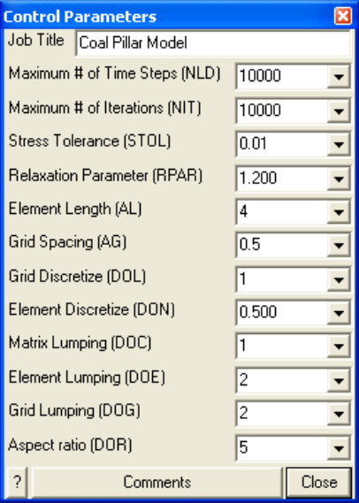

Ingrese lo siguiente:

Job Title: Coal Pillar Model

Todos los parámetros pueden dejarse en sus valores por defecto, excepto la tolerancia de esfuerzos, la longitud de elemento y el espaciado de grilla.

Stress Tolerance: 0.01 MPa

debe fijarse en aproximadamente el 0,1% del estado de esfuerzos de campo lejano. Esto garantiza que, durante la solución, los esfuerzos superficiales se calculen con una precisión numérica de 0,01 MPa.

Element Length: 4

debe fijarse en el doble del espesor del manto de carbón. Este parámetro controla el tamaño mínimo de los elementos de contorno que se usarán donde haya mantos o pilares estrechos. Esto garantiza que se formule un problema bien condicionado y fácil de resolver.

Grid Spacing: 0.5

debe fijarse en aproximadamente un cuarto del espesor del manto. Este parámetro controla el tamaño mínimo de los elementos de contorno y el espaciado mínimo en el plano de grilla que se usarán donde este pase cerca del modelo o lo intersecte. Pueden obtenerse resultados precisos hasta a la mitad de este espaciado de las superficies del modelo. Este parámetro también garantiza que se calcule un número suficiente de puntos de esfuerzo dentro del pilar para generar contornos suaves.

El usuario puede elegir un valor mayor para el espaciado de grilla. Esto dará un problema más pequeño y, por lo tanto, tiempos de ejecución más cortos. Sin embargo, con elementos de contorno más grandes los resultados serán menos precisos, sobre todo cerca de las superficies del modelo; además, con un espaciado de grilla mayor no pueden generarse contornos suaves.

Los valores sugeridos para los parámetros de discretización y agrupamiento son los siguientes:

_DON_ =0.5, _DOL_ = _DOC_ =1, _DOE_ = _DOG_ =2 para un error del 10-20% _DON_ =0.5, _DOL_ = _DOC_ =2, _DOE_ = _DOG_ =4 para un error del 5-10% _DON_ =1.0, _DOL_ =DOC=4, _DOE_ = _DOG_ =8 para un error &lt; 5%

Se recomiendan los ajustes para resultados de análisis gruesos en todos los problemas, excepto en aquellos que requieren mayor precisión. Con estos ajustes cabe esperar errores numéricos del 10-20% en las predicciones de esfuerzos. Los ajustes para resultados detallados proporcionan un error numérico del 5-10%. Los ajustes de alta precisión proporcionan un error numérico inferior al 5%. El usuario puede especificar ajustes de mayor precisión para estos parámetros, pero esto dará problemas más grandes y, por lo tanto, tiempos de ejecución más largos.

#### Ejecución de un análisis en Map3D

En este punto hemos completado la construcción del modelo y estamos listos para comenzar un análisis. Si usa Map3D Fault-Slip, obtendrá una solución elástica de este problema. Si usa Map3D NonLinear, se realizará un análisis no lineal completo.

El análisis se ejecuta desde el menú principal.

Puede ejecutar el análisis completo seleccionando

#### BEM Analysis

Aquí lo haremos por etapas. Así que primero seleccione

#### Discretization

Si ha modificado el modelo de cualquier forma desde la última vez que lo guardó, se le pedirá que guarde las modificaciones.

Cuando hayan terminado los análisis de intersecciones y discretización, seleccione

#### Analysis > Graphics

En el modo gráfico, debe seleccionar la opción de vista discretizada

#### View > Render > Discretize

Esto le permitirá ver cómo se han discretizado las superficies de los bloques en elementos de contorno. Debe tener activados los contornos de bloque para ver los elementos individuales

#### View > Render > Block Outlines

Para ver cómo se ha discretizado la grilla (si la barra de herramientas de contornos no está visible, actívela con Tools > CAD Toolbar), debe seleccionar

#### Plot > Grid Selection > Grid #1

en la barra de herramientas de contornos

El análisis de discretización puede repetirse tantas veces como se desee con distintos valores de espaciado de grilla y de los parámetros de discretización y agrupamiento, hasta lograr la densidad deseada de elementos de contorno y puntos de grilla.

Una vez satisfecho, puede pasar al análisis BEM (ensamblaje y solución de la matriz) seleccionando

#### Analysis

en el menú principal y luego

#### BEM Analysis

Cuando termine el análisis, seleccione

#### Analysis > Graphics

En el modo gráfico, puede representar mediante contornos cualquier parámetro deseado. Por ejemplo, para mostrar los contornos del esfuerzo principal mayor, seleccione

Plot > Stress > S1 Major Principal Stress

Esto generará un gráfico de contornos sobre el plano de grilla.

La interpretación de los resultados no se trata aquí.
