Este ejemplo muestra la construcción de un modelo para un caso de minería tabular en varias etapas.

Las líneas de construcción se utilizan para definir la ubicación detallada de elementos subterráneos como excavaciones, contactos, estructuras, etc. Normalmente, un modelo de Map3D se construye sobre estos datos de líneas de construcción.

Los planos de mina se digitalizaron previamente con Map3D

#### CAD > Digitizer Setup

o con otro programa CAD. Estos planos pueden guardarse en alguno de los siguientes formatos:

El formato de archivo de puntos es un archivo de datos ASCII universal con la extensión ".PNT". Este formato es útil para intercambiar datos brutos de líneas de construcción con otros programas CAD.

El formato AutoCAD-DXF es un formato popular de intercambio de dibujos con la extensión ".DXF". Este formato es útil para intercambiar datos de líneas de construcción con otros programas CAD.

Queremos empezar desde cero, así que seleccionaremos

#### File > New Model

Antes de comenzar, tenga en cuenta que puede situar el cursor sobre cualquier botón para ver una información sobre herramientas que identifica su función. Además, puede hacer clic con el botón derecho en cualquier elemento para obtener ayuda detallada sobre esa función.

#### Importación de planos de mina digitalizados

Primero debemos abrir un archivo que contenga los planos de mina digitalizados. Esto se hace con

#### File > Open Construction Lines

En este caso, las líneas de construcción se guardaron en formato PNT. El archivo "TAB.pnt" se incluye con la instalación de Map3D y debería estar disponible para importar.

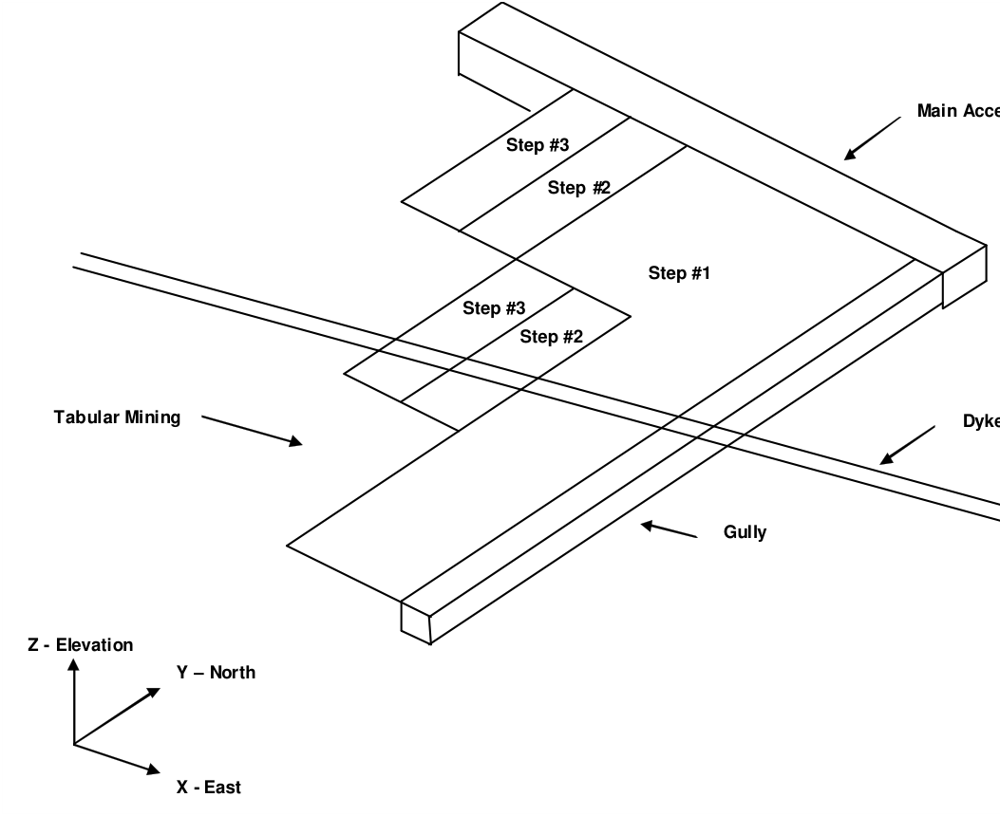

#### Reposicionamiento de la vista

Durante la construcción de bloques, o en cualquier otro momento, puede reposicionar (trasladar, rotar o hacer zoom) la geometría para facilitar la visualización. Esto se logra fácilmente de varias formas (consulte Rotación del modelo y Traslación del modelo). La forma más sencilla de rotar es mantener presionado el botón izquierdo del ratón mientras arrastra el cursor por la pantalla. La traslación se logra manteniendo presionado el botón derecho. Para acercar o alejar el modelo, mantenga presionados ambos botones del ratón.

Coloque la vista de modo que las líneas de construcción se vean con claridad.

#### Construcción de la etapa de minado n.º 1

Construyamos ahora la etapa de minado tabular n.º 1. Se construirá con elementos de discontinuidad de desplazamiento, definidos por el perímetro de la zona minada.

Para construir el primer bloque, use CAD > Build > DDLoop. Esta función puede seleccionarse desde la barra de herramientas CAD de la siguiente manera (si la barra de herramientas CAD no está visible, actívela con Tools > CAD Toolbar):

Seleccione CAD > Build en la barra de herramientas CAD

Se mostrará el submenú de funciones de construcción

Ahora seleccione

#### CAD > Build > DDLoop

Como queremos ajustar a las líneas de construcción, debemos configurar el modo de ajuste. Esto se hace con CAD > Snap > Nearest Edge. Esta función puede seleccionarse desde la barra de herramientas Build Entity

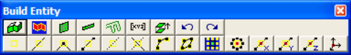

Para activar el ajuste a la arista más cercana, seleccione

#### CAD > Snap > Nearest Edge

(esto solo es necesario si el botón de ajuste a la arista más cercana no está ya resaltado).

En este modo, se mostrará una caja de selección en la intersección de la cruz de referencia. Aunque las coordenadas de la ubicación actual del cursor se indican en la barra de estado, si la caja de selección está sobre la esquina de una línea de construcción, se seleccionará esa esquina; de lo contrario, se seleccionará el punto más cercano de la arista de la línea de construcción que esté bajo la caja de selección. En ambos casos, los 3 valores de coordenadas (x, y, z) quedan especificados de forma única.

Verá que la rutina de construcción DDLoop le pide en la barra de estado que ingrese la primera esquina del bloque

Input: Select Point 1

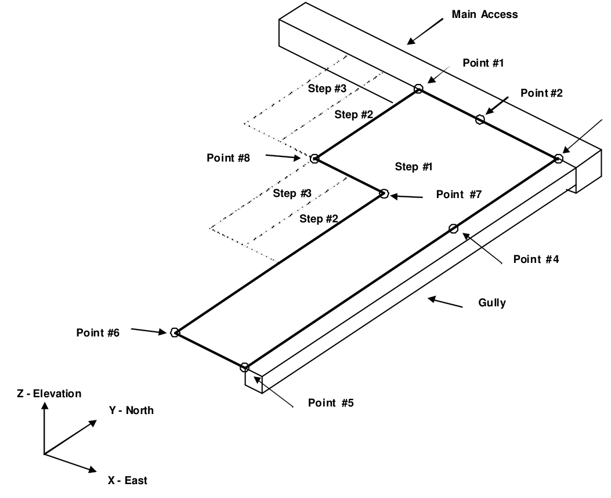

Seleccione los puntos 1 a 8 como se muestra.

Observe que aquí podríamos usar el modo de ajuste a esquinas

#### CAD > Snap > Nearest Corner

para todos los puntos excepto el 2 y el 4.

Si selecciona una ubicación incorrecta para un punto, simplemente deshaga esa selección

#### CAD > Build > Undo Point

y vuelva a intentarlo.

Los puntos 2 y 4 son opcionales y solo se han seleccionado para obtener un modelo de aspecto más ordenado.

Una vez seleccionado el punto n.º 8, el plano de planta está completo. Para terminar de construir el DDLoop, vuelva a seleccionar el punto n.º 1 o haga clic en el botón.

Se le pedirá automáticamente que ingrese las propiedades del bloque (CAD > Build > DDLoop)

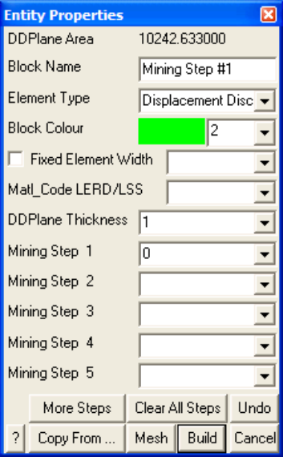

Ingrese lo siguiente:

Block Name: Mining Step #1 Element Type: Displacement Discontinuity Block Colour: 2 DDPlane Thickness: 1

DDPlane Thickness debe fijarse en la potencia de explotación.

Esta minería tabular debe excavarse en la etapa de minado 1. Esto se indica especificando

Mining Step 1: 0

Hemos terminado y podemos construir este bloque presionando el botón.

#### Construcción de la etapa de minado n.º 2

Construyamos ahora la etapa de minado tabular n.º 2. También se construirá con elementos de discontinuidad de desplazamiento, definidos por el perímetro de la zona minada. Para comenzar, seleccione

CAD > Build > DDLoop

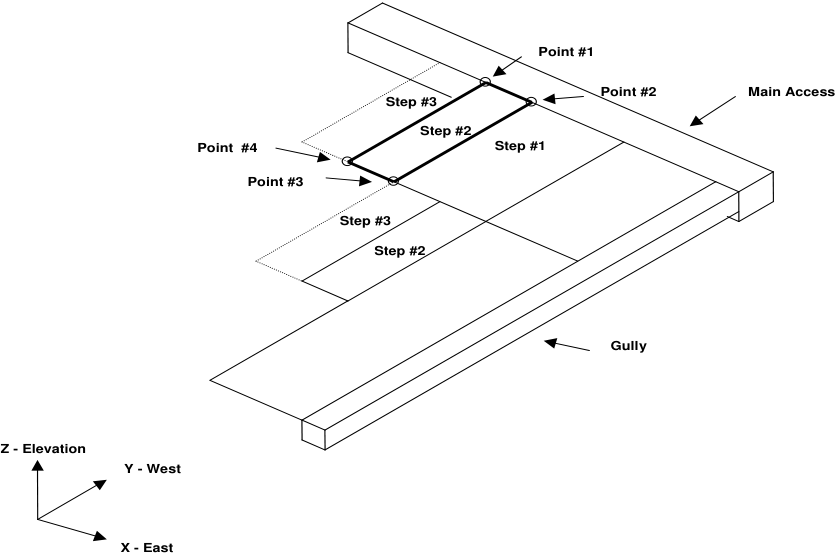

Seleccione los 4 puntos como se muestra.

Una vez seleccionado el punto 4, el plano de planta está completo. Para terminar de construir el DDLoop, vuelva a seleccionar el punto n.º 1 o haga clic en el botón.

Se le pedirá automáticamente que ingrese las propiedades del bloque (

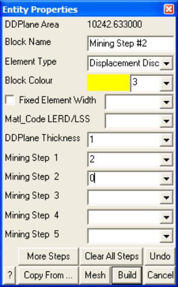

Ingrese lo siguiente:

Block Name: Mining Step #2 Element Type: Displacement Discontinuity Block Colour: 3 DDPlane Thickness: 1

DDPlane Thickness debe fijarse en la potencia de explotación.

A esta minería tabular deben asignársele las propiedades del mineral (material n.º 2) en la etapa de minado 1 y luego debe excavarse en la etapa de minado 2. Esto se indica especificando

Mining Step 1: 2 Mining Step 2: 0

Hemos terminado y podemos construir este bloque presionando el botón.

Ahora construya la otra parte de la etapa 2 con el mismo procedimiento.

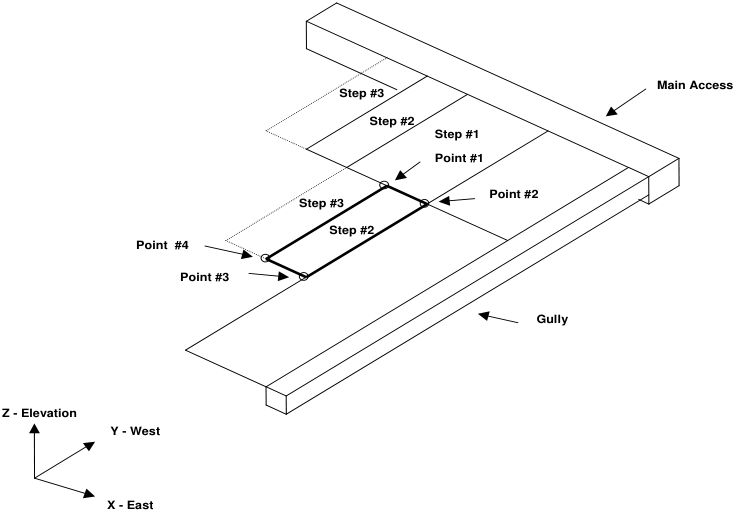

#### Construcción de la etapa de minado n.º 3

Esta minería puede construirse igual que la de la etapa 2, excepto que a esta minería tabular deben asignársele las propiedades del mineral (material n.º 2) en las etapas de minado 1 y 2, y luego debe excavarse en la etapa de minado 3.

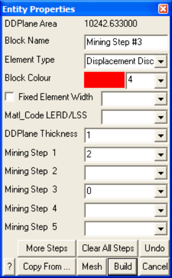

#### Obtención de resultados

Aunque hemos definido la geometría minera, todavía debemos especificar dónde queremos obtener predicciones de esfuerzos. Por defecto, se obtendrán en todos los planos DD no minados. Si también queremos esfuerzos fuera del manto, o por delante de la zona minada, debemos colocar planos DD o planos de grilla en esas ubicaciones. Los planos de grilla son una alternativa mucho más económica (en términos de tiempo de análisis).

En este caso elegimos obtener resultados solo en los planos DD. Querremos forzar la discretización de estos planos a un tamaño de elemento adecuado con el parámetro Fixed Element Width. Para ello, use CAD > Edit > Properties > Entity Properties. Esta función puede seleccionarse desde la barra de herramientas CAD de la siguiente manera (si la barra de herramientas CAD no está visible, actívela con Tools > CAD Toolbar):

Seleccione CAD > Edit en la barra de herramientas CAD

Se mostrará el submenú de funciones de edición

Ahora seleccione

CAD > Edit > Entity Properties

Esto abrirá la barra de herramientas de edición de entidades

Al iniciar esta rutina, primero se le pedirá que cree una lista de las entidades que desea editar. Mantenga presionada la tecla Mayús y seleccione todos los planos DD que representan las etapas de minado.

Una vez seleccionada toda la minería, puede seleccionar de nuevo

#### CAD > Edit > Entity Properties

o hacer doble clic en cualquier entidad para abrir el cuadro de diálogo Entity Properties.

Si alguno de los campos del cuadro de diálogo muestra "Variable", se debe a que algunos de los bloques seleccionados tienen propiedades distintas en ese campo. Si desea mantener esas propiedades como están (es decir, distintas para cada bloque), deje el campo como "Variable". Si desea cambiar el valor de ese campo para todos los bloques seleccionados, ingrese el valor deseado.

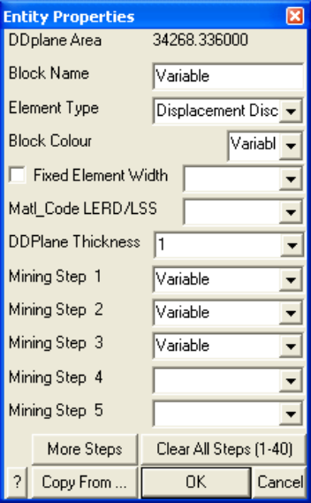

En este caso, el único campo que queremos cambiar es

Fixed Element Width:  20

Fije este valor en 20 y seleccione OK.

Esto obligará a Map3D a subdividir la zona minada en elementos uniformes de 20 metros de ancho durante el proceso de discretización. Este parámetro puede reducirse más adelante si se desea una discretización más fina.

#### Guardar la geometría

En este ejemplo supondremos que la geometría definida hasta ahora es satisfactoria. Como tanto la geometría final como la secuencia de minado están completas, conviene guardar el modelo. Para ello seleccionamos

#### File > Save Model As

Guardémoslo con el nombre "TAB.INP"

#### Construcción del dique

Como complicación adicional, construyamos ahora el dique. Para construirlo, use CAD > Build > FFLoop. Esta función puede seleccionarse desde la barra de herramientas CAD de la siguiente manera (si la barra de herramientas CAD no está visible, actívela con Tools > CAD Toolbar):

Seleccione CAD > Build en la barra de herramientas CAD

Se mostrará el submenú de funciones de construcción

Ahora seleccione

#### CAD > Build > FFLoop

Como queremos ajustar a las esquinas de las líneas de construcción, debemos configurar el modo de ajuste. Esto se hace con CAD > Snap > Nearest Corner. Esta función puede seleccionarse desde la barra de herramientas Build Entity

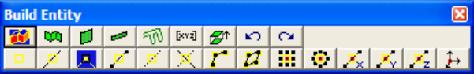

Para activar el ajuste a la esquina más cercana, seleccione

#### CAD > Snap > Nearest Corner

(esto solo es necesario si el botón Nearest Corner Snap no está ya resaltado).

En realidad, aquí podríamos usar el modo de ajuste a aristas

#### CAD > Snap > Nearest Edge

ya que de todos modos se seleccionarían las esquinas de las líneas de construcción (siempre que la esquina esté dentro de la caja de selección). Sin embargo, el ajuste a esquinas permite ser menos preciso al seleccionar, ya que solo se seleccionan esquinas.

Seleccione los cuatro puntos como se muestra en la figura.

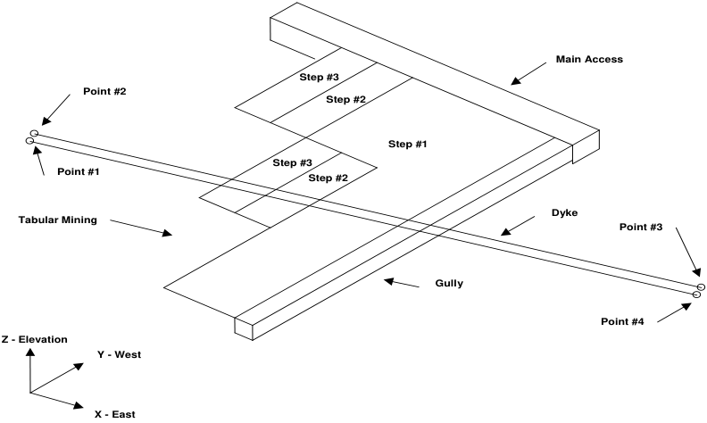

Si selecciona una ubicación incorrecta para un punto, simplemente deshaga esa selección con el botón deshacer

#### CAD > Build > Undo Point y vuelva a intentarlo.

Por último, vuelva a seleccionar el primer punto (es decir, el punto n.º 1).

Al volver a seleccionar el primer punto, la base del bloque queda completamente formada. Se mostrará el mensaje

#### Loop complete: Start next loop.

Para terminar de construir el bloque, generaremos los 4 puntos restantes a partir de las 4 primeras esquinas añadiéndoles un desplazamiento. Para usar este procedimiento, seleccione la función de desplazamiento en la barra de herramientas Build Entity

#### CAD > Build > Extrude/Offset Remaining

Se le pedirá el vector de desplazamiento de la siguiente manera

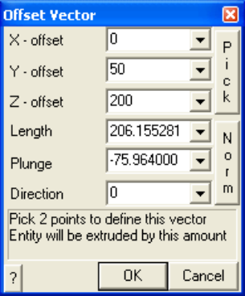

Ingrese el desplazamiento como:

X-offset > 0 Y-offset > 50 Z-offset > 200

Los puntos 5, 6, 7 y 8 se generarán a partir de los puntos 1, 2, 3 y 4, respectivamente, sumando los valores de desplazamiento a sus coordenadas.

Al completar la construcción del bloque, se le pedirá automáticamente que ingrese las propiedades del bloque (CAD > Build > FFLoop)

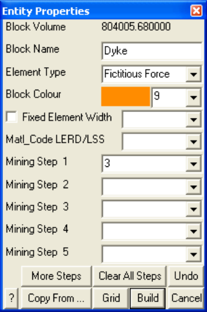

Ingrese lo siguiente:

Block Name: Dyke Element Type: Fictitious Force Block Colour: 9

Desmarque Fixed Element Width para desactivar esta función

A este dique debe asignársele el material n.º 3 en la etapa de minado 1. Esto se indica especificando

Mining Step 1: 3

Hemos terminado y podemos construir este bloque presionando el

botón.

También necesitamos prolongar el dique por debajo de la minería. Para ello podemos copiar este bloque por debajo de la minería. Seleccione

CAD > Edit en la barra de herramientas CAD

Esto abrirá la barra de herramientas de edición

Para copiar entidades, seleccione

CAD > Edit > Copy Entities

Esto abrirá la barra de herramientas de copia de entidades

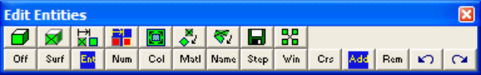

Al iniciar esta rutina, primero se le pedirá que cree una lista de las entidades que desea editar. Haga clic en el dique. Esto abrirá el cuadro de diálogo del vector de desplazamiento de la copia

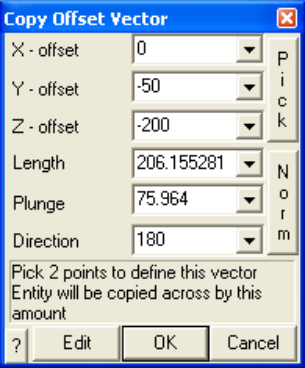

Seleccionemos esta ubicación gráficamente con la función Pick.

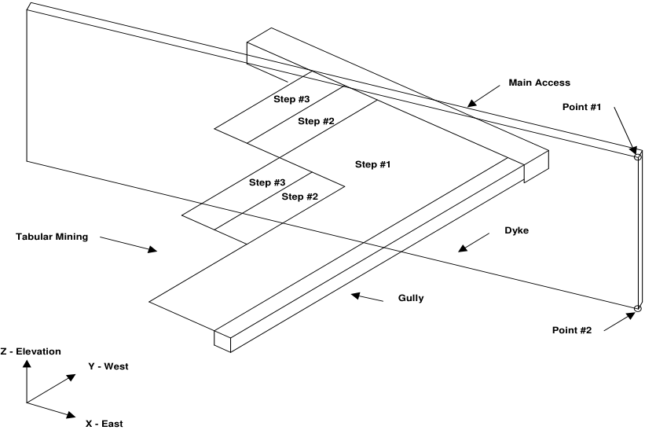

Esto definirá el vector de desplazamiento

X - offset: 0

Y - offset: -50

Z - offset: -200

Ahora seleccione OK. Esto copiará el dique por debajo de la minería.

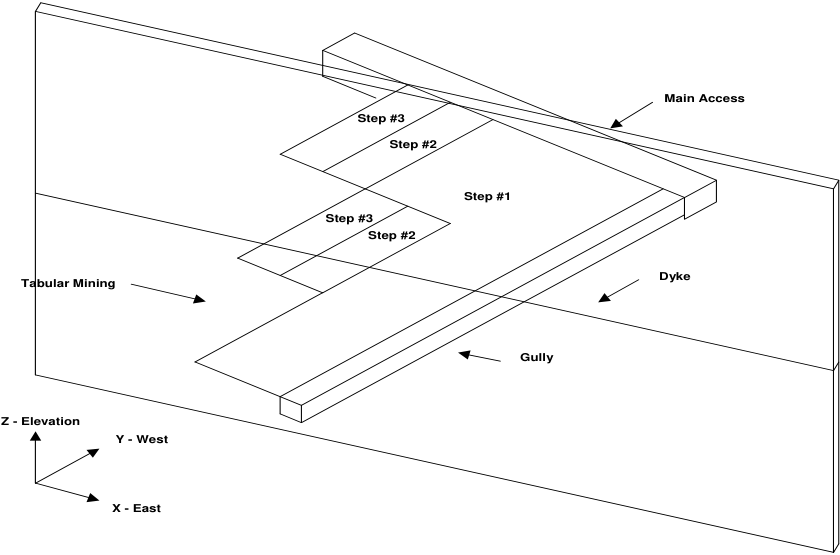

Con esto se completa la construcción del modelo.

#### Especificación de las propiedades de material de la roca encajante

Ahora debemos especificar las propiedades del material encajante. Se ingresan con la función de propiedades de material

#### CAD > Properties > Material Properties

Al seleccionar este elemento se abre un submenú de elementos relacionados con la edición de las propiedades de material. Tenga en cuenta que el material número 1 es, por definición, el material encajante. Los demás números de material se usan para definir zonas de materiales alternativos, como mineral, relleno de falla, relleno, etc. Primero se le pedirá que ingrese el número de material que desea editar. Definamos primero las propiedades del material encajante

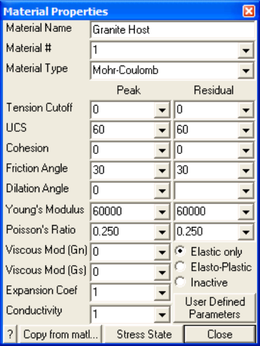

Ingrese lo siguiente:

Material Name: Granite Host Material #: 1 Young's (deformation) Modulus: 60000 MPa Poisson's Ratio: 0.25

Los módulos viscosos pueden fijarse en cero, ya que solo se usan para simular la respuesta de fluencia en el análisis no lineal.

Aquí queremos usar el criterio de Mohr-Coulomb. Para ello, fije

Material Type: Mohr-Coulomb UCS: 60 MPa

En este caso no se usa el parámetro de cohesión, por lo que puede fijarse en cero.

Friction angle: 30°

En este caso no se usa el ángulo de dilatancia, por lo que puede fijarse en cero.

Seleccione Stress State para abrir el cuadro de diálogo del estado de esfuerzos

El estado de esfuerzos de campo lejano adecuado para este modelo es

sa constant:  30 MPa sb constant:  20 MPa sc constant:  20 MPa

Fijaremos la variación de los esfuerzos con la profundidad en

Dsa variation:  -0.027 MPa/m Dsb variation:  -0.013 MPa/m Dsc variation:  -0.013 MPa/m

Además, las orientaciones de los esfuerzos (rumbo e inclinación) deben fijarse en cero, con lo que sa y sb quedan definidos como horizontales y sc como vertical.

El datum puede fijarse en 1000 metros para definir la variación con la profundidad como

s + Ds ( _z_ - _Datum_ )

Definido así, el esfuerzo sa es igual a 30 MPa a una profundidad z de 1000 m y aumenta a razón de 0,027 MPa por metro de profundidad.

#### Especificación de las propiedades de material del mineral

Ahora debemos especificar las propiedades del mineral. Se ingresan con la función de propiedades de material

#### CAD > Properties > Material Properties

Al seleccionar este elemento se abre un submenú de elementos relacionados con la edición de las propiedades de material. Tenga en cuenta que el material número 1 es, por definición, el material encajante. Los demás números de material se usan para definir zonas de materiales alternativos, como mineral, relleno de falla, relleno, etc. Primero se le pedirá que ingrese el número de material que desea editar.

Fijemos Material # en 2.

Todos los parámetros pueden fijarse según se desee. En este caso conviene tener especial cuidado, ya que este material se inserta en planos DD. Estos rasgos pueden comportarse de forma no lineal, cediendo en compresión y en corte (consulte la sección sobre Mohr-Coulomb en planos DD).

Seleccione Stress State para abrir el cuadro de diálogo del estado de esfuerzos

Queremos que el esfuerzo inicial en el mineral sea el mismo que en la roca encajante, así que usemos Copy para copiarlo del material 1.

#### Especificación de las propiedades de material del dique

Ahora debemos especificar las propiedades del dique. Se ingresan con la función de propiedades de material

#### CAD > Properties > Material Properties

Al seleccionar este elemento se abre un submenú de elementos relacionados con la edición de las propiedades de material. Tenga en cuenta que el material número 1 es, por definición, el material encajante. Los demás números de material se usan para definir zonas de materiales alternativos, como mineral, relleno de falla, relleno, etc. Primero se le pedirá que ingrese el número de material que desea editar.

Fijemos Material # en 3.

Todos los parámetros pueden fijarse según se desee. Si se usa Map3D Non-Linear, conviene tener especial cuidado en este caso, ya que este rasgo puede comportarse de forma no lineal, cediendo en compresión y en corte (consulte la sección sobre Mohr-Coulomb en bloques FF 3D).

Asegúrese de seleccionar Stress State para abrir el cuadro de diálogo del estado de esfuerzos y fijar el estado de esfuerzos del dique igual al de la roca encajante (Copy desde el material 1).

#### Especificación de los parámetros de control

Ahora debemos especificar los parámetros que controlan la discretización y la solución del modelo. Se ingresan con la función de parámetros de control

#### CAD > Properties > Control Parameters

Al seleccionar este elemento se abre un cuadro de diálogo con los elementos relacionados con los parámetros de control

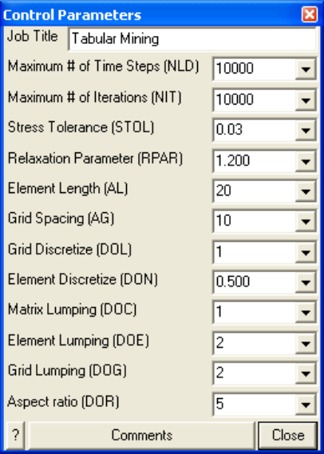

Ingrese lo siguiente:

Job Title: Tabular Mining

Todos los parámetros pueden dejarse en sus valores por defecto, excepto la tolerancia de esfuerzos, la longitud de elemento y el espaciado de grilla.

Stress Tolerance: 0.03 MPa

debe fijarse en aproximadamente el 0,1% del estado de esfuerzos de campo lejano. Esto garantiza que, durante la solución, los esfuerzos superficiales se calculen con una precisión numérica de 0,03 MPa.

Element Length: 20

debe fijarse en el doble del espesor del dique (el dique tiene 10 metros de espesor), ya que es el rasgo más estrecho de este modelo. Este parámetro controla el tamaño mínimo de los elementos de contorno que se usarán donde haya mantos o pilares estrechos. Esto garantiza que se formule un problema bien condicionado y fácil de resolver.

El espaciado de grilla (Grid Spacing) no se usa, ya que no hemos definido grillas de puntos de campo.

Los valores sugeridos para los parámetros de discretización y agrupamiento son los siguientes:

_DON_ =0.5, _DOL_ = _DOC_ =1, _DOE_ = _DOG_ =2 para un error del 10-20% _DON_ =0.5, _DOL_ = _DOC_ =2, _DOE_ = _DOG_ =4 para un error del 5-10% _DON_ =1.0, _DOL_ =DOC=4, _DOE_ = _DOG_ =8 para un error &lt; 5%

Se recomiendan los ajustes para resultados de análisis gruesos en todos los problemas, excepto en aquellos que requieren mayor precisión. Con estos ajustes cabe esperar errores numéricos del 10-20% en las predicciones de esfuerzos. Los ajustes para resultados detallados proporcionan un error numérico del 5-10%. Los ajustes de alta precisión proporcionan un error numérico inferior al 5%. El usuario puede especificar ajustes de mayor precisión para estos parámetros, pero esto dará problemas más grandes y, por lo tanto, tiempos de ejecución más largos.

#### Ejecución de un análisis en Map3D

En este punto hemos completado la construcción del modelo y estamos listos para comenzar un análisis. Si usa Map3D Fault-Slip, obtendrá una solución elástica de este problema. Si usa Map3D NonLinear, se realizará un análisis no lineal completo.

El análisis se ejecuta desde el menú principal.

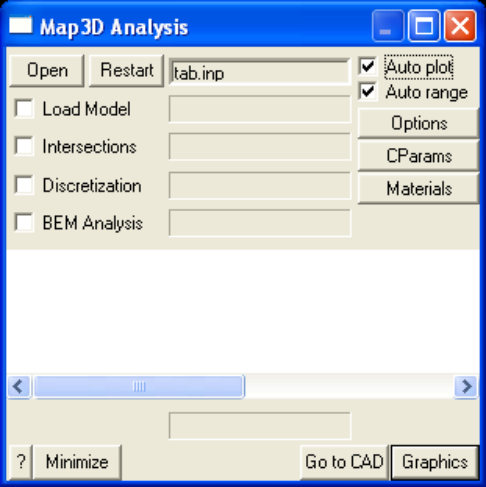

Puede ejecutar el análisis completo seleccionando

#### BEM Analysis

Aquí lo haremos por etapas. Así que primero seleccione

#### Discretization

Si ha modificado el modelo de cualquier forma desde la última vez que lo guardó, se le pedirá que guarde las modificaciones.

Cuando hayan terminado los análisis de intersecciones y discretización, seleccione

#### Analysis > Graphics

En el modo gráfico, debe seleccionar la opción de vista discretizada

#### View > Render > Discretize

Esto le permitirá ver cómo se han discretizado las superficies de los bloques en elementos de contorno. Debe tener activados los contornos de bloque para ver los elementos individuales

#### View > Render > Block Outlines

Para ver cómo se ha discretizado la grilla, debe seleccionar

#### Plot > Grid Selection > Grid #1

Si todo es satisfactorio, puede pasar al análisis BEM (ensamblaje y solución de la matriz) seleccionando

#### Analysis

en el menú principal y luego

#### BEM Analysis

Cuando termine el análisis, seleccione

#### Analysis > Graphics

En el modo gráfico, puede representar mediante contornos cualquier parámetro deseado. Por ejemplo, para mostrar el desplazamiento normal (convergencia) en la minería tabular, seleccione

#### Plot > Surface Components > Dn Normal Displacement (Closure)

Esto generará un gráfico de contornos sobre los planos DD.

#### Construcción del acceso principal

Se construirá dibujando un plano de planta con DDLoop y extruyéndolo luego en un bloque 3D.

Para ello debemos volver a la etapa CAD del análisis de Map3D seleccionando

#### Analysis > Go to CAD

en el cuadro de diálogo de análisis. Luego seleccione

#### Analysis > Graphics

Para comenzar, seleccione la función de menú de construcción DDLoop

#### CAD > Build > DD Loop

Configure el modo de ajuste en arista más cercana (o esquina más cercana)

#### CAD > Snap > Nearest Edge

(esto solo es necesario si el botón de ajuste a aristas no está ya resaltado).

Verá que la rutina de construcción DDLoop le pide en la barra de estado que ingrese la primera esquina del bloque

Input: Select Point 1

Seleccione los dos primeros puntos como se muestra en la figura.

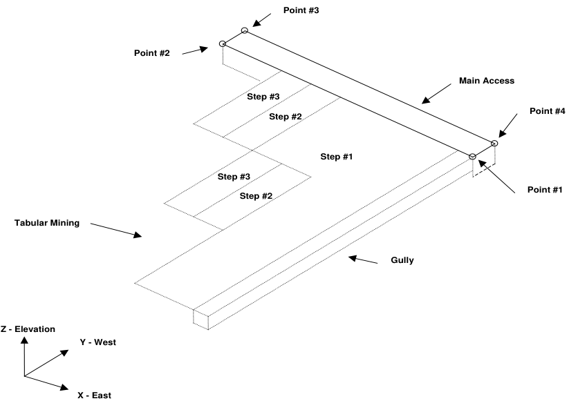

Los puntos 3 y 4 se generarán desplazándolos desde la línea definida por los puntos 1 y 2. Para ello seleccione

#### CAD > Build > Offset Remaining

en la barra de herramientas de construcción.

Se le pedirá que ingrese el vector de desplazamiento.

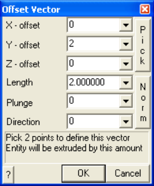

Ingrese el desplazamiento como

X - offset: 0

Y - offset: 2

#### Z - offset: 0

Esto generará los puntos 3 y 4 y completará la construcción del DDLoop.

Se le pedirá automáticamente que ingrese las propiedades del bloque

Ingrese lo siguiente:

#### Block Name: Main Access

#### Element Type: Fictitious Force

Al hacerlo, se le pedirá que ingrese el vector de desplazamiento que se usará para extruir el bloque.

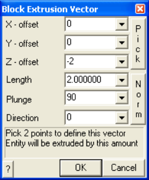

Ingrese el desplazamiento como:

X - offset: 0 Y - offset: 0 Z - offset: -2

Block Colour: 1 Fixed Element Width:   (deje esta casilla sin marcar)

Este acceso debe excavarse en la etapa de minado 1. Esto se indica especificando

Mining Step 1: 0

Hemos terminado y podemos construir este bloque.

#### Construcción del cruzado (gully)

Ahora construya el gully con el mismo procedimiento descrito anteriormente.

Seleccione los dos primeros puntos como se muestra en la figura.

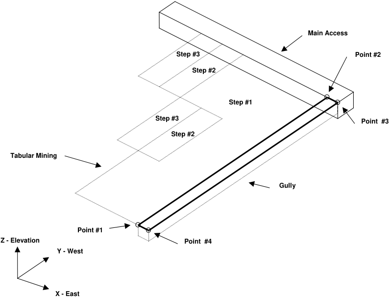

Los puntos 3 y 4 se generarán desplazándolos desde la línea definida por los puntos 1 y 2. Para ello seleccione

CAD > Build > Offset Remaining

en la barra de herramientas de construcción.

Se le pedirá que ingrese el vector de desplazamiento.

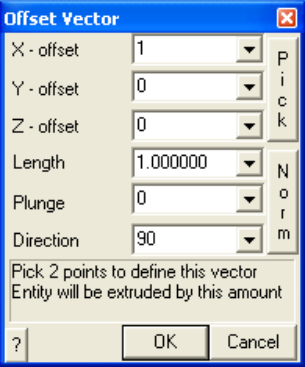

Ingrese el desplazamiento como:

- X - offset: 1

- Y - offset: 0

- Z - offset: 0

Esto generará los puntos 3 y 4 y completará la construcción del DDLoop.

Se le pedirá automáticamente que ingrese las propiedades del bloque

#### Ingrese lo siguiente:

#### Block Name: Gully

#### Element Type: Fictitious Force

Al hacerlo, se le pedirá que ingrese el vector de desplazamiento que se usará para extruir el bloque.

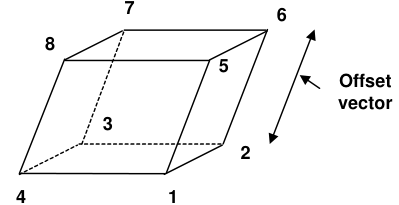

Ingrese el desplazamiento como:

X - offset: 0 Y - offset: 0 Z - offset: -1

Block Colour: 1

Fixed Element Width:   (deje esta casilla sin marcar)

Este acceso debe excavarse en la etapa de minado 1. Esto se indica especificando

Mining Step 1: 0

Hemos terminado y podemos construir este bloque.

#### Discusión

Antes de continuar con el análisis, debemos modificar el parámetro de control Element Length ( _AL_ ) para tener en cuenta adecuadamente estas nuevas incorporaciones al modelo

#### CAD > Properties > Control Parameters

AL debe fijarse en el doble del espesor del gully (el gully tiene 1 metro de espesor), ya que es el rasgo más estrecho de este modelo.

Si ahora discretizamos el modelo

#### Analysis > Discretization

una revisión cuidadosa muestra que se usa un gran número de elementos de contorno para discretizar las zonas adyacentes al gully y al acceso principal. Evidentemente, estos rasgos resultarán costosos en términos de tiempo de análisis. Si no son factores importantes, puede lograrse un ahorro considerable de esfuerzo de análisis eliminándolos del análisis. Esto se consigue convirtiéndolos en inactivos.

Para ello seleccione

#### Analysis > Go to CAD

en el cuadro de diálogo de análisis. Luego seleccione

Analysis > Graphics

Ahora seleccione

en la barra de herramientas CAD

Esto abrirá la barra de herramientas de edición

Para editar entidades, seleccione

CAD > Edit > Entity Properties

Esto abrirá la barra de herramientas de edición de entidades

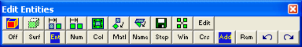

Al iniciar esta rutina, primero se le pedirá que cree una lista de las entidades que desea editar. Mantenga presionada la tecla Mayús y seleccione el gully y el acceso principal. No seleccione la minería tabular ni el dique.

Una vez seleccionados estos rasgos, puede seleccionar de nuevo

CAD > Edit > Entity Properties

o hacer doble clic en el gully o en el acceso principal para abrir el cuadro de diálogo Entity Properties.

Si alguno de los campos del cuadro de diálogo muestra "Variable", se debe a que algunos de los bloques seleccionados tienen propiedades distintas en ese campo. Si desea mantener esas propiedades como están (es decir, distintas para cada bloque), deje el campo como "Variable". Si desea cambiar el valor de ese campo para todos los bloques seleccionados, ingrese el valor deseado.

En este caso, el único campo que queremos cambiar es el parámetro Element Type. Fíjelo en Inactive Fictitious Force

Element Type: Inactive Fictitious Force

y luego seleccione OK.

Ahora puede volver a iniciar el análisis BEM seleccionando

BEM Analysis

