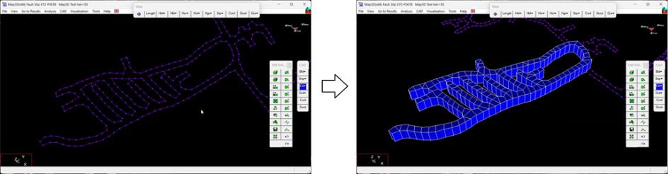

Este ejemplo muestra cómo usar la función DDLoop de Map3D para construir un diseño complejo de galerías. El diseño contiene formas complicadas de pilares interiores.

Las líneas de construcción usadas en este video se incluyen con la versión de demostración de Map3D y/o pueden descargarse desde z305_floor_plan-a.dxf

**Demostración en video de la construcción de modelos DDLoop con lazos interiores**
