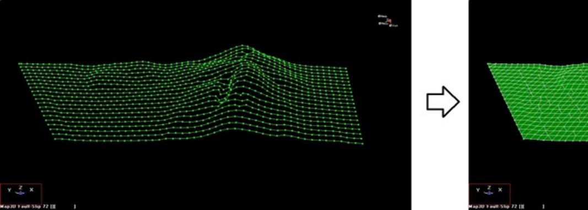

Este ejemplo muestra cómo construir modelos con DDLoop en Map3D usando la opción "Snap > Window".

El diseño contiene múltiples líneas de construcción subparalelas.

Las líneas de construcción usadas en este video se incluyen con la versión de demostración de Map3D y/o pueden descargarse desde lines3a.dxf

**Demostración en video de la construcción de modelos DDLoop con la opción Window (lines3a.dxf)**
