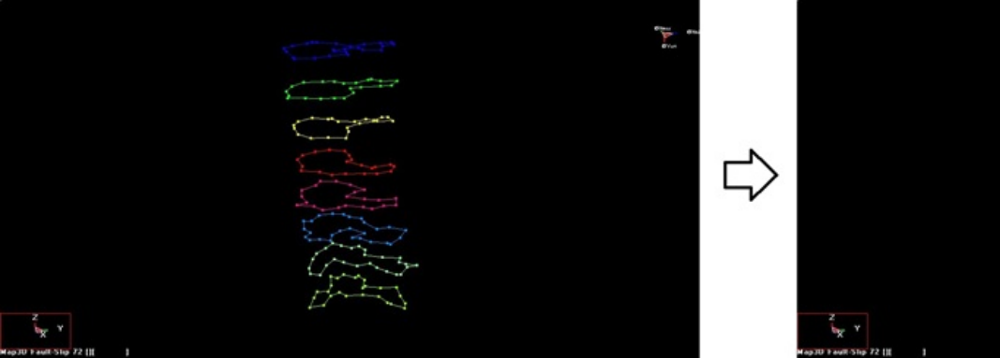

Este ejemplo muestra cómo usar la función FFLoop de Map3D con la nueva opción "Snap > Window".

El diseño contiene múltiples lazos de líneas de construcción.

Este video muestra la construcción con FFLoop a partir de un conjunto de lazos de líneas de construcción. Las líneas de construcción usadas en este video se incluyen con la versión de demostración de Map3D y/o pueden descargarse desde 7a.pnt

**Demostración en video de la construcción de modelos FFLoop con la nueva opción "Win > Snap"**
