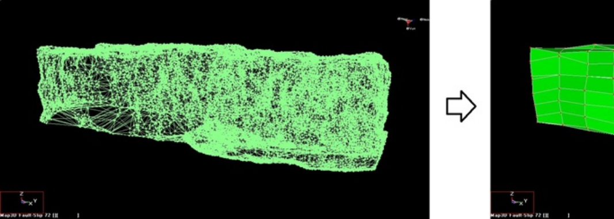

Este ejemplo muestra cómo usar la simplificación de modelos mediante cortes en Map3D. El diseño contiene una forma de excavación excesivamente compleja.

Este video muestra la simplificación de una geometría compleja mediante "Slicing" (corte), "Smoothing" (suavizado) y luego construcción con "FFLoop".

Las líneas de construcción usadas en este video se incluyen con la versión de demostración de Map3D y/o pueden descargarse desde Skivpall.dxf

**Demostración en video de la simplificación de modelos mediante cortes (Skivpall.dxf)**
