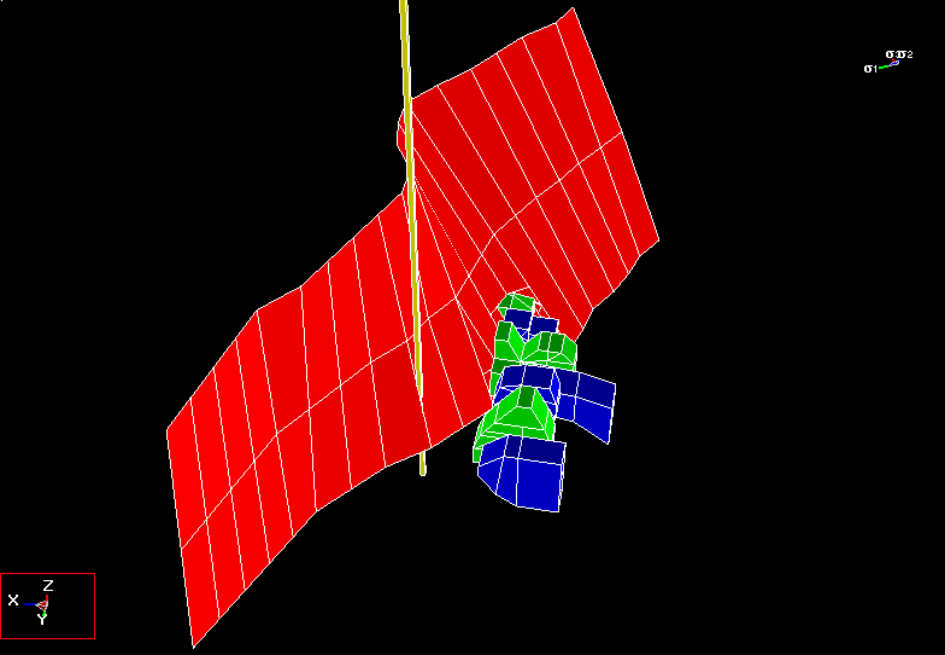

En este ejemplo se examinan varios métodos alternativos para modelar la falla por deslizamiento de falla, con el fin de evaluar el comportamiento pseudoestático del deslizamiento. Los resultados del modelamiento numérico se usan para comparar estos enfoques e intentar demostrar que los resultados son válidos y confiables.

Ejemplo de deslizamiento de falla

