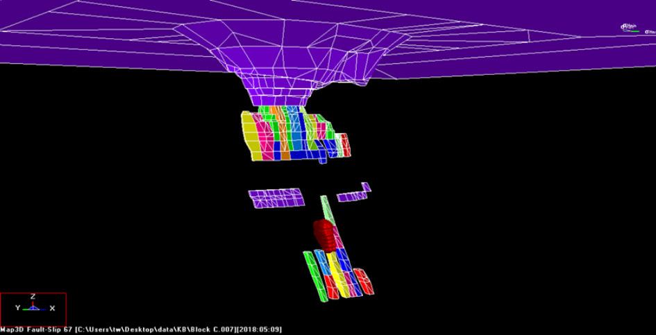

En este ejemplo, la sobreexcavación ocurrida en una etapa anterior de la minería se usa para calibrar un modelo que permita predecir el comportamiento esperado al minar un nivel posterior más profundo.

#### Ejemplo KB

