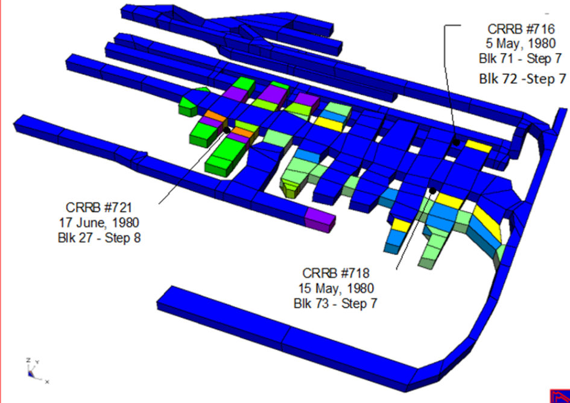

En este ejemplo se produjeron múltiples fallas de pilares durante la etapa de desarrollo de subniveles (silling out) en 3 niveles distintos. Estas fallas se usan para calibrar un modelo que permita predecir el comportamiento esperado al minar un pilar corona posterior.

#### Ejemplo CR

