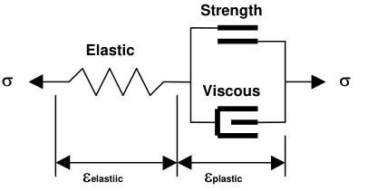

Effectue une analyse de fluage élasto-visco-plastique.

Cette fonction n'est utilisée que dans les analyses non linéaires (blocs FF 3D dans Map3D Non-Linear et plans DD dans Map3D Fault-Slip). Le modèle de fluage peut servir simplement de technique d'amortissement des déformations non linéaires ou, si cette option de fluage est activée, de simulation de fluage dépendant du temps en temps réel.

À chaque pas de fluage, l'état de contrainte de tous les éléments en plastification (éléments dont la contrainte dépasse la résistance) est calculé comme la résistance plus la résistance au fluage. Cela limite la taille de l'incrément de fluage plastique Deplastic sur chaque élément en plastification

s = _Strength_ + _C_ Deplastic /D _t_

_C_ = _G_ D _t_

où la résistance au fluage est déterminée comme le coefficient de fluage _C_ multiplié par la vitesse de déformation plastique Deplastic /D _t_ . Notez que l'utilisateur doit choisir à la fois le coefficient de fluage _C_ et la taille du pas de temps D _t_ , puis spécifier leur quotient comme module visqueux _G_ . La contribution de l'incrément de fluage à la contrainte s correspond à la contrainte excédentaire, donnée par

Ds  = _C_ Deplastic /D _t_

La contrainte excédentaire maximale pour tous les éléments en plastification est indiquée par Plot > Surface Components > Ferr

Si cette option de fluage est activée, Map3D n'exécute qu'un seul incrément de fluage par étape d'exploitation. Le temps écoulé peut alors être déterminé comme le produit du numéro du pas de temps actuel _is_ (Analysis Dialogue) par la taille du pas de temps D _t_ définie par l'utilisateur.

Temps écoulé total = _is_ D _t_

L'utilisateur peut souhaiter répéter plusieurs étapes d'exploitation sans ajouter de nouvelle exploitation, simplement pour laisser le modèle fluer pendant un nombre contrôlé de pas.

Si cette option de fluage n'est pas activée, Map3D exécute autant d'incréments de fluage que nécessaire pour réduire _fer_ sous la tolérance de contrainte _STOL_ , avant de passer à l'étape d'exploitation suivante.

Dans les deux cas, la déformation plastique cumulée eplastic est déterminée comme la somme des incréments de fluage plastique Deplastic pour tous les pas de fluage.

Rubriques connexes :

Plot > Surface Components > DTs Excess Shear Stress

Plot > Surface Components > DEs Incremental Shear Strain

Plot > Surface Components > Ts Shear Stress

Plot > Surface Components > Es Shear Strain

Cette fonction doit être cochée avant d'effectuer l'analyse BEM de Map3D

Analysis > BEM Analysis
