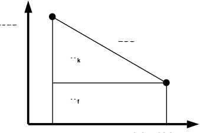
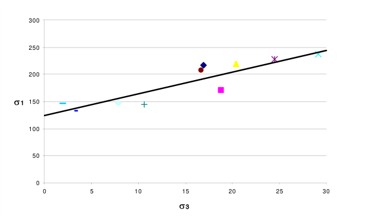
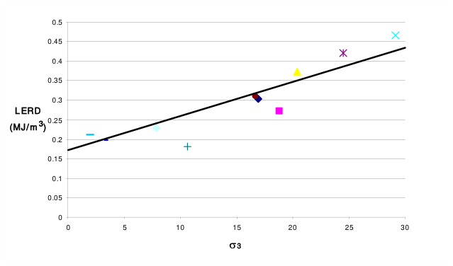
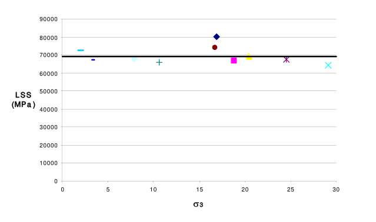

Calcule le taux de libération d'énergie et la rigidité du système de chargement pendant l'analyse BEM de Map3D.

Cette routine permet de calculer le taux de libération d'énergie ( _ERR_ ) en tout point souhaité et offre une grande souplesse pour contrôler le déroulement du calcul. Une autre

méthode est disponible, où _ERR_ est calculé uniquement en avant du front d'une excavation : Plot > Surface Components > ERR

Lorsque vous sélectionnez LERD/LSS, le programme vous demande un nom de fichier de données dans lequel écrire les résultats des calculs LERD/LSS. L'extension par défaut de ce fichier est ".ERR".

Les résultats sont écrits dans ce fichier au format suivant :

Si le bloc d'essai est construit comme un bloc 3D (à l'aide d'éléments FF)

**Block# Volume Area   Wk  Wf  Ev  LSS   x y z** s **1  t1  p1** s **2  t2  p2** s **3  t3  p3**

où s **i  ti  pi** représentent une composante de contrainte principale, sa direction (trend) et son plongement (plunge).

Si le bloc d'essai est construit comme un élément plan (à l'aide d'éléments DD)

**Block# Volume Area   Wk  Wf  Ev  LSS   x y z** t **s  ts  ps** s **n  tn  pn**

où t **s  ts  ps** représentent la contrainte de cisaillement maximale dans le plan, sa direction et son plongement, et s **n  tn  pn** représentent la contrainte normale, sa direction et son plongement.

Dans les deux cas, **x y z** sont les coordonnées du centre du bloc d'essai où les contraintes sont calculées.

**Wk  Wf** et **LSS** sont définis ci-dessous.

**Ev** est la variation de volume qui se produit pendant le calcul LERD/ERR.

De plus, la libération d'énergie totale associée aux nouvelles excavations réalisées à l'étape d'exploitation en cours est également calculée. Notez qu'aucun bloc d'essai n'a besoin d'être spécifié pour que ce calcul ait lieu. Les résultats sont présentés comme suit :

#### Stp# Volume Area Wk Wf Ev LSS

La rigidité du système de chargement ( _LSS_ ) et la densité locale de libération d'énergie ( _LERD_ ) sont de bons indicateurs de la nature de la réponse attendue pendant la plastification. En différents endroits d'un modèle, on peut

s'attendre à ce que ces indicateurs varient en raison d'effets géométriques. Aux endroits où la _LSS_ est plus rigide que la réponse post-pic de la roche en plastification, on peut s'attendre à une rupture contrôlée qui progresse en suivant l'avancement de l'exploitation. En revanche, aux endroits où la _LSS_ est plus souple que la réponse post-pic de la roche en plastification, on peut s'attendre à des ruptures incontrôlées. La quantité d'énergie excédentaire disponible devrait être corrélée à la magnitude de l'événement.

Pour déterminer la _LSS_ ou la _LERD_ dans un modèle numérique, il faut fléchir le modèle et observer la réponse du système de chargement. Pour cela, on spécifie le code de matériau du calcul LERD/LSS à l'aide de

#### CAD > Edit > Entity Properties > Matl Code LERD/LSS

Ce code de matériau spécial sert à modifier temporairement les propriétés du matériau ou les conditions aux limites dans la zone d'essai afin de provoquer une certaine déformation du modèle.

Comme la _LSS_ devrait changer d'un endroit à l'autre, il faut procéder ainsi à tous les endroits d'intérêt. En surveillant attentivement la réponse du système de chargement pendant cette déformation, on peut calculer la _LSS_ et les différentes quantités d'énergie transférées.

Prenons l'exemple simple d'un plan de faille traversant une zone d'exploitation, et posons la question : « Comment cette faille réagirait-elle si elle se plastifiait ? ». On pourrait simplement substituer un angle de frottement plus faible et observer comment le massif rocheux se déforme. Appelons « Étape I » le modèle avec la faille à son angle de frottement normal, et « Étape II » le même modèle avec la faille à un angle de frottement réduit. En un point du plan de faille, on peut s'attendre au type de réponse suivant.

La _LSS_ est simplement la pente de la courbe de réponse charge-déformation. La quantité maximale d'énergie pouvant être libérée sous forme d'énergie cinétique correspond à l'aire du triangle supérieur noté Wk (on s'attend à ce qu'elle soit corrélée à la magnitude de l'événement observé). La quantité minimale d'énergie pouvant être dissipée dans la déformation par frottement de la faille correspond à l'aire du rectangle inférieur noté Wf (on s'attend à ce qu'elle soit corrélée à l'ampleur des dommages observés à la source de l'événement). Ce calcul doit être effectué en tous les points du plan de faille afin d'obtenir l'énergie totale transférée à la suite de la réduction de l'angle de frottement. Notez que, selon la façon dont les propriétés du matériau sont définies, il peut y avoir des déformations normales (dilatance accompagnant la réponse en cisaillement) qui doivent être incluses dans les calculs d'énergie.

Les mêmes calculs peuvent être effectués pour un pilier entre deux galeries. Dans ce cas, appelons « Étape I » le modèle avec le pilier intact. Pour fléchir le modèle, on pourrait substituer un matériau différent dans le pilier et appeler cela « Étape II ». Tous les calculs et interprétations de Wk et Wf ci-dessus peuvent alors être repris. Notez que, comme précédemment, les composantes normale et de cisaillement contribuent toutes deux aux calculs d'énergie.

Comme Map3D calcule les contraintes agissant sur les éléments de frontière, le transfert d'énergie total peut être calculé comme l'intégrale des contraintes sur leurs déformations, sur l'ensemble des éléments. Dans l'exemple du pilier ci-dessus, si l'on excave réellement le pilier pour obtenir l'étape II, puis que l'on divise Wk par le volume du pilier, on obtient la densité locale de libération d'énergie ( _LERD_ ). Celle-ci s'est révélée très bien corrélée aux épisodes de rupture violente. (Notez que, dans le cas d'une exploitation tabulaire, si l'on divise Wk par l'aire (dans le plan d'exploitation), on obtient le taux classique de libération d'énergie, _ERR_ ).

Pour renforcer ce concept, considérons un exemple réel. Prenons plusieurs coups de terrain sur piliers survenus au cours de plusieurs années d'exploitation. Pour chaque rupture, un modèle numérique a été exécuté afin de déterminer l'état de contraintes au moment et à l'endroit de la rupture. Si l'on reporte toutes ces prédictions de contraintes sur un ensemble d'axes s **1** en fonction de s **3**, on obtient ce qui suit :

Cette figure montre qu'il existe une forte corrélation entre l'état de contraintes au moment de chaque coup de terrain et un critère de résistance linéaire. Le coefficient de corrélation de ces données est de 0,90. Autrement dit, l'erreur moyenne de prédiction de s **1** est d'environ 17 MPa. Cela donne un coefficient de variation de seulement 9 %.

La _LERD_ au moment du coup de terrain, à chaque emplacement, montre également une forte corrélation entre l'état de contraintes au moment de chaque coup de terrain et un critère linéaire. Le coefficient de corrélation de ces données est de 0,88.

Autrement dit, l'erreur moyenne de prédiction de la _LERD_ est d'environ 0,045 MPa/mª. Cela donne un coefficient de variation de seulement 14 %.

Si les composantes Wk et Wf se calculent facilement de cette manière, la définition de la _LSS_ est moins directe. On peut toutefois déterminer une _LSS_ représentative comme suit :

Identifiez une zone représentative pour laquelle la _LSS_ doit être déterminée. Pour cela, construisez un bloc d'essai qui doit englober la zone de plastification prévue.

Vous construisez le bloc d'essai comme n'importe quel autre élément, mais vous l'identifiez comme « bloc d'essai » en spécifiant le code de matériau souhaité pour le calcul LERD/LSS à l'aide de

#### CAD > Edit > Entity Properties > Matl Code LERD/LSS

Le code de matériau des étapes d'exploitation doit être défini selon la façon dont vous souhaitez que cette zone soit traitée pendant la séquence d'exploitation. Ces blocs peuvent servir de zones de matériau alternatif et être excavés si vous le souhaitez.

En supposant que ce bloc d'essai soit rempli d'un matériau fictif dont la rigidité post-pic correspond exactement à la réponse du système de chargement, et que le comportement du bloc d'essai puisse être décrit par

s **1 =** **_LSS_** e **1** s **2 =** **_LSS_** e **2** s **3 =** **_LSS_** e **3**

La densité d'énergie peut être calculée comme

**½ (** s **1** e **1 +** s **2** e **2 +** s **3** e **3 )**

La densité d'énergie moyenne peut être estimée comme

**( Wk + Wf ) /** **_Volume_**

La rigidité du système de chargement peut donc être déterminée à partir de

**_LSS_ = ½ (** s **1² +** s **2² +** s **3² )** **_Volume_ / ( Wk + Wf )**

Si l'on effectue ce calcul pour les données présentées ci-dessus, on obtient le graphique suivant.

La _LSS_ au moment du coup de terrain, à chaque emplacement, présente une valeur nettement indépendante de la contrainte. L'erreur moyenne de prédiction de la _LSS_ est d'environ 4730 MPa. Cela donne un coefficient de variation de seulement 7 %.

Ce calcul de la _LSS_ n'est représentatif que si les contraintes sont réparties uniformément dans le bloc d'essai. Lorsque ce n'est pas le cas, la corrélation avec la _LSS_ est faible.

#### Notes

Cette fonction doit être cochée avant de lancer l'analyse de discrétisation

Analysis > Discretization
