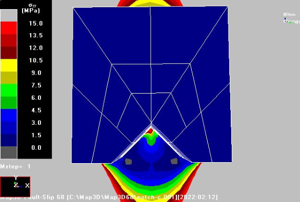

Utilise des éléments de frontière d'ordre supérieur pendant l'analyse BEM de Map3D.

La méthode des éléments de frontière utilise une approximation numérique de la façon dont l'intensité des composantes de surface de la contrainte ou de la discontinuité de déplacement est répartie sur les frontières. L'hypothèse la plus simple consiste à supposer que ces composantes de surface sont réparties uniformément sur chaque élément de frontière. L'expérience acquise avec Map3D montre que cette approximation donne des résultats précis pour tous les problèmes, sauf une classe limitée où les effets de flexion sont importants. Même pour ce dernier type de problème, les résultats restent précis partout, sauf près des surfaces de frontière.

Pour obtenir des résultats précis près des frontières dans les problèmes où les effets de flexion sont importants, il faut recourir à des éléments de frontière d'ordre supérieur. Les effets de flexion deviennent normalement importants pour les problèmes comportant de grandes portées de forme irrégulière. Cela est particulièrement important près des angles vifs de la frontière, qui peuvent résulter des intersections entre diverses entités.

Lorsque ni **linear** ni **quad** n'est coché, l'intensité des composantes de surface de la contrainte ou de la discontinuité de déplacement est répartie sous forme de valeurs **constantes**.

Lorsque l'option **linear** est cochée, l'intensité des composantes de surface de la contrainte ou de la discontinuité de déplacement est répartie sur les éléments de frontière selon une distribution polynomiale d'ordre linéaire. Pour les triangles, la distribution suivante est utilisée

_a + b x + c y_

Pour les quadrilatères, la distribution suivante est utilisée

_a + b x + c y + d xy_

Lorsque l'option **quad** est cochée, l'intensité des composantes de surface de la contrainte ou de la discontinuité de déplacement est répartie sur les éléments de frontière selon une distribution polynomiale d'ordre quadratique. Pour les triangles, la distribution suivante est utilisée

_a + b x + c y + d x_ ² _+ e xy + f y_ ²

Pour les quadrilatères, la distribution suivante est utilisée

_a + b x + c y + d x_ ² _+ e xy + f y_ ² _+ g x_ ²y _+ h x_ ² _y_ ² _+ i y_ ²x

Notes :

Cette fonction doit être cochée avant de lancer l'analyse BEM de Map3D

#### Analysis > BEM Analysis

Cette option augmente la taille du problème et donc le temps d'analyse, car les éléments d'ordre supérieur exigent davantage de nœuds d'interpolation sur les surfaces de frontière.

Si vous ignorez la sensibilité de votre modèle à cette approximation, il est conseillé d'exécuter un sous-ensemble du modèle réel avec et sans éléments linéaires, afin de les comparer.

Dans l'exemple ci-dessous, une excavation avec une entaille est illustrée. La contrainte verticale est tracée en isovaleurs pour les trois cas : ni **linear** ni **quad**, puis **linear**, puis **quad**. Notez la concentration de contraintes anormale à la pointe de l'entaille avec la distribution constante. Cet effet est éliminé avec la distribution **linear**, et encore réduit avec la distribution **quad**.

#### Distribution linear

Distribution **quad**

