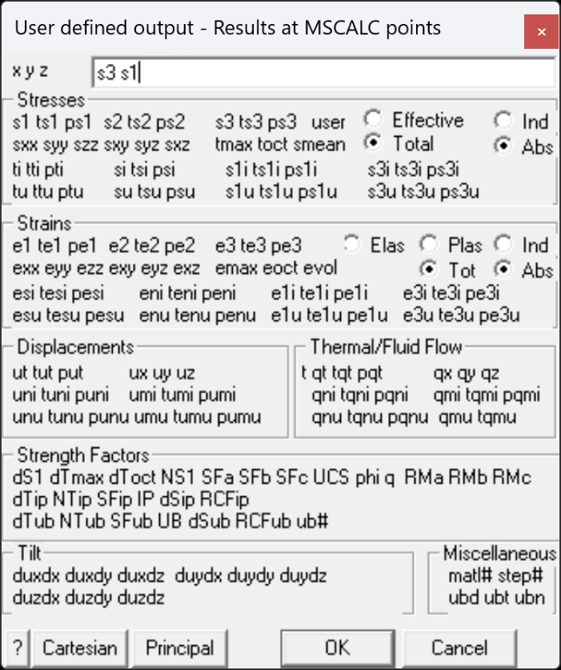

Calcule les résultats en des points définis par l'utilisateur pendant l'analyse BEM de Map3D.

Les résultats d'analyse peuvent être calculés à des emplacements dont les coordonnées sont définies par l'utilisateur.

Lorsque vous sélectionnez MSCALC, le programme vous demande un nom de fichier de données et le format de sortie souhaité, comme suit.

#### Format du fichier de données :

Le fichier de données est simplement un fichier texte (*.txt) contenant la liste des coordonnées des emplacements où les résultats doivent être calculés.

Ce fichier exige un jeu de coordonnées par ligne

x1 y1 z1 x2 y2 z2 x3 y3 z3 x4 y4 z4 ...

où x y z représentent les coordonnées de chaque point.

Si vous le souhaitez, vous pouvez spécifier x y z dipub ddrub Et vous pouvez aussi spécifier x y z dipub ddrub so phi

Ici, dipub ddrub représentent respectivement le pendage et la direction de pendage du plan UB souhaité

- ils ne sont utilisés que si vous calculez certaines composantes UB telles que su tu

so et phi représentent respectivement la cohésion et l'angle de frottement

- ils ne sont utilisés que si vous calculez certains paramètres de résistance UB tels que sfu rcfu dsu ntu

#### Format du fichier de sortie :

Les résultats sont réécrits dans le même fichier de données, avec les coordonnées x y z suivies des paramètres spécifiés par l'utilisateur.

#### Contraintes :

s1 ts1 ps1 contrainte principale majeure s1, sa direction (trend) et son plongement (plunge). s2 ts2 ps2 contrainte principale intermédiaire s2, sa direction et son plongement. s3 ts3 ps3 contrainte principale mineure s3, sa direction et son plongement. user Valeur définie par l'utilisateur. sxx syy szz sxy syz sxz Composantes cartésiennes de la contrainte. tmax contrainte de cisaillement maximale tmax=½ ( s1 - s3 ) toct contrainte de cisaillement octaédrique toct=¹/3 [( s1 - s2 )² + ( s2 - s3 )² +( s3 - s1 )²]1/2 smean contrainte moyenne smean=¹/3 ( s1 + s2 + s3 ) ti tti pti contrainte de cisaillement maximale dans le plan de la grille, sa direction et son plongement. si tsi psi contrainte normale au plan de la grille, sa direction et son plongement. s1i ts1i ps1i contrainte maximale tangentielle au plan de la grille, sa direction et son plongement. s3i ts3i ps3i contrainte minimale tangentielle au plan de la grille, sa direction et son plongement. tu ttu ptu contrainte de cisaillement maximale dans le plan ubiquiste, sa direction et son plongement. su tsu psu contrainte normale au plan ubiquiste, sa direction et son plongement. s1u ts1u ps1u contrainte maximale tangentielle au plan ubiquiste, sa direction et son plongement. s3u ts3u ps3u contrainte minimale tangentielle au plan ubiquiste, sa direction et son plongement. L'orientation du plan ubiquiste est spécifiée dans

Plot > Strength Factors > Ubiquitous Parameters Effective/Total composantes de contrainte effective ou de contrainte totale. Ces options ne sont utilisées que dans Map3D Thermal-Fluid Flow, car ce code permet de calculer les distributions de pression interstitielle en régime permanent. Induced/Absolute La contrainte induite est la contrainte sans la contribution de la contrainte avant exploitation. Elle représente la variation de contrainte depuis l'état avant exploitation. La contrainte absolue est la contrainte incluant la contribution de la contrainte avant exploitation.

#### Déformations :

e1 te1 pe1 déformation principale majeure e1, sa direction et son plongement. e2 te2 pe2 déformation principale intermédiaire e2, sa direction et son plongement. e3 te3 pe3 déformation principale mineure e3, sa direction et son plongement. exx eyy ezz exy eyz exz Composantes cartésiennes de la déformation. emax déformation de cisaillement maximale emax=½ ( e1 - e3 ) eoct déformation de cisaillement octaédrique eoct=¹/3 [( e1 - e2 )² + ( e2 - e3 )² +( e3 - e1 )²]1/2 evol déformation volumique evol=( e1 + e2 + e3 ) esi tesi pesi déformation de cisaillement maximale dans le plan de la grille, sa direction et son plongement. eni teni peni déformation normale au plan de la grille, sa direction et son plongement. e1i te1i pe1i déformation maximale tangentielle au plan de la grille, sa direction et son plongement. e3i te3i pe3i déformation minimale tangentielle au plan de la grille, sa direction et son plongement. esu tesu pesu déformation de cisaillement maximale dans le plan ubiquiste, sa direction et son plongement. enu tenu penu déformation normale au plan ubiquiste, sa direction et son plongement. e1u te1u pe1u déformation maximale tangentielle au plan ubiquiste, sa direction et son plongement. e3u te3u pe3u déformation minimale tangentielle au plan ubiquiste, sa direction et son plongement. Elastic/Plastic/Total composantes de déformation élastique, plastique ou totale. Ces options ne sont utilisées que dans Map3D Non-Linear, car ce code permet de calculer les déformations non linéaires. Induced/Absolute La déformation induite est la déformation sans la contribution avant exploitation. Elle représente la variation de déformation depuis l'état avant exploitation. La déformation absolue est la déformation incluant la contribution avant exploitation.

#### Déplacements :

ut tut put déplacement total, sa direction et son plongement. ux uy uz Composantes cartésiennes du déplacement. uni tuni puni déplacement normal au plan de la grille, sa direction et son plongement. umi tumi pumi déplacement maximal tangentiel au plan de la grille, sa direction et son plongement. unu tunu punu déplacement normal au plan ubiquiste, sa direction et son plongement. umu tumu pumu déplacement maximal tangentiel au plan ubiquiste, sa direction et son plongement.

#### Écoulement :

t température/charge hydraulique.

qt tqt pqt écoulement total, sa direction et son plongement. qx qy qz Composantes cartésiennes de l'écoulement.

qni tqni pqni déplacement normal au plan de la grille, sa direction et son plongement.

qmi tqmi pqmi déplacement maximal tangentiel au plan de la grille, sa direction et son plongement. qnu tqnu pqnu déplacement normal au plan ubiquiste, sa direction et son plongement. qmu tqmu pqmu déplacement maximal tangentiel au plan ubiquiste, sa direction et son plongement.

#### Résistance :

- ds1 contrainte principale majeure excédentaire Ds1 = s1 - ( _UCS_ + _q_ s3 )

- dtmax contrainte de cisaillement maximale excédentaire Dtmax = ½(s1 - s3) - [ _UCS_ + ½(s1+s3) ( _q_ -1) ]/( _q_ +1) = [s1 - ( _UCS_ + _q_ s3) ]/( _q_ +1)

- dtoct contrainte de cisaillement octaédrique excédentaire Dtoct = toct - [ _UCS_ + ( _q_ –1) smean ] Ö(2) /( _q_ +2)

- NS1 probabilité selon la loi normale N(Ds1 /std)

- SF-A La résistance/contrainte peut être déterminée comme ( _UCS_ + _q_ s3 )/ s1

- SF-B La résistance/contrainte peut être déterminée comme ( _UCS_ + _q_ s3 - s3 )/(s1 - s3)

- SF-C La résistance/contrainte peut être déterminée comme [ _UCS_ + ½(s1+s3) ( _q_ -1) ]/[ ½(s1 - s3)( _q_ +1) ]

- dTip contrainte de cisaillement excédentaire dans le plan Dtip = tip - [ Cohesion + sip tan(j) ]

- NTip probabilité selon la loi normale N(Dtip /std)

- SFip La résistance/contrainte peut être déterminée comme [ Cohesion + sip tan(j) ] / tip

- dSip contrainte excédentaire sur la paroi dans le plan Dsip = [ 3 s1i - s3i ] - UCS

- RCFip Facteur d'état du rocher (Rock Condition Factor) pour la contrainte sur la paroi dans le plan RCFip = [ 3 s1i - s3i ]/UCS

- dTub contrainte de cisaillement excédentaire dans le plan ubiquiste Dtub

- NTub probabilité selon la loi normale N(Dtub /std)

- SFub La résistance/contrainte peut être déterminée comme [ Cohesion + sub tan(j) ] / tub

- dSub contrainte excédentaire sur la paroi dans le plan ub Dsub = [ 3 s1ub - s3ub ] - UCS

- RCFub Facteur d'état du rocher pour la contrainte sur la paroi dans le plan ub RCFip = [ 3 s1ub - s3ub ]/UCS

- UB# Trace le numéro de famille UB (1, 2 ou 3) qui présente la plus grande valeur de Dtub

#### Divers :

matl# numéro du matériau dans lequel le point est situé. Le matériau encaissant porte le numéro 1. Dans les problèmes qui utilisent plusieurs matériaux, les résultats peuvent être calculés dans une zone de matériau alternatif.

step# numéro de l'étape d'exploitation.

ubd, ubt, ubn représentent respectivement le pendage, la direction de pendage et la normale du plan ubiquiste.

#### Autres :

Cartesian   configure la sortie des composantes cartésiennes de la contrainte. Principal   configure la sortie des composantes principales de la contrainte.

#### Notes :

Cette fonction doit être cochée avant de lancer l'analyse de discrétisation

Analysis > Discretization.

Vous pouvez spécifier autant de points que vous le souhaitez.

Le modèle est discrétisé en fonction des emplacements des points spécifiés.
