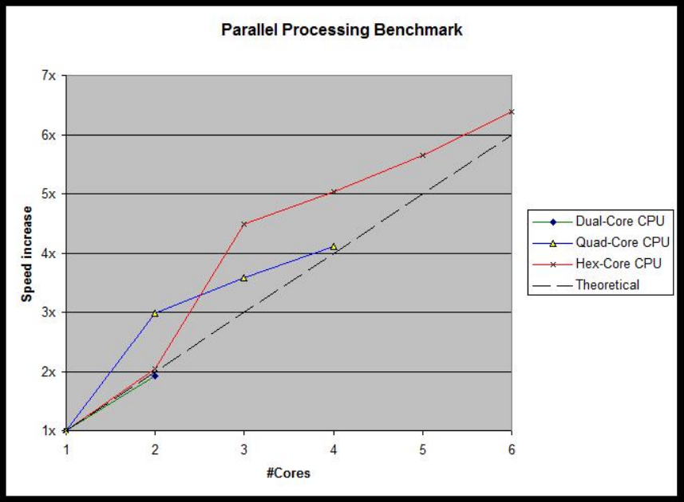

Affiche le nombre de cœurs/threads actifs.

Map3D prend entièrement en charge le calcul parallèle et les E/S disque parallèles avec l'option multiprocesseur/multidisque.

Si votre licence inclut l'option multiprocesseur/multidisque, Map3D exécute toutes les procédures d'analyse en parallèle, réparties entre tous les processeurs disponibles.

**CPU :** Les processeurs récents sont désormais proposés en versions double, quadruple et hexa cœurs. Map3D V58 prend désormais en charge le calcul parallèle, ce qui permet des vitesses de calcul plus élevées. Il en résulte une réduction de plus de 6 fois des temps d'assemblage de la matrice et de la grille. Les ordinateurs multi-CPU iraient encore plus vite.

Le test de performance du calcul parallèle ci-dessous montre clairement que l'on peut s'attendre à ce que les processeurs à deux cœurs soient plus de deux fois plus rapides,

les quadruple cœurs plus de 4 fois plus rapides et les hexa cœurs plus de 6 fois plus rapides. Dans les processeurs avec hyper-threading activé, 2 threads de calcul sont superposés sur le même cœur. C'est la raison pour laquelle Map3D-MP atteint en fait des performances supérieures au maximum théorique.

Pour obtenir ces gains de performance, il faut améliorer la puissance de calcul et/ou le débit d'E/S disque Analysis > Options > Drive #.
