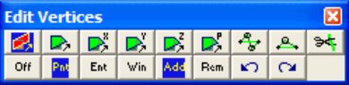

Vous pouvez lancer cette routine en choisissant une fonction de modification (par exemple un bouton) ou simplement en cliquant avec le bouton droit sur un sommet.

Lorsque vous lancez une routine de modification d'entités, vous êtes d'abord invité à créer la liste des sommets à modifier.

   - Si Tools > Shift-key Selection est coché, vous devez maintenir la touche Shift enfoncée pour effectuer des sélections multiples.

   - Par défaut, les entités sélectionnées sont ajoutées à la liste. Toutefois, si vous maintenez la touche Ctrl enfoncée, les entités sélectionnées sont retirées de la liste.

   - Tout en maintenant la touche Shift ou Ctrl enfoncée, vous pouvez tracer une fenêtre de sélection.

   - Appuyer sur la barre d'espace active automatiquement la dernière fonction de modification utilisée.

- Maintenir la touche Alt enfoncée lorsque vous cliquez avec le bouton droit répète automatiquement la dernière fonction de modification utilisée.

Cette barre d'outils commande les différentes fonctions utilisées pour créer la liste.

Interrompt la modification.

Sélectionne des sommets un par un.

Sélectionne des sommets par groupes.

Inclut toutes les entités situées dans la fenêtre sélectionnée.

- Les entités ne sont sélectionnées que si l'entité entière est contenue dans la fenêtre.

- Vous pouvez aussi activer cette fonction en maintenant la touche Shift ou Ctrl enfoncée et en traçant une fenêtre d'intersection.

Les entités sélectionnées sont ajoutées à la liste.

Les entités sélectionnées sont retirées de la liste.

Annule la dernière sélection.

Rétablit la dernière sélection.

Une fois les entités souhaitées sélectionnées, vous pouvez choisir l'un des boutons de modification :

CAD > Edit > Stretch Vertices

CAD > Edit > Move Vertices to Point

CAD > Edit > Move Vertices to X CAD > Edit > Move Vertices to Y CAD > Edit > Move Vertices to Z CAD > Edit > Move Vertices to Plane CAD > Edit > Smooth Construction Lines CAD > Edit > Remove Construction Vertex CAD > Edit > Subdivide Construction Lines

- double-cliquez sur un sommet pour exécuter la fonction en surbrillance,

- cliquez avec le bouton droit pour afficher une liste d'options.

Une fois toute opération de modification terminée, vous avez une seule possibilité d'annuler les modifications en sélectionnant

#### Undo

Vous pouvez aussi restaurer le même ensemble de sélection et modifier à nouveau le même ensemble d'entités en sélectionnant

Redo

Vous pouvez ajuster le délai du double-clic avec

Tools > Double Click Time
