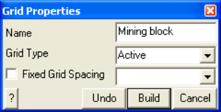

Modifie le nom de la grille et l'espacement maximal.

Lorsque vous lancez cette routine, vous êtes d'abord invité à créer la liste des entités à modifier

- Si Tools > Shift-key Selection est coché, vous devez maintenir la touche Shift enfoncée pour effectuer des sélections multiples.

- L'utilisation de cette barre d'outils est détaillée dans Build A List of Entities for Editing

- Appuyer sur la barre d'espace active automatiquement la dernière fonction de modification utilisée.

Une fois les entités souhaitées sélectionnées, vous pouvez choisir l'un des boutons de modification :

CAD > Edit > Entity Properties Modifie le type de bloc, la couleur, la séquence d'exploitation, CAD > Edit > Erase Entities Efface les entités sélectionnées, CAD > Edit > Move Entities Déplace les entités sélectionnées, CAD > Edit > Copy Entities Copie les entités sélectionnées, CAD > Edit > Scale Entities Met à l'échelle les entités sélectionnées, CAD > Edit > Rotate Azimuth Fait pivoter l'azimut des entités sélectionnées, CAD > Edit > Rotate Dip Fait pivoter le pendage des entités sélectionnées, CAD > Edit > Dump to File Exporte les entités sélectionnées dans un fichier, CAD > Edit > Group Regroupe les entités sélectionnées en un seul bloc,

- double-cliquez sur un sommet pour exécuter la fonction en surbrillance,

- cliquez avec le bouton droit pour afficher une liste d'options.

Si l'un des champs de la boîte de dialogue indique « Variable », c'est que certains des blocs sélectionnés ont des propriétés différentes pour ce champ. Pour conserver ces propriétés telles quelles (c'est-à-dire différentes pour chaque bloc), laissez le champ sur « Variable ». Pour modifier la valeur de ce champ pour tous les blocs sélectionnés, saisissez la valeur souhaitée.

Name - spécifie un nom descriptif pour la grille.

Grid Type - indique si la grille doit être active (utilisée dans l'analyse des contraintes) ou inactive (non utilisée dans l'analyse des contraintes).

Maximum Spacing - spécifie l'espacement maximal autorisé.

- Ce paramètre permet d'imposer une discrétisation fine et uniforme sur les grilles sélectionnées. Faites preuve d'une très grande prudence en spécifiant cette valeur, car une petite valeur peut facilement conduire à un problème de taille énorme.

- En général, laissez ce paramètre vide (c'est-à-dire non utilisé) et laissez la discrétisation au paramètre _AG_. Ce dernier paramètre concentre les éléments uniquement là où des résultats d'analyse sont demandés, ce qui optimise l'utilisation des éléments et réduit la taille du problème.

CAD > Properties Control Parameters.

- Si ce champ est laissé vide, ce paramètre n'est pas utilisé.

OK - termine la modification des blocs et applique les propriétés qui ont été modifiées.

Cancel - interrompt la modification des entités.

Une fois toute opération de modification terminée, vous avez une seule possibilité d'annuler les modifications en sélectionnant

Undo

Vous pouvez aussi restaurer le même ensemble de sélection et modifier à nouveau le même ensemble d'entités en sélectionnant

Redo

Vous pouvez ajuster le délai du double-clic avec

Tools > Double Click Time
