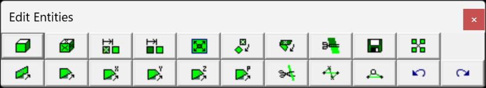

Active la barre d'outils Edit.

Cette barre d'outils donne un accès rapide aux fonctions de modification utilisées lors de l'étape de construction et de modification du modèle de l'analyse BEM Map3D Analysis > Go to CAD

Les fonctions de modification sont regroupées en deux sections, selon que vous souhaitez modifier des blocs ou des coordonnées.

#### Modifier les blocs :

CAD > Edit > Entity Properties Modifie le type de bloc, la couleur, la séquence d'exploitation, etc. CAD > Edit > Erase Entities Efface les entités sélectionnées. CAD > Edit > Move Entities Déplace les entités sélectionnées. CAD > Edit > Copy Entities Copie les entités sélectionnées. CAD > Edit > Scale Entities Met à l'échelle les entités sélectionnées.

CAD > Edit > Rotate Azimuth Fait pivoter l'azimut des entités sélectionnées.

CAD > Edit > Rotate Dip Fait pivoter le pendage des entités sélectionnées. CAD > Edit > Slice Entities Découpe les entités sélectionnées.

CAD > Edit > Dump to File Exporte les entités sélectionnées dans un fichier. CAD > Edit > Group Regroupe les entités sélectionnées en un seul bloc.

#### Modifier les coordonnées :

CAD > Edit > Stretch Vertices Étire les sommets sélectionnés. CAD > Edit > Move Vertices to Point Déplace les sommets sélectionnés vers un point. CAD > Edit > Move Vertices to X Déplace la coordonnée x des sommets sélectionnés. CAD > Edit > Move Vertices to Y Déplace la coordonnée y des sommets sélectionnés. CAD > Edit > Move Vertices to Z Déplace la coordonnée z des sommets sélectionnés. CAD > Edit > Move Vertices to Plane Déplace les sommets sélectionnés vers un plan.

CAD > Edit > Subdivide Construction Lines Subdivise une ligne de construction.

CAD > Edit > Smooth Construction Lines Lisse les lignes de construction. CAD > Edit > Remove Construction Vertex Supprime un sommet de construction.

#### Undo - Redo

Une fois toute opération de modification terminée, vous avez une seule possibilité d'annuler les modifications en sélectionnant

#### Undo

Vous pouvez aussi restaurer le même ensemble de sélection et modifier à nouveau le même ensemble d'entités en sélectionnant

Redo

Appuyer sur la barre d'espace active automatiquement la dernière fonction de modification utilisée.
