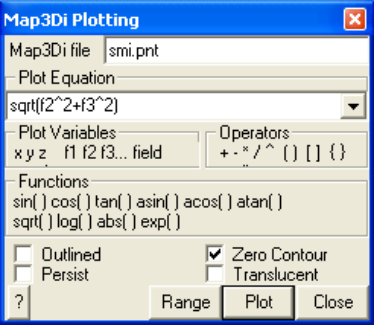

Cette option permet de visualiser les données Map3Di.

#### Map3Di File:

Le fichier de données Map3Di est simplement un fichier de données ASCII dont l'extension par défaut est « .PNT ».

Consultez CAD > Properties > Map3Di pour plus de détails sur le format des données.

Consultez Visualization > Plane > Make Map3Di File pour plus de détails sur le format des données.

#### Plot Equation:

Définit le paramètre qui sera tracé.

La liste déroulante permet de stocker jusqu'à 20 équations différentes. Elles sont conservées entre les sessions Map3D dans le fichier map3d.ini.

#### Plot Variables:

f1 f2 f3… - champs de données du fichier d'événements.

#### Functions:

sin() cos() tan() - fonctions trigonométriques sinus, cosinus et tangente. asin() acos() atan() - fonctions trigonométriques inverses. sqrt() - fonction racine carrée. log() - fonction logarithme népérien. abs() - valeur absolue.

exp() - fonction exponentielle (antilogarithme).

#### Location:

x y z - coordonnées du point de grille.

#### Operators:

+ - * / ^   opérateurs d'addition, de soustraction, de multiplication, de division et d'exponentiation. Notez que les exponentielles sont calculées en premier, suivies des multiplications et divisions, puis des additions et soustractions.

() [] &#123;&#125;   types de parenthèses. Les parenthèses doivent être appariées.

>   valeur maximale. Par exemple, si l'équation de tracé est spécifiée comme f1 > 10, la plus grande des valeurs f1 ou 10 sera tracée.

&lt;   valeur minimale. Par exemple, si l'équation de tracé est spécifiée comme f1 &lt; 10, la plus petite des valeurs f1 ou 10 sera tracée.

#### Point Plotting Options:

Outlined – les zones de données Map3Di sont délimitées par un contour.

#### Other:

Persist – lorsque cette option est cochée, les points sont retracés chaque fois que le modèle est réorienté, déplacé ou zoomé. Comme cela peut prendre du temps pour les grands modèles, cette option n'est pas toujours souhaitable. Translucent - dessine les points sous forme de sphères translucides.

Zero Contour - lorsque cette option est décochée, les contours inférieurs à la plage de contours minimale ne sont pas tracés. Cela est utile pour afficher des contours dont seule la partie supérieure de la plage est importante. Range – spécifie le minimum, le maximum et l'intervalle pour la mise à l'échelle des rayons et le tracé des contours.

Plot - régénère le tracé. Ce bouton peut être placé soit dans la barre d'outils View (Tools > View Toolbar Configure), soit dans la barre d'outils Contour (Tools > Contour Toolbar Configure).
