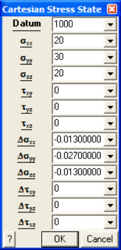

L'état de contrainte avant exploitation est spécifié comme une variation linéaire avec la profondeur, en composantes cartésiennes ou principales.

La variation de chacune des composantes cartésiennes est décrite comme une variation linéaire avec la profondeur, par exemple pour la composante sxx :

- sxx + Dsxx ( _z_ - _Datum_ )

Pour déterminer les valeurs appropriées de chacune de ces composantes, vous devez d'abord choisir une profondeur

- ( _z_ = _Datum_ )

où les contraintes ont des valeurs connues. Ces dernières valeurs sont les

sxx  syy  szz  txy  tyz  txz

valeurs constantes.

La variation de chaque composante avec la profondeur peut ensuite être spécifiée par les

Dsxx  Dsyy  Dszz  Dtxy  Dtyz  Dtxz

valeurs de variation. Si vous avez configuré votre système de coordonnées avec _z_ positif vers le haut, les variations doivent être spécifiées comme des quantités négatives afin que les contraintes augmentent avec la profondeur.

Par exemple, si vous savez que la composante sxx a une valeur de

30 MPa à _z_ = -1000m

et varie comme suit ( _z_ est positif vers le haut)

- 0.027 MPa/m

vous spécifieriez

Datum = -1000 sxx = 30 Dsxx = -0.027
