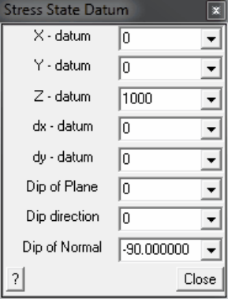

La variation de chacune des composantes de contrainte est décrite comme une variation linéaire, en composantes principales ou cartésiennes.

Si vous le souhaitez, vous pouvez la spécifier comme une variation dans les directions x, y et z en définissant un niveau de référence incliné. Cette option est destinée aux sites où la topographie présente une pente dominante.

Pour définir un niveau de référence incliné, vous devez spécifier un point du plan qui représente le niveau de référence ( _X-datum_ , _Y-datum_ et _Z-datum_ ),

ainsi que la pente du plan. La pente est spécifiée sous forme de gradient dans les directions X ( _dx-datum_ ) et Y ( _dydatum_ ).

Pour plus de commodité, la pente du plan peut être spécifiée à l'aide du « pendage » et de la « direction de pendage » du plan, ou de la « direction de pendage » et du « pendage de la normale » au plan. Les gradients sont déterminés automatiquement à partir de ces dernières valeurs comme suit :

_dx-datum_ = -sin(q) sin(j) _dy-datum_ = -cos(q) sin(j)

d'où

tan(q)= _dx/dy_ tan(j)=sqrt( _dx_ ^2+ _dy_ ^2)

Ainsi définies, les contraintes varient à la fois avec la profondeur et avec la position horizontale.
