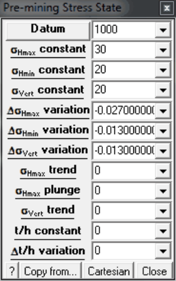
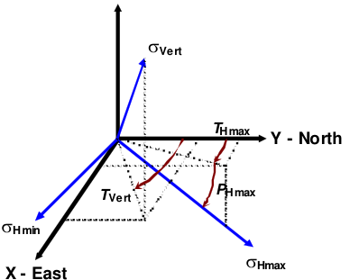

Datum - L'état de contrainte avant exploitation est spécifié comme une variation linéaire avec la profondeur, en composantes principales ou cartésiennes.

Copy from... - permet de copier l'état de contrainte d'un autre matériau.

- Seul l'état de contrainte est copié.

- Les autres propriétés du matériau restent inchangées.

Cartesian - L'état de contrainte avant exploitation est spécifié comme une variation linéaire avec la profondeur, en composantes principales ou cartésiennes.

Les trois composantes de contrainte principale sont appelées composantes _Hmax_ , _Hmin_ et _Vert_ .

- sHmax est la contrainte (quasi) horizontale maximale.

- sHmin est la contrainte (quasi) horizontale minimale.

- sVert est la contrainte (quasi) verticale.

Ces composantes de contrainte sont perpendiculaires entre elles.

Les composantes horizontales et la composante verticale n'ont pas besoin d'être exactement horizontales ou verticale. La direction et le plongement de sHmax peuvent être ajustés avec _THmax_ et _PHmax_ . La direction de sVert peut être ajustée avec _TVert_ .

La variation de chacune de ces composantes est décrite comme une variation linéaire avec la profondeur, par exemple pour la composante sHmax :

sHmax + DsHmax ( _z_ - _Datum_ )

Pour déterminer les valeurs appropriées de chacune de ces composantes, vous devez d'abord choisir une profondeur _z_ où les contraintes ont des valeurs connues.

_Datum_ doit être fixé à cette valeur de _z_.

L'amplitude de la contrainte à cette profondeur est spécifiée par les valeurs constantes suivantes

sHmax sHmin sVert

La variation de chaque composante avec la profondeur peut ensuite être spécifiée par les valeurs de variation suivantes

DsHmax DsHmin DsVert

Si vous avez configuré votre système de coordonnées avec _z_ positif vers le haut, les variations doivent être spécifiées comme des quantités négatives afin que les contraintes augmentent avec la profondeur.

Par exemple, si vous savez que la composante _Hmax_ a une valeur de

30 MPa à _z_ = 1000m

et varie comme suit ( _z_ est positif vers le haut)

0.027 MPa/m

vous spécifieriez

Datum = 1000 sa = 30 Dsa = -0.027

Enfin, la direction et le plongement de la composante _Hmax_ ainsi que la direction de la composante _Vert_ définissent de façon unique l'orientation de l'état de contrainte.

Les paramètres

valeur constante _t/h_

variation D _t/h_

se rapportent à la distribution de la température ambiante ou de la charge hydraulique et sont spécifiés de la même manière que les contraintes.
