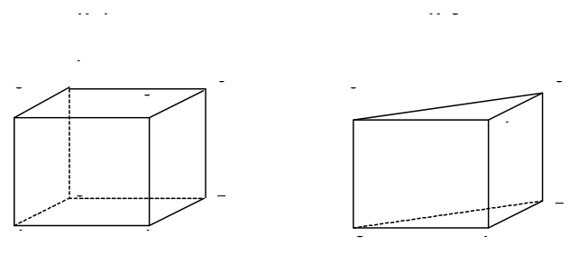
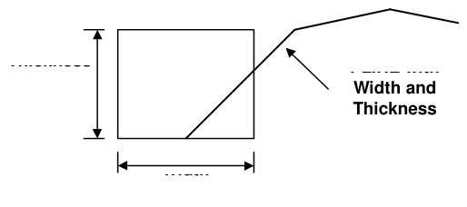
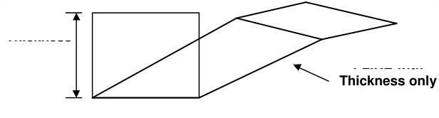
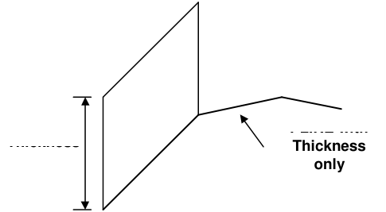
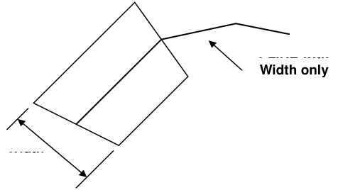
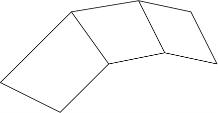
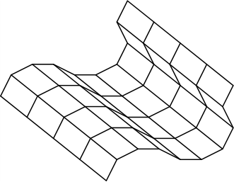

Le format DXF est un fichier d'échange de dessins AutoCAD dont l'extension est « .DXF ».

Ce format est utile pour échanger des données de modèle avec d'autres logiciels de CAO.

#### Entités AutoCAD de type bloc tridimensionnel

La méthode la plus fiable pour générer des données compatibles avec Map3D consiste à utiliser des entités AutoCAD tridimensionnelles. Ce type d'entité génère des blocs dont la structure est identique à celle des blocs FF 3D de Map3D, qui peuvent donc être transmis directement à Map3D. La fermeture de toutes les surfaces est garantie avec cette commande, puisque chaque entité tridimensionnelle définit un bloc fermé. Il existe de nombreuses façons de générer de tels objets dans AutoCAD, comme décrit ci-dessous.

#### 3DMESH

La méthode recommandée pour définir des entités AutoCAD tridimensionnelles consiste à utiliser la commande 3DMESH, avec les valeurs THICKNESS et WIDTH d'AutoCAD fixées à zéro. Ces 3DMESH peuvent être spécifiés avec n'importe quelles valeurs de M et N. Si N est égal à 3 ou 4, ces entités sont importées dans Map3D sous forme de blocs. Cette approche est la plus générale, mais aussi la plus complexe à spécifier, car il faut définir la disposition du plancher et du toit de la galerie sur toute sa longueur.

#### PLINE, POLYLINE ou ELLIPSE avec WIDTH et THICKNESS

La technique la plus simple pour générer une galerie ou un chantier de section rectangulaire régulière et de hauteur uniforme consiste à utiliser la commande PLINE d'AutoCAD. Vous définissez simplement un UCS AutoCAD (système de coordonnées utilisateur) pour la galerie, puis la ligne médiane de la galerie à l'élévation du plancher avec la commande PLINE. La largeur de la galerie est ensuite spécifiée avec la commande PEDIT d'AutoCAD. Vous pouvez spécifier soit une largeur constante, soit une largeur variable à chaque sommet. Le COLOUR d'AutoCAD (numéro de bloc Map3D) et le THICKNESS d'AutoCAD (hauteur de la galerie) sont spécifiés avec la commande CHANGE PROPERTIES d'AutoCAD. Les commandes POLYLINE et ELLIPSE d'AutoCAD peuvent aussi servir à créer des galeries avec des valeurs WIDTH et THICKNESS spécifiées.

#### PLINE, POLYLINE ou SOLID avec THICKNESS uniquement

Une autre méthode simple pour définir des galeries ou des chantiers de section rectangulaire consiste à utiliser l'une des commandes PLINE, POLYLINE ou SOLID d'AutoCAD avec un THICKNESS spécifié (hauteur de la galerie) et un WIDTH d'AutoCAD fixé à zéro (voir la figure 32). Bien que cette approche soit plus générale que PLINE, elle est aussi plus complexe à spécifier, car il faut définir le plan au sol de la galerie sur toute sa longueur. Si vous utilisez les commandes PLINE ou POLYLINE d'AutoCAD, vous devez former une boucle fermée de 3 ou 4 segments de ligne.

#### Autres entités AutoCAD tridimensionnelles

AutoCAD fournit des routines pour générer plusieurs objets tridimensionnels, notamment des sphères, des tores, des boîtes, des cônes, etc. Vous pouvez tous les utiliser si vous le souhaitez. Il vous incombe de fermer les extrémités ouvertes de formes telles que les hémisphères et les cônes.

#### Entités AutoCAD de type plaque bidimensionnelle

Vous pouvez aussi spécifier des données compatibles avec Map3D à l'aide d'entités AutoCAD bidimensionnelles. Cette technique est moins fiable que les méthodes décrites ci-dessus, car la fermeture de toutes les surfaces n'est plus garantie. Vous devez définir les excavations à l'aide d'une série de plaques de surface (toutes affectées du même numéro de couleur AutoCAD), qui doivent se rejoindre le long de leurs arêtes et envelopper complètement l'excavation d'une peau de surface continue. Ces surfaces ont une structure identique à celle des plaques de surface de Map3D. La fermeture de toutes les surfaces n'est pas garantie avec cette méthode, puisque vous pouvez omettre un morceau de surface et ainsi créer un trou dans la surface de l'excavation. Vous devez veiller à placer toutes les plaques de sorte que toutes les surfaces se ferment parfaitement.

#### LINE, PLINE, 3DPOLY, POLYLINE et ELLIPSE - THICKNESS uniquement

Ces entités permettent de définir des plaques bidimensionnelles. Vous définissez simplement un UCS AutoCAD (système de coordonnées utilisateur) pour la plaque, puis le bord de la plaque avec l'une des commandes LINE, PLINE, 3DPOLY, POLYLINE ou ELLIPSE d'AutoCAD. Le COLOUR d'AutoCAD (numéro de bloc Map3D) et le THICKNESS d'AutoCAD (largeur de la plaque) sont spécifiés avec la commande CHANGE PROPERTIES d'AutoCAD. Le WIDTH d'AutoCAD doit être fixé à zéro.

#### LINE, PLINE, 3DPOLY, POLYLINE et ELLIPSE avec WIDTH uniquement

Avec ces entités, vous définissez la ligne médiane de la plaque à l'aide de l'une des commandes LINE, PLINE, 3DPOLY, POLYLINE ou ELLIPSE d'AutoCAD. La largeur est ensuite spécifiée avec la commande PEDIT d'AutoCAD. Vous pouvez spécifier soit une largeur constante, soit une largeur variable à chaque sommet. Le THICKNESS d'AutoCAD doit être fixé à zéro.

#### 3DFACE, POLYLINE ou LWPOLYLINE

Vous pouvez aussi générer des surfaces bidimensionnelles avec la commande 3DFACE d'AutoCAD. Cette méthode est plus générale, mais comme tous les coins de la 3DFACE d'AutoCAD doivent être spécifiés, elle est aussi plus complexe.

#### 3DMESH

Vous pouvez générer des surfaces bidimensionnelles complexes à l'aide de types de 3DMESH avec N supérieur à 4 (par exemple Rulesurf, Tabsurf, Revsurf, etc.). Pour ces formes, la routine de conversion DXF crée une série de 3DFACE pour décrire la surface de l'excavation. Ces surfaces ont une structure identique à celle des plaques de surface de Map3D. Dans ces cas, il est assez facile d'assurer la fermeture des surfaces en raison de la régularité de la construction.

#### Entités AutoCAD non prises en charge

Un certain nombre d'entités AutoCAD ne sont pas prises en charge, c'est-à-dire que Map3D n'a pas été conçu pour les reconstruire telles qu'elles apparaissent dans AutoCAD. Ces entités comprennent les entités CIRCLE, ARC et DOUGHNUT. Ces entités pourraient être prises en charge dans de futures mises à jour de Map3D. Notez que la plupart des formes peuvent être générées par d'autres moyens à l'aide de la commande ELLIPSE ou de la commande 3DMESH d'AutoCAD.

#### Données d'entité étendues AutoCAD DXF (EXTENDED ENTITY DATA)

Les données d'entité étendues DXF (EXTENDED ENTITY DATA, EED) font partie de la spécification DXF. Les EED permettent d'étiqueter chaque ENTITY DXF avec des attributs de données personnalisés. Vous trouverez ci-dessous la liste des EED prises en charge par Map3D.

La plupart des systèmes de CAO permettent d'ajouter ces EED à votre DXF. Par exemple, Deswik les appelle « attributs ». Depuis Deswik, vous pouvez donc créer des géométries Map3D, y compris la spécification des noms de blocs, des couleurs et de la séquence d'exploitation Map3D :

- Exportez chaque bloc avec DXF-POLYLINE/POLYFACEMESH - c'est le réglage par défaut de Deswik.

- Il est recommandé de ne pas utiliser DXF-3DFACE.

- Dans Deswik, les attributs sont exportés vers le DXF sous forme d'AutoCAD Extended Entity Data.

- Les noms d'attributs (ils ne sont pas sensibles à la casse) sont définis comme suit : `o` MAP3D_BLOCKNAME - nom du bloc (par défaut, vide).

   - MAP3D_BLOCKCOLOR ou MAP3D_BLOCKCOLOUR - numéro de couleur Map3D (par défaut, le numéro de couleur défini par Deswik).

   - MAP3D_BLOCKTYPE - 1 pour FF, 2 pour DD, 98 pour FF inactif, 99 pour DD inactif, 0 pour un plan de grille (par défaut, 1 pour FF).

   - MAP3D_MSTEP# - # est le numéro de l'étape d'exploitation (par défaut, excavé à l'étape 1).

   - Ø Par exemple, pour excaver à l'étape d'exploitation 2, créez un attribut nommé MAP3D_MSTEP2, puis spécifiez 0 (excavation) comme valeur de l'attribut.

   - Ø Par exemple, pour remblayer à l'étape d'exploitation 3, créez un attribut nommé MAP3D_MSTEP3, puis spécifiez 4 (où est le numéro de matériau représentant le remblai) comme valeur de l'attribut.

   - MAP3D_BLOCKNUMBER - numéro d'identification unique du bloc (par défaut, un numéro unique différent pour chaque DXF-POLYLINE/POLYFACEMESH ou chaque DXF-3DFACE).

- Les noms d'attributs ne sont pas sensibles à la casse.

- Tous les attributs peuvent être définis comme des chaînes (code de groupe 1000), des entiers (code de groupe 1070 ou 1071) ou des nombres réels (code de groupe 1040).

- Tous les attributs sont facultatifs - des valeurs par défaut sont fournies comme indiqué ci-dessus.

- Notez que si aucun attribut défini par Map3D n'est spécifié, le DXF est lu correctement à condition d'utiliser DXF-POLYLINE/POLYFACEMESH.

- Map3D suppose simplement que chaque DXF-POLYLINE/POLYFACEMESH est un bloc distinct.

- Si vous utilisez plusieurs DXF-3DFACE, Map3D peut avoir du mal à les regrouper en blocs.

- Ces problèmes surviennent uniquement lorsque des blocs adjacents partagent leurs coins et portent le même nom.

- Vous pouvez utiliser MAP3D_BLOCKNUMBER pour identifier les DXF-3DFACE qui appartiennent à des blocs distincts.
