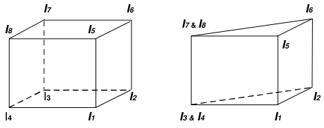
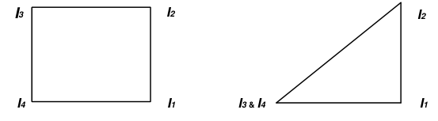
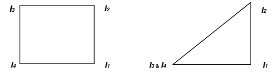
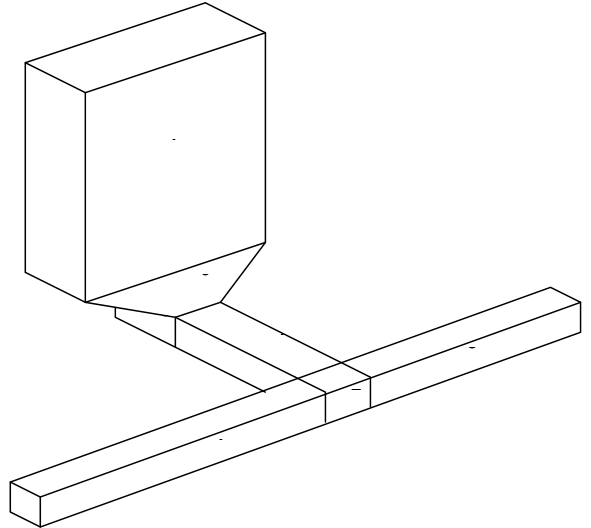
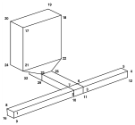
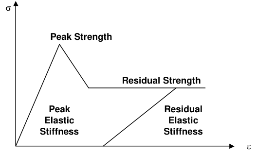

Le format INP est un fichier de données ASCII modifiable dont l'extension est « .INP ».

C'est le format de modèle Map3D recommandé. Toutes les fonctionnalités de Map3D sont prises en charge avec ce format.

Le fichier est organisé en 7 sections :

1. Titre du travail

2. Paramètres de contrôle

3. Spécification des blocs

4. Spécification des coordonnées

5. Spécification des propriétés des matériaux

6. Spécification des grilles

7. Spécification des étapes d'exploitation

Les lignes de commentaire doivent commencer par un astérisque « * » en colonne 1.

Les lignes vides sont ignorées.

La longueur maximale d'une ligne est de 256 caractères.

Vous pouvez séparer les champs de données par des virgules ou des espaces.

#### 1. Titre du travail

Cette section permet de spécifier un titre descriptif pour le projet : 1 ligne de données doit être spécifiée. Les guillemets ne sont pas nécessaires. Seuls les 70 premiers caractères sont utilisés.

#### 2. Paramètres de contrôle

Cette section permet de spécifier les paramètres de contrôle du travail.

#### _NLD,NIT,NPS RPAR,STOL AL,AG DOL,DON DOC,DOE,DOG,DOR_

1 ligne de données doit être spécifiée. Tous les paramètres doivent figurer sur une seule ligne.

Seuls les 7 premiers paramètres ( **_NLD,NIT,NPS  RPAR,STOL  AL,AG_** ) doivent être spécifiés. Les paramètres restants reçoivent des valeurs par défaut, qui peuvent convenir ou non à votre application.

Pour une description détaillée des paramètres, consultez CAD > Properties > Control Parameters

**_NPS_** Cet élément spécifie le nombre de plans de symétrie à utiliser dans l'analyse. Normalement, aucun plan de symétrie n'est utilisé. Si vous utilisez la symétrie, les contraintes en champ lointain (Stress State) doivent être alignées avec l'axe de symétrie.

**_NPS_** =0   aucune symétrie **_NPS_** =1 _x_ &lt;=> _-x_ , la géométrie est réfléchie dans le plan _y-z_ **_NPS_** =2 _x_ &lt;=> _-x_ et _y_ &lt;=> _-y_ , la géométrie est réfléchie dans les plans _y-z_ et _x-z_ **_NPS_** =3 _x_ &lt;=> _-x, y_ &lt;=> _-y_ et _z_ &lt;=> _-z_ , la géométrie est réfléchie dans les plans _y-z_ , _x-z_ et _x-y_

**_RPAR_** Pendant le processus de résolution matricielle, le programme modifie continuellement le paramètre de relaxation afin d'obtenir la convergence avec le moins d'itérations possible. Ce paramètre limite la valeur maximale qui sera utilisée. La valeur suggérée de 1.2 est recommandée pour les problèmes bien conditionnés. Pour les problèmes très mal conditionnés, utilisez une valeur de 0.8.

#### 3. Spécification des blocs

Cette section permet de définir la géométrie du modèle. Les blocs FF 3D et les plans DD sont construits ici.

**_N  'Block_Name' I_ 1** **_,I_ 2** **_,I_ 3** **_,I_ 4** **_I_ 5** **_,I_ 6** **_,I_ 7** **_,I_ 8** **_Type  Thickness,Width_**

1 ligne de données par bloc doit être spécifiée.

Tous les paramètres doivent figurer sur une seule ligne. Seuls les 5 premiers paramètres ( **_N I_ 1** **_,I_ 2** **_,I_ 3** **_,I_ 4** ) doivent être spécifiés. Utilisez **_N_** =0 pour terminer la liste des blocs. Pour une description détaillée des paramètres, consultez

CAD > Build > Block

CAD > Build > FF Loop

#### CAD > Build > DD Loop

- **_N_** spécifie le numéro de couleur du bloc. Il sert à identifier ce bloc lors de la définition des codes de matériaux, ainsi qu'à définir la couleur du bloc à l'affichage graphique. Utilisez des numéros de couleur différents pour représenter des regroupements logiques de blocs (par exemple pour différents niveaux, sections ou unités d'exploitation logiques telles que le développement, l'abattage, etc.). Le plus grand nombre possible de blocs devrait utiliser le même numéro d'identification de bloc.

Un total de 10 couleurs sont disponibles pour l'affichage. Elles sont numérotées respectivement

de 1 à 10, de 11 à 20, de 21 à 30, etc.,

de sorte que la même couleur soit affichée pour les numéros

1, 11, 21...,

- 2, 22, 32...,

3, 23, 33..., etc.

- **_'Block_Name'_** spécifie un nom descriptif pour le bloc (par exemple 4540 stope). Le programme utilise ce nom lorsqu'il fournit des informations concernant le volume du bloc, les erreurs et les avertissements. Le nom du bloc est facultatif, mais s'il est utilisé, il doit figurer entre apostrophes. Seuls les 20 premiers caractères de tout nom de bloc sont utilisés.

- **_I_ 1** **_,I_ 2** **_,I_ 3** **_,I_ 4** **_I_ 5** **_,I_ 6** **_,I_ 7** **_,I_ 8** représentent les numéros des points de coordonnées qui forment les coins du bloc. Ils sont décrits en détail ci-dessous.

- **_Type_** spécifie le type d'élément de frontière à utiliser. Les éléments inactifs (98 pour FF inactif et 99 pour DD inactif) permettent d'afficher des éléments qui ne sont inclus qu'à des fins de visualisation et qui ne servent pas à l'analyse des contraintes proprement dite.

- Pour les éléments tridimensionnels tels que les excavations, les zones de matériaux alternatifs, les chantiers remblayés, etc., il faut utiliser des éléments de **_Type_** =1 (forces fictives).

- Les 4 premiers coins ( **_I_ 1** **_,I_ 2** **_,I_ 3** **_,I_ 4** ) représentent les numéros de coordonnées qui définissent une face (par exemple la base) d'un bloc à 6 faces. Les 4 coins suivants ( **_I_ 5** **_,I_ 6** **_,I_ 7** **_,I_ 8** ) définissent la face opposée du bloc (par exemple le sommet). Vous pouvez saisir les coins dans le sens horaire ou antihoraire. Vous pouvez répéter n'importe quel coin pour définir des formes à 3 faces et des coins. Vous pouvez relier des blocs entre eux pour former des excavations plus grandes et plus complexes en utilisant des numéros de coordonnées communs pour spécifier les blocs adjacents.

- Si vous le souhaitez, vous pouvez construire des surfaces à 3 ou 4 côtés en n'utilisant que les 4 premiers coins ( **_I1,I2,I3,I4_** ). Les 4 coins suivants ( **_I5,I6,I7,I8_** ) doivent être spécifiés comme des zéros. Vous pouvez saisir les coins dans le sens horaire ou antihoraire. Vous pouvez répéter n'importe quel coin pour définir des formes à 3 côtés et des coins.

- Vous pouvez relier ces surfaces entre elles pour former des excavations plus grandes et plus complexes en utilisant des numéros de coordonnées communs pour spécifier les plaques adjacentes. Vous devez veiller à construire des surfaces complètement fermées, sans trous ni plaques manquantes.

- Il faut utiliser des éléments de **_Type_** =2 (discontinuité de déplacement) pour les excavations d'exploitation tabulaire, les fractures et les plans de faille.

- Les surfaces sont construites à partir de surfaces à 3 ou 4 côtés en n'utilisant que les 4 premiers coins ( **_I_ 1** **_,I_ 2** **_,I_ 3** **_,I_ 4** ). Les 4 coins suivants ( **_I_ 5** **_,I_ 6** **_,I_ 7** **_,I_ 8** ) doivent être spécifiés comme des zéros. Vous pouvez saisir les coins dans le sens horaire ou antihoraire. Vous pouvez répéter n'importe quel coin pour définir des formes à 3 côtés et des coins.

- Vous pouvez relier ces surfaces entre elles pour former des formes plus grandes et plus complexes en utilisant des numéros de coordonnées communs pour spécifier les surfaces adjacentes.

- **_Thickness_** Ce paramètre n'est utilisé que pour les éléments de type 2 (discontinuité de déplacement), où il sert à spécifier l'épaisseur apparente du matériau de remplissage (c'est-à-dire la gouge de faille, l'ouverture du filon, la largeur d'exploitation ou la hauteur du pilier). Le déplacement normal (fermeture) de cet élément lorsqu'il est remblayé sera limité à cette épaisseur. De plus, le déplacement normal (fermeture) et le déplacement de cisaillement (glissement) sont divisés par _Thickness_ pour déterminer la déformation subie par le matériau de remplissage. Ce paramètre doit être spécifié dans les mêmes unités que celles utilisées pour les positions de coordonnées (c'est-à-dire mètres ou pieds).

- **_Width_** spécifie la largeur maximale autorisée.

- Ce paramètre permet d'imposer une discrétisation uniforme sur les entités sélectionnées. Faites preuve d'une très grande prudence en spécifiant cette valeur, car une petite valeur peut facilement conduire à un problème de taille énorme.

- En général, laissez ce paramètre vide (c'est-à-dire non utilisé) et laissez la discrétisation aux paramètres **_AL_** et **_AG_**. Ces derniers paramètres concentrent les éléments uniquement là où des résultats d'analyse sont demandés, ce qui optimise l'utilisation des éléments et réduit la taille du problème.

- Pour un exemple d'utilisation de ce paramètre, consultez Tabular Mining Example.

#### Un exemple simple

Pour illustrer la construction d'un modèle à l'aide de blocs tridimensionnels, considérez la construction d'une configuration simple de point de soutirage. Ce modèle est assemblé à partir de 7 blocs. Les blocs 1, 2 et 3 forment la galerie d'extraction, le bloc 4 forme le travers-banc, les blocs 5 et 6 représentent le point de soutirage et le bloc 7 représente le chantier. Map3D reconnaît et supprime les surfaces communes aux blocs adjacents.

De nombreux blocs peuvent partager le même numéro de bloc (couleur), ce qui permet d'utiliser un groupe de blocs pour construire des formes d'excavation complexes. Il est important d'utiliser le moins de numéros de bloc possible, car toutes les surfaces entre des blocs portant des numéros de bloc différents sont conservées dans la base de données.

Les numéros de coordonnées de la même configuration de point de soutirage sont nécessaires pour construire le modèle à l'aide de la spécification du fichier d'entrée Map3D. Les blocs seraient numérotés comme suit :

- Spécification des blocs

- N 'Block Name' I1,I2,I3,I4 I5,I6,I7,I8 Type,Thic,Width

- 1 'Block 1' 1 2 7 8 9 10 15 16 1 0 0

- 1 'Block 2' 2 3 6 7 10 11 14 15 1 0 0

- 1 'Block 3' 3 4 5 6 11 12 13 14 1 0 0

- 1 'Block 4' 7 6 26 25 15 14 30 29 1 0 0

- 2 'Block 5' 25 26 27 28 29 30 31 32 1 0 0

- 2 'Block 6' 21 22 23 24 25 26 27 28 1 0 0

- 2 'Block 7' 17 18 19 20 21 22 23 24 1 0 0

0

#### 4. Spécification des coordonnées

Cette section permet de spécifier les emplacements de coordonnées utilisés pour définir les coins des blocs, des plans DD et des plans de grille.

#### _M X,Y,Z_

1 ligne de données par point de coordonnées doit être spécifiée. Tous les paramètres doivent figurer sur une seule ligne. Les 4 paramètres ( **_M X,Y,Z_** ) doivent être spécifiés. Utilisez N=0 pour terminer la liste des coordonnées.

**_M_** Ce paramètre est le numéro de coordonnée. Vous pouvez saisir les coordonnées dans l'ordre de votre choix.

- **_X,Y,Z_** Ces paramètres représentent l'emplacement des coordonnées. Il est recommandé d'utiliser **_X_** pour l'est, **_Y_** pour le nord et **_Z_** pour l'élévation (positive vers le haut). Les valeurs doivent être spécifiées en unités de longueur (mètres ou pieds).

#### 5. Spécification des propriétés des matériaux

Cette section permet de spécifier les propriétés de chaque matériau utilisé dans le modèle. Les propriétés de chaque matériau sont définies en groupes de trois lignes qui spécifient respectivement l'état de contrainte, les paramètres constitutifs et les paramètres de résistance.

**_M_ sa, sb, sc   Dsa, Dsb, Dsc** **_Ta,Pa,Tc   Datum   t/h_ ,D** **_t/h Mt   E_ p** **_,E_ r** **_v_ p** **_,v_ r** **_G_ n** **_,G_ s** **_A,C   'Material Name'_**

#### _Mf T_ o p , _T_ o r _UCS_ p , _UCS_ r _Cohesion_ p , _Cohesion_ r fp , fr fi

Pour une description détaillée des paramètres, consultez CAD > Properties > Material Properties

- 3 lignes de données par matériau doivent être spécifiées. Utilisez _N=0_ pour terminer la liste.

#### Spécification des propriétés des matériaux - Ligne 1 - État de contrainte

Cette ligne de données définit l'état de contrainte initial du matériau numéro **_N_** . Le matériau numéro 1 est réservé au massif rocheux encaissant.

**_M_ sa, sb, sc   Dsa, Dsb, Dsc** **_Ta,Pa,Tc   Datum   t/h_ ,D** **_t/h_**

1 ligne de données numériques par matériau doit être spécifiée. Tous les paramètres doivent figurer sur une seule ligne. Seuls les 4 premiers paramètres ( **_M_ sa, sb, sc** ) doivent être spécifiés. Pour une description détaillée des paramètres, consultez Stress State

#### Spécification des propriétés des matériaux - Ligne 2 - Propriétés constitutives

Les propriétés constitutives peuvent être spécifiées de cinq façons différentes,

**_Mt_ =1** **_E_ p** **_,E_ r** **_v_ p** **_,v_ r** **_G_ n** **_,G_ s** **_0,0   A,C   'Material Name'_**

- où **_E_ p** **_,E_ r** **_v_ p** **_,v_ r** représentent respectivement les valeurs de pic et résiduelles du module de Young (à l'échelle du massif rocheux - déformation) et du coefficient de Poisson

#### _E_ = 9 _BS_ /(3 _B_ + _S_ )

#### _v_ = (3 _B_ -2 _S_ )/(6 _B_ +2 _S_ )

**_G_ n** **_,G_ s** représentent respectivement les modules visqueux normal et de cisaillement,

- **_A,C_** représentent respectivement le coefficient de dilatation et la conductivité (utilisés uniquement dans Map3D Thermal-Fluid Flow).

Pour plus de détails, consultez

**Mohr-Coulomb in 3D FF Blocks**

**Mohr-Coulomb in DD Planes**

- **_Mt_ =2** **_B_ p** **_,B_ r** **_S_ p** **_,S_ r** **_G_ n** **_,G_ s** **_0,0   A,C   'Material Name'_**

   - où **_B_ p** **_,B_ r** **_S_ p** **_,S_ r** représentent respectivement les valeurs de pic et résiduelles des modules de compressibilité et de cisaillement,

**_B_ =** **_E_ (1-2** **_v_ )/3**

**_S_ =** **_E_ / [ 2(1+** **_v_ ) ]**

**_G_ n** **_,G_ s** représentent respectivement les modules visqueux normal et de cisaillement,

   - **_A,C_** représentent respectivement le coefficient de dilatation et la conductivité (utilisés uniquement dans Map3D Thermal-Fluid Flow).

- **_Mt_ =3** **_Kn_ p** **_,Kn_ r** **_Ks_ p** **_,Ks_ r** **_G_ n** **_,G_ s** **_0,0   A,C   'Material Name'_**

   - où **_Kn_ p** **_,Kn_ r** **_Ks_ p** **_,Ks_ r** représentent respectivement les valeurs de pic et résiduelles des rigidités normale et de cisaillement,

#### _K_ n = _N/Thickness K_ s = _S/Thickness_

**_G_ n** **_,G_ s** représentent respectivement les modules visqueux normal et de cisaillement,

- **_A,C_** représentent respectivement le coefficient de dilatation et la conductivité (utilisés uniquement dans Map3D Thermal-Fluid Flow).

Ce type de matériau ne peut être utilisé que dans les plans DD.

**_Mt_ =4** **_N_ p** **_,N_ r** **_S_ p** **_,S_ r** **_G_ n** **_,G_ s** **_B,Et   A,C   'Material Name'_**

- où **_N_ p** **_,N_ r** **_S_ p** **_,S_ r** représentent respectivement les valeurs de pic et résiduelles des modules normal et de cisaillement,

- **_G_ n** **_,G_ s** représentent respectivement les modules visqueux normal et de cisaillement,

- **_A,C_** représentent respectivement le coefficient de dilatation et la conductivité (utilisés uniquement dans Map3D Thermal-Fluid Flow).

Ce type de matériau ne peut être utilisé que dans les plans DD.

Pour plus de détails, consultez **Fault-Gouge in DD planes**

**_Mt_ =5** **_N_ p** **_,N_ r** **_S_ p** **_,S_ r** **_G_ n** **_,G_ s** **_B,Et   A,C   'Material Name'_**

- où **_N_ p** **_,N_ r** **_S_ p** **_,S_ r** représentent respectivement les valeurs de pic et résiduelles des modules normal et de cisaillement,

- **_G_ n** **_,G_ s** représentent respectivement les modules visqueux normal et de cisaillement,

- **_B,Et_** représentent respectivement la limite de compression et la déformation de transition,

- **_A,C_** représentent respectivement le coefficient de dilatation et la conductivité (utilisés uniquement dans Map3D Thermal-Fluid Flow).

Ce type de matériau ne peut être utilisé que dans les plans DD. Pour plus de détails, consultez **Backfill-Hyperbolic in DD planes**

Pour le massif rocheux encaissant et les zones non homogènes entourées d'éléments FF, la valeur de **_Mt_** doit être 1 ou 2. Pour un matériau de remplissage placé dans des éléments DD, toute valeur de **_Mt_** peut être utilisée.

En analyse élastique, seule la valeur de pic est utilisée. En analyse non linéaire (glissement de faille ou plastification du matériau dans Map3D Non-Linear), la valeur résiduelle n'est utilisée qu'après la plastification du matériau.

#### Spécification des propriétés des matériaux - Ligne 3 - Paramètres de résistance

1 ligne de données numériques par matériau doit être spécifiée.

Tous les paramètres doivent figurer sur une seule ligne.

Tous les paramètres doivent être spécifiés si **_Mf_** est non nul. Les paramètres de résistance peuvent être spécifiés de quatre façons différentes :

#### _Mf_ =0

Aucun critère de rupture n'est utilisé.

**_Mf_ =1** **_To_ p** **_,To_ r** **_UCS_ p** **_,UCS_ r** **_Cohesion_ p** **_,Cohesion_ r wp** **_,_ wr wi**

Ces paramètres sont définis en détail dans

**Mohr-Coulomb in 3D FF Blocks**

**Mohr-Coulomb in DD Planes**

**_Mf_ =2** **_To_ p** **_,To_ r sc p** **_,_ sc r** **_m_ p** **_,m_ r** **_s_ p** **_,s_ r** Ces paramètres sont définis en détail dans

**Hoek-Brown in 3D FF Blocks**

#### _Mf_ =3 _To_ p _,To_ r _UCS_ p _,UCS_ r _Cohesion_ p _,Cohesion_ r wp _,_ wr

Ces paramètres sont définis en détail dans

**Drucker-Prager in 3D FF Blocks**

#### 6. Spécification des grilles

Cette section permet de définir l'emplacement des plans de grille où les résultats d'analyse seront calculés.

**_N  'Gird_Name' I_ 1** **_,I_ 2** **_,I_ 3** **_,I_ 4** **_I_ 5** **_,I_ 6** **_,I_ 7** **_,I_ 8** 0,0,0,0

**_N  'Grid_Name' I_ 1** **_,I_ 2** **_,I_ 3** **_,I_ 4** **_I_ 5** **_,I_ 6** **_,I_ 7** **_,I_ 8** **_Type  Thickness,Width_**

1 ligne de données par bloc doit être spécifiée.

Tous les paramètres doivent figurer sur une seule ligne.

Utilisez **_N_** =0 pour terminer la liste des grilles.

- **_N_** Ce paramètre est le numéro de la grille. Numérotez les grilles consécutivement à partir de 1, mais vous pouvez les saisir dans l'ordre de votre choix.

**_I3 I2_**

**_I4 I1_**

- **_'Grid_Name'_** Ce paramètre permet de spécifier un nom descriptif pour la grille (par exemple HW grid through 4540 stope). Le programme utilise ce nom lorsqu'il fournit des informations concernant la grille. Le nom de la grille est facultatif, mais s'il est utilisé, il doit figurer entre apostrophes. Seuls les 20 premiers caractères de tout nom de grille sont utilisés.

- **_I_ 1** **_,I_ 2** **_,I_ 3** **_,I_ 4** Ces paramètres représentent les numéros des points de coordonnées qui forment les coins de la grille.

Les grilles sont construites à partir de plans à 4 côtés. Vous pouvez saisir les coins dans le sens horaire ou antihoraire.

**_I_ 5** **_,I_ 6** **_,I_ 7** **_,I_ 8** Ces paramètres ne sont pas utilisés et doivent être spécifiés comme des zéros. **_Thickness_** Ce paramètre n'est pas utilisé et doit être spécifié comme zéro. **_Spacing_** spécifie l'espacement maximal autorisé.

- Ce paramètre permet d'imposer une discrétisation uniforme sur la grille. Faites preuve d'une très grande prudence en spécifiant cette valeur, car une petite valeur peut facilement conduire à un problème de taille énorme.

- En général, ce paramètre doit être fixé à zéro (c'est-à-dire non utilisé), et la discrétisation doit être laissée aux paramètres **_AL_** et **_AG_**. Ces derniers paramètres concentrent les éléments uniquement là où des résultats d'analyse sont demandés, ce qui optimise l'utilisation des éléments et réduit la taille du problème.

#### 7. Spécification des étapes d'exploitation

Cet élément permet de spécifier le code de matériau à affecter aux entités sélectionnées à chaque étape d'exploitation.

#### _'Mining_Step_Title'_

#### _N, Mc_

1 ligne de données numériques par spécification de bloc doit être spécifiée.

Tous les paramètres doivent figurer sur une seule ligne.

2 paramètres ( **_N,Mc_** ) doivent être spécifiés.

La séquence d'exploitation est définie en spécifiant à plusieurs reprises une liste de codes de matériaux. Chaque liste se termine par **_N_** =0. À chaque étape d'exploitation, seuls les codes de matériaux qui changent doivent être spécifiés. Les blocs restent inactifs tant qu'un code de matériau ne leur est pas affecté.

Les blocs auxquels aucun code de matériau n'est jamais affecté reçoivent un type de bloc 98 ou 99 (c'est-à-dire inactif). Ces blocs sont inclus dans la base de données à des fins de visualisation uniquement. Ils ne sont pas utilisés dans l'analyse et aucune intersection n'est créée pour ces surfaces.

- **_'Mining_Step_Title'_** Ce paramètre permet de spécifier un nom descriptif pour chaque étape d'exploitation. Le programme utilise ce nom lorsqu'il fournit des informations concernant l'étape d'exploitation. Ce paramètre est facultatif, mais s'il est utilisé, il doit figurer entre apostrophes.

- **_N_** Ce paramètre est le numéro d'identification du bloc utilisé pour déterminer quels blocs reçoivent le code de matériau spécifié. Vous pouvez les saisir dans l'ordre de votre choix. 0 indique la fin de chaque liste d'étapes d'exploitation.

**_Mc_** Ce paramètre définit le code de matériau du bloc. **_Mc_** _=0_ contraintes de surface égales à zéro. Cette valeur sert normalement à indiquer des surfaces d'excavation libres de contraintes.

**_Mc=-M_** Un numéro de matériau négatif insère (applique) l'état de contrainte initial du matériau comme condition aux limites. Cela permet de spécifier toute condition de chargement de surface souhaitée. C'est en fait équivalent à insérer un matériau de rigidité nulle, qui ne peut donc ni accumuler ni dissiper de contrainte. Cette valeur sert normalement à indiquer des excavations soumises à un certain état de contrainte interne dû au soutènement, au remblai ou à une pressurisation active.

Pour la plupart des analyses, l'encaissant est si rigide par rapport au remblai que l'accumulation ou la dissipation de contrainte est négligeable. Les exceptions sont la déformation non linéaire des matériaux ou les grandes zones de fermeture.

**_Mc=+M_** Un numéro de matériau positif **_M_** spécifie l'insertion du matériau numéro **_M_** à l'état de contrainte initial spécifié pour ce matériau. Le matériau est placé avec un état de contrainte de départ égal à l'état de contrainte initial du matériau, puis il peut accumuler ou dissiper de la contrainte avec la déformation. L'ampleur de la variation de contrainte dépend de la rigidité du matériau inséré. Cette option sert à affecter des propriétés de matériau alternatives aux zones définies par des blocs de type 1, ou à placer de la gouge ou du remblai dans des éléments de type 2 (discontinuités de déplacement) afin de simuler des failles ou des zones d'exploitation tabulaire remblayées.

- Le tableau suivant présente un exemple simple illustrant cette fonction :

* Mining Step Specification * Mining Step #1 * N,Mc

'Block #1 is assigned properties of Ore Material #2' 1   2 0

'Block #1 is excavated'

1   0 0 'Block #1 is backfilled with Material #3' 1   3 0
