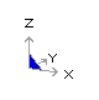
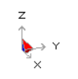

L'orientation du modèle est indiquée par une icône d'orientation située dans le coin inférieur gauche de l'affichage. Cette icône indique la direction des axes (X pour l'est, Y pour le nord et Z vers le haut).

Dans la vue ci-dessus, l'axe Y pointe surtout vers l'intérieur de l'écran et un peu vers la droite, l'axe X pointe surtout vers la droite et un peu vers l'extérieur de l'écran, et l'axe Z pointe directement vers le haut. Notez que l'arrière de l'icône est ombré en bleu.

Dans la vue ci-dessus, l'axe Y pointe surtout vers la droite et un peu vers l'intérieur de l'écran, l'axe X pointe surtout vers l'extérieur de l'écran et un peu vers la droite, et l'axe Z pointe directement vers le haut. Notez que l'intérieur de l'icône est ombré en rouge.

Trois modèles de rotation sont sélectionnables :

1. Les rotations peuvent être appliquées à la géométrie actuelle. Ce mode permet d'avoir des horizons non horizontaux

2. Les rotations peuvent être appliquées de sorte que l'horizon reste toujours horizontal, en supposant que l'axe Z+ est vers le haut (Tools > Global Transform Z+ up). La rotation à la souris se fait alors dans le sens opposé à celui de Tools > Global Transform Z- up.

3. Les rotations peuvent être appliquées de sorte que l'horizon reste toujours horizontal, en supposant que l'axe Z- est vers le haut (Tools > Global Transform Z- up).

La rotation à la souris se fait alors dans le sens opposé à celui de Tools > Global Transform Z+ up. Vous pouvez faire pivoter le modèle en maintenant enfoncé le bouton gauche de la souris et en attendant que le pointeur de glissement

apparaisse, puis en faisant glisser l'icône d'orientation jusqu'à la position souhaitée. Glisser vers le haut ou vers le bas fait pivoter le modèle vers le haut ou vers le bas. Près du bas de l'écran, glisser vers la gauche ou vers la droite fait pivoter le modèle vers la gauche ou vers la droite. Près du haut de l'écran, glisser vers la gauche ou vers la droite fait pivoter le modèle dans le sens antihoraire ou horaire. Vous pouvez personnaliser cette opération avec Tools > Rotation Toolbar.

Vous pouvez aussi faire pivoter le modèle avec les commandes de l'écran tactile, en faisant glisser 1 ou 2 doigts sur l'écran et en pinçant pour zoomer. Vous pouvez personnaliser cette opération avec Tools > Rotation Toolbar.

Remarques :

Avant de faire pivoter le modèle, vous devez définir le centre de rotation souhaité

#### View > Centre

Vous pouvez ajuster le temps d'attente avant le glissement avec

#### Tools > Drag Wait Time

Vous pouvez répéter automatiquement les opérations de rotation et de translation en tapant n# avant de sélectionner l'opération. Par exemple, pour produire un affichage animé d'un tracé de contraintes, spécifiez

Plot > Options > Persist Plot > Stress > Sigma:1 View > Rotation Increment > 10 tapez 35# au clavier

sélectionnez la rotation vers la droite (depuis la barre d'outils de rotation ou avec la touche PageDown)

Appuyez sur la touche Échap pour annuler l'animation.

Saisir 0# répète l'opération indéfiniment. Appuyez sur la touche Échap pour l'arrêter.

Rubriques connexes :

Translating the model Selecting special view positions

#### Index

#### - 0 -

001 002 ... fichiers     510, 600

**- 3 -**

Formes d'excavation 3D     27, 29, 30

#### - A -

Abandon d'une analyse Map3D     461 À propos de Map3D     2 Déformation absolue     223, 299 Contrainte absolue     209, 299 Précision     45, 308, 381, 462, 482 AG - espacement de la grille     45, 300, 301, 302, 308, 381, 462 AL - taille des éléments     45, 300, 301, 308, 381, 462 Zones de matériaux alternatifs     30

Boîte de dialogue Analysis     172, 308, 328, 381, 461, 462, 463, 464, 465, 489, 490

Boîte de dialogue Analysis Options     329, 465, 466, 467, 468, 469, 471, 473, 477, 478, 482, 484, 485, 486, 487, 489

Résultats d'analyse     164, 171, 172, 173, 186, 510, 524, 600

Temps d'analyse     45, 308, 381, 462 Animation     184, 508 Applications de Map3D     11 Modèles tels que construits     27 Discrétisation automatisée     45, 300, 301, 302, 308, 381, 462 Valeur moyenne des points de contour     317

#### - B -

Remblayage     30, 33, 477, 487 Analyses par lots     466

Analyse BEM     317, 390, 433, 461, 462, 465, 466, 467, 469, 471, 473, 477, 478, 482, 484, 485, 486, 487, 489, 490, 569, 594, 595, 597, 598

Exportation en bitmap de l'écran     173, 174, 184, 185, 508 Modèles de blocs     29, 30 BMP     173, 174, 184, 508 Intersections booléennes     467 Méthode des éléments de frontière     12, 13, 477, 482, 487, 570

Barre d'outils Build     331, 335, 341, 348, 358, 360, 362, 364, 365, 366, 367, 368, 369, 436, 494, 507 Construction de blocs FF 3D     331, 335, 341, 348, 364, 365, 366, 367, 368, 369, 390, 394, 395, 397, 398, 400, 402, 407, 408, 410, 412, 413, 415, 416, 418, 421, 423 Construction de lignes de construction     362, 364, 365, 366, 367, 368, 369, 498

Construction de plans DD     331, 335, 341, 348, 364, 365, 366, 367, 368, 369, 390, 394, 395, 397, 398, 400, 402, 407, 408, 410, 412, 413, 415, 416, 418, 421, 423

Construction de lignes de grille de points de champ     358, 360 Construction de plans de grille de points de champ     358, 360, 364, 365, 366, 367, 368, 369, 494, 496

Construction de plans de lignes de points de champ     364, 365, 366, 367, 368, 369

Construction de tunnels     331, 335, 341, 348, 364, 365, 366, 367, 368, 369 Exploitation en masse - Tutoriel de construction de modèle     85

#### - C -

CAD     426, 427, 428, 429 CAD > Build     331, 335, 341, 348, 358, 360, 362, 364, 365, 366, 367, 368, 369 Menu CAD > Build     494, 507

CAD > Edit     390, 394, 395, 397, 398, 400, 402, 407, 408, 410, 412, 413, 415, 416, 418, 421, 423 Menu CAD > Edit     495, 496, 498 CAD > Properties     308, 317, 381, 390 Menu CAD > Properties     313, 314, 386, 387 CAD > Propertiesu     313, 386 CAD > Snap     369, 370, 371, 372, 373, 376, 377, 378, 379

Menu CAD > Snap     494 Menu CAD     303, 425 Barre d'outils CAD     436, 494, 507

Déformation cartésienne     221 Contrainte cartésienne     208 Effacement des données de lignes de construction     169 Effacement des données du modèle     165 Vérification de la fermeture et du chevauchement     467 Matrice de coefficients     471, 484, 485, 487 Problèmes courants de construction de modèle     39 Terminer l'analyse en cours     489, 490 Réalisation d'une analyse des contraintes BEM     462 Réalisation d'une analyse Map3D     328 Configuration des barres d'outils     196, 432, 433, 434, 435, 436 Mode console     466 Données de lignes de construction     169, 170, 171, 508, 510, 511 Analyse des contacts et des intersections     464 Options de tracé de contours     304 Plage de contours     302 Barre d'outils Contouring     432, 433, 594, 595, 597, 598 Copie des données du modèle     397 Fluage élasto-viscoplastique     469 Police personnalisée des boutons     439 Couleurs personnalisées     437, 438, 439

**- D -**

Épaisseur du plan DD     496 Plans DD     27, 35, 36 tampon de profondeur     440, 441 Deswick     511 Prise en charge de la tablette à numériser     426, 502 Analyse de discrétisation     462, 484, 485, 569 Discrétisation et regroupement     45, 300, 301, 302, 308, 381, 462 Affichage discrétisé     600 Test de performance du disque     441 Espace disque requis     45, 308, 381, 462, 484, 485 Composantes du déplacement     224 Éléments de discontinuité de déplacement     27, 35, 36 Barre d'outils Displacement     224 Affichage d'une image d'écran enregistrée     184, 185, 508

Solutions divergentes     45, 300, 301, 308, 381, 462 DOC - regroupement de la matrice     45, 300, 301, 308, 381, 462 DOE - regroupement des éléments     45, 308, 381, 462 DOG - regroupement de la grille     45, 308, 381, 462 DOL - précision de la solution     45, 300, 301, 302, 308, 381, 462 DON - conditionnement de la matrice     45, 300, 301, 308, 381, 462 DOR - rapport d'aspect des éléments     45, 308, 381, 462 Rotation du modèle par glissement     431, 601 Translation du modèle par glissement     431, 599 Zoom du modèle par glissement     431, 599 Drucker-Prager dans les blocs FF 3D     232, 238, 240, 243, 246, 248, 251, 254, 256, 533 Exportation des résultats d'analyse     175, 180 Exportation de l'image d'écran     173, 174, 175, 508 Format de fichier de lignes de construction DXF     510, 511 Exportation DXF de l'écran     174 Format de fichier de modèle DXF     511, 525 Format de fichier d'image d'écran DXF     174

**- E -** Barre d'outils Edit     390, 394, 395, 397, 398, 400, 402, 407, 408, 410, 412, 413, 415, 416, 418, 421, 423, 436, 495, 496, 498, 499, 501 Modification des données du modèle     390, 430, 495, 496, 498, 499, 501 Contrainte effective     209 Déformation élastique     222, 298 Fluage élasto-viscoplastique     469 Regroupement des éléments     45, 300, 301, 308, 381, 462 Taille des éléments     45, 300, 301, 308, 381, 462 Calcul du taux de libération d'énergie     478 Effacement des données du modèle     394 ESS     200, 202, 203, 205 Fichiers EVP     443, 446 Contrainte excédentaire     232, 238, 240, 243, 246, 248, 251, 254, 256, 259, 263, 265, 266, 268, 272, 276, 526, 531, 533, 535, 547, 556, 595 Coefficient de dilatation et conductivité     568 EXTENDED ENTITY DATA     511 Extrusion de plans en blocs     365

#### - F -

Critère de rupture     232, 238, 240, 243, 246, 248, 251, 254, 256, 259, 263, 265, 266, 268, 272, 276, 526, 531, 533, 535, 547, 556, 595

Spécification de l'état de contraintes en champ lointain     503, 505 Plans de faille     36 Gouge de faille dans les plans DD     259, 263, 265, 266, 268, 272, 276, 535

Éléments de force fictive     27, 29 Menu File > Output     173, 174, 175, 180 Menu File     164, 165, 166, 167, 168, 169, 170, 171, 172, 173, 184, 185, 186, 507, 508, 524, 525 Recherche d'un point de coordonnées spécifié dans le modèle     195 Lois d'écoulement     526, 535, 547, 556, 568 Composantes d'écoulement     230 Barre d'outils Flow     230 Analyse d'écoulement de fluide/thermique     568 Dessin à main levée - Tutoriel de construction de modèle     60

Remblai hyperbolique dans les plans DD     259, 263, 265, 266, 268, 272, 276, 556

#### - I -

Spécification de l'état de contraintes in situ     503, 505 Blocs inactifs     39 Déformation induite     223, 299 Contrainte induite     209, 299 Spécification de l'état de contraintes initial     503, 505 Initialisation de tous les paramètres d'affichage     195 Format de fichier de modèle INP     515, 525

Dans le plan     259, 263, 265, 266, 268, 272, 276 Déformation dans le plan     213, 215, 216, 218 Contrainte dans le plan     200, 202, 203, 205 Interprétation des résultats     15, 23, 478 Analyse des intersections     464, 467, 468, 485, 569 Introduction     2

#### - J -

#### - G -

GIF     173, 174, 184, 508

Passage aux graphiques à l'étape d'analyse en cours     463 Passage à l'étape de construction et de modification du modèle     463 Regroupement de la grille     45, 300, 301, 302, 308, 381, 462 Sélection de grille     303, 425, 436

Espacement de la grille     45, 300, 301, 302, 308, 381, 462 Surface du terrain     35 Regroupement des données du modèle     408

#### - H -

Menu Help     456, 457

élimination des surfaces cachées     440, 441 Barre d'outils Hide block colours     189, 190, 196, 435 Barre d'outils Hide Cline Colours     190 Barre d'outils Hide construction line colours     190, 196, 435 Barre d'outils Hide     186, 196, 435 Masquage de diverses parties du modèle     186 Hoek-Brown dans les blocs FF 3D     232, 238, 240, 243, 246, 248, 251, 254, 256, 531

JPEG     173, 174, 184 JPG     173, 174, 184

#### - L -

Location de Map3D     2

Limites et lacunes     15

Chargement d'un modèle depuis un fichier     164, 165, 167, 464, 507, 525

Chargement des résultats d'analyse depuis un fichier récent     186

Chargement des résultats d'analyse depuis un répertoire récemment utilisé 524

Chargement des résultats d'analyse depuis un fichier de redémarrage     164, 171 Chargement des données de lignes de construction depuis un fichier     169, 170 Chargement des données du modèle depuis un répertoire récemment utilisé 524 Chargement des données du modèle depuis un fichier récemment utilisé     186 Calcul de la rigidité du système de chargement     478 Calcul du taux de libération d'énergie local     478 Regroupement et discrétisation     45, 300, 301, 302, 308, 381, 462

#### - M -

Map3D     2, 9, 11, 12, 13, 569, 570 Options d'analyse Map3D     329 Map3Di     314, 387, 453 Codes de matériaux     33 Spécification des propriétés des matériaux     313, 386, 464, 503, 505, 526, 531, 533, 535, 547, 556, 568 Conditionnement de la matrice     45, 300, 301, 308, 381, 462 Regroupement de la matrice     45, 300, 301, 308, 381, 462 Résolution de la matrice     465, 467, 486 Déformation de cisaillement maximale     212 Contrainte de cisaillement maximale     199 Contrainte moyenne     207 Valeur moyenne des points de contour     317 Menu Commands - Boîte de dialogue Analysis     172, 308, 381, 461, 462, 463, 464, 465, 489, 490 Menu Commands – Boîte de dialogue Analysis     328 Menu Commands - Boîte de dialogue Analysis Options 465, 466, 467, 468, 469, 471, 473, 477, 478, 482, 484, 485, 486, 487, 489 Menu Commands – Boîte de dialogue Analysis Options 329

Menu Commands - CAD     426, 427, 428, 429 Menu Commands - CAD > Build     331, 335, 341, 348, 358, 360, 362, 364, 365, 366, 367, 368, 369 Menu Commands - Menu CAD > Build     494, 507 Menu Commands - CAD > Edit     390, 394, 395, 397, 398, 400, 402, 407, 408, 410, 412, 413, 415, 416, 418, 421, 423

Menu Commands - Menu CAD > Edit     495, 496, 498 Menu Commands - CAD > Properties     308, 313, 314, 317, 381, 386, 387, 390 Menu Commands - CAD > Snap     369, 370, 371, 372, 373, 376, 377, 378, 379 Menu Commands - Menu CAD > Snap     494 Menu Commands - Menu CAD     303, 425 Menu Commands  File     169, 170 Menu Commands - File     164, 165, 166, 167, 168, 169, 171, 172, 173, 184, 185, 186 Menu Commands - File > Output     173, 174, 175, 180 Menu Commands - Menu File     507, 524, 525 Menu Commands - Menu Help     456, 457

Menu Commands - Plot     302 Menu Commands - Plot > Displacement     224 Menu Commands - Plot > Flow     230 Menu Commands - Plot > Miscellaneous     302 Menu Commands - Plot > Properties     308, 313, 317, 381, 386, 390

Menu Commands - Plot > Strain     210, 212, 213, 215, 216, 218, 220, 221, 222, 223, 226, 298, 299 Menu Commands - Plot > Strength Factors     232, 238, 240, 243, 246, 248, 251, 254, 256, 259, 263, 265, 266, 268, 272, 276

Menu Commands - Plot > Stress     198, 199, 200, 202, 203, 205, 207, 208, 209, 226, 299

Menu Commands - Plot > Surface Components     279, 280, 281, 282, 283, 284, 285, 286, 287, 292, 294, 295, 296, 297, 298, 300, 301

Menu Commands - Menu Plot     594, 595, 597, 598 Menu Commands – Menu Plot     304, 317 Menu Commands - Seismic     443, 446, 453, 456, 492 Menu Commands - Tools     196, 430, 431, 432, 433, 434, 435, 436, 437, 438, 439, 440, 441, 442 Menu Commands – Menu Tools Menu Commands - Tools Menu Tools     439

Menu Commands - View > Find Coordinate     195 Menu Commands - View > Hide     186 Menu Commands - View > Hide Block Colours     189, 190

Menu Commands - View > Hide Cline Colours     190 Menu Commands - View > Initialize     195 Menu Commands - View > Length     196, 435 Menu Commands - View > Pan     196, 435 Menu Commands - View > Render     192, 194, 600 Menu Commands - View > Zoom     196, 435 Menu Commands - View > Zoom Extents     195 Menu Commands - Menu View     196, 197 Menu Commands - Menu File     508 Fusion des surfaces adjacentes     468 Fusion des points de coordonnées proches les uns des autres 467 Fusion des données du modèle     507, 525 Conception de la mine     23 Sélection de l'étape d'exploitation     173 Séquence des étapes d'exploitation     33

Construction de modèle     12, 27, 29, 30, 33, 35, 36, 39, 60, 85, 106, 314, 331, 335, 341, 348, 358, 360, 362, 387, 390, 394, 395, 397, 398, 400, 402, 407, 408, 410, 412, 413, 415, 416, 418, 421, 423, 426, 463, 467, 468, 485, 486, 494, 496, 498, 507, 525 Données du modèle     164, 165, 166, 167, 168, 186, 314, 387, 464, 467, 486, 507, 509, 511, 515, 524, 525, 569 Icône d'orientation du modèle     601 Mohr-Coulomb dans les blocs FF 3D     232, 238, 240, 243, 246, 248, 251, 254, 256, 526 Mohr-Coulomb dans les plans DD     259, 263, 265, 266, 268, 272, 276, 547 Déplacement des points de champ très proches des surfaces de frontière     473 Déplacement des données du modèle     395, 412, 413, 415, 416, 418

#### - N -

Modélisation numérique     9, 11, 12, 13, 15, 23

#### - O -

Exportation OBJ de l'écran     175 Format de fichier d'image d'écran OBJ     175 Vue d'ensemble de Map3D     9 Vue d'ensemble de la construction de modèle     12 Fosses à ciel ouvert     36 OpenGL     440, 441 Zones de minerai     27, 29, 30

#### - P -

Études paramétriques     15 Exportation PDF 3D de l'écran     175 Format de fichier d'image d'écran PDF 3D     175 Taille de la zone de sélection     442 Déformation plastique     222, 298 Plot > Displacement     224 Plot > Flow     230 Plot > Miscellaneous     302 Plot > Properties     308, 313, 317, 381, 386, 390

Menu Plot > Properties     313, 386

Plot > Strain     210, 212, 213, 215, 216, 218, 220, 221, 222, 223, 226, 298, 299 Plot > Strength Factors     232, 238, 240, 243, 246, 248, 251, 254, 256, 259, 263, 265, 266, 268, 272, 276 Plot > Stress     198, 199, 200, 202, 203, 205, 207, 208, 209, 226, 299 Plot > Surface Components     279, 280, 281, 282, 283, 284, 285, 286, 287, 292, 294, 295, 296, 297, 298, 300, 301 Menu Plot     302, 303, 304, 317, 425, 594, 595, 597, 598 Options de tracé     304 Tracé des composantes de surface pendant l'analyse     461, 462 PNG     173, 174, 184, 508 Format de fichier de lignes de construction PNT     508, 510 Exportation PNT des résultats d'analyse     175, 180 Exportation PNT de l'écran     175, 508 Format de fichier de modèle PNT     509, 525 Format de fichier d'image d'écran PNT     175, 508 Problèmes mal conditionnés     45, 300, 301, 308, 381, 462 Déformations principales     210 Contraintes principales     198 Probabilité     232, 238, 240, 243, 248, 251, 256, 259, 263, 265, 266, 268, 272, 276 Taille du problème     45, 308, 381, 462

#### - R -

RAM pour le stockage de la matrice     485, 487 Plage de tracé des contours     302 Répertoires récemment utilisés     524 Fichiers récemment utilisés     186 Fiabilité des prédictions de modélisation     15 Rendu des contours     304 Rendu du modèle     192, 194 Renumérotation des surfaces pour que le volume soit positif     486 Réinitialisation de tous les paramètres d'affichage     195 Fichiers de redémarrage     510, 600 Redémarrage d'une analyse     172 Restauration d'une position de vue et d'une plage de contours précédemment enregistrées     185

Prédictions de la réponse du massif rocheux     15, 23, 478 Soustraction des résultats d'analyse     172 Rotation des données du modèle     400, 402 Support et ventes     2 Rotation du modèle     197, 431, 601 Mise en place du soutènement     30, 33, 477, 487 Rotation Toobar     431 Barre d'outils Surface Components     279, 280, 281, 282, Exécution de plusieurs analyses consécutives     466 283, 284, 285, 286, 287, 292, 294, 296, 297, 298, 300, 301, 598 **- S -** Barre d'outils Surface Components     295 Modèles de surface     27, 30 Suspension d'une analyse Map3D     489 Ventes et support     2

Ventes et support     2 Enregistrement d'un modèle dans un fichier     166 Enregistrement d'un modèle sous un nouveau nom de fichier     166, 168 Enregistrement des données de lignes de construction dans un fichier     171 Enregistrement des données de lignes de construction sous un nouveau nom de fichier     171 Enregistrement des données du modèle     407 Enregistrement de la position de vue et des plages de contours actuelles     185 Mise à l'échelle des données du modèle     398 Exportation de l'écran     173, 174, 175, 184, 185, 508 Sismique     443, 446, 453, 456, 492 Menu Seismic     443, 446, 453, 456, 492 Moment sismique     317 Défilement fluide dans la boîte de dialogue Analysis     442 Lissage des lignes de construction     421, 423 Barre d'outils Snap     369, 370, 371, 372, 373, 376, 377, 378, 379, 436, 494, 502 Précision de la solution     45, 300, 301, 302, 308, 381, 462, 482

#### - T -

Exploitation tabulaire - Tutoriel de construction de modèle     106 Zones d'exploitation tabulaire     36 Approche observationnelle de Terzaghi     15 Test de performance du disque     441 Analyse d'écoulement thermique/de fluide     568 Formes d'excavation tridimensionnelles     27, 29, 30 Barres d'outils     431, 433, 436, 594, 595, 597, 598 Menu Tools     196, 430, 431, 432, 433, 434, 435, 436, 437, 438, 439, 440, 441, 442 Déformation totale     222, 298 Contrainte totale     209 Translation et zoom du modèle     599 Translation du modèle     196, 431 Barre d'outils Translation     431 Tutoriel     60, 85, 106

Barre d'outils Solve     433, 434 Positions de vue spéciales     197 Analyse d'écoulement thermique/de fluide en régime permanent     568 Barre d'outils Strain     210, 212, 213, 215, 216, 218, 220, 221, 222, 223, 226, 298, 299, 597 Critère de résistance     232, 238, 240, 243, 246, 248, 251, 254, 256, 259, 263, 265, 266, 268, 272, 276, 526, 531, 533, 535, 547, 556, 595 Barre d'outils Strength Factors     232, 238, 240, 243, 246, 248, 251, 254, 256, 259, 263, 265, 266, 268, 272, 276, 595

#### - U -

Plan ubiquiste     259, 263, 265, 266, 268, 272, 276 Déformation du plan ubiquiste     213, 215, 216, 218 Contrainte du plan ubiquiste     200, 202, 203, 205 Mise à jour du fichier de résultats     172 Police des boutons définis par l'utilisateur     439 Couleurs définies par l'utilisateur     437, 438, 439 Tracés de contours définis par l'utilisateur     443, 446, 453, 456, 492 Exportation définie par l'utilisateur des résultats d'analyse     175, 180 Tracés définis par l'utilisateur     226 Points définis par l'utilisateur pour le calcul des contraintes     473

Stress Orientation Icon     599 Barre d'outils Stress     198, 199, 200, 202, 203, 205, 207, 208, 209, 226, 299, 594 Étirement des données du modèle     410 Subdivision des quadrilatères non plans en triangles 485

#### - V -

Menu View > Hide Block Colours     189, 190 Menu View > Hide Cline Colours     190 Menu View > Hide     186 Menu View > Render     192, 194, 600 Menu View     195, 196, 197, 435 Barre d'outils View     189, 190, 196, 435 Affichage des plans de grille     303, 425, 436 Affichage des étapes d'exploitation     173 Exportation VRML de l'écran     175 Format de fichier d'image d'écran VRML     175

#### - W -

Exportation WRL de l'écran     175 Format de fichier d'image d'écran WRL     175 [www.map3d.com/how_to_buy](https://www.map3d.com/how_to_buy)     2

#### - Z -

z-buffering     440, 441 Zoom pour que toutes les entités soient visibles     195 Zoom du modèle     197, 431
