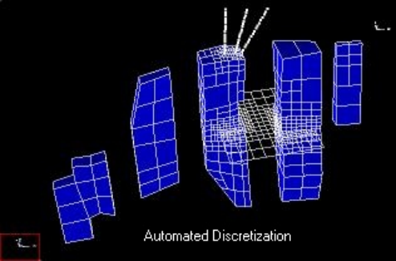
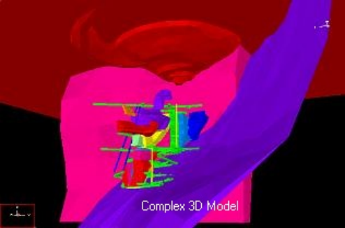
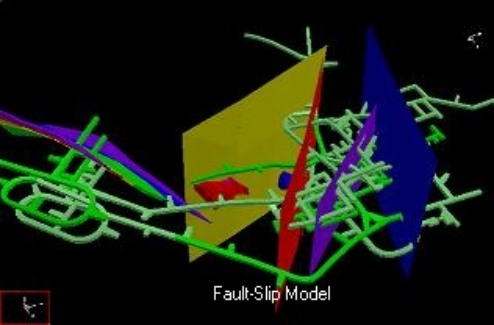
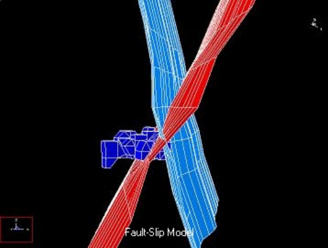
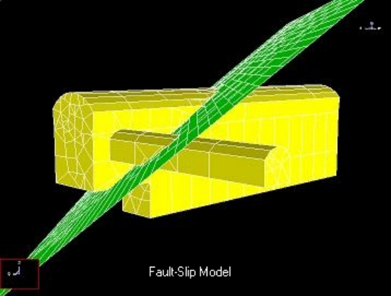

**Map3D Fault-Slip** - analyse des contraintes d'un massif rocheux élastique avec glissement de faille entièrement plastique.

Ce module sert à effectuer l'analyse des contraintes de modèles 3D. Ce logiciel est utilisé pour des projets civils, géologiques et miniers.

Inclut le modeleur CAD 3D (Map3D Modeller), le visualiseur de résultats (Map3D Results Viewer) et la base de données visuelle SIG.

L'analyse des contraintes utilise la BEM (méthode des éléments de frontière) et offre de nombreuses fonctionnalités :

- Très grande taille de problème. Map3D peut effectuer l'analyse des contraintes de modèles comptant des milliers d'excavations (plus d'un million de degrés de liberté). Cela permet de représenter la géométrie en détail et élimine la nécessité de simplifier les grands modèles (la simplification excessive est une source majeure d'erreur en modélisation). Les modèles à l'échelle de toute la mine peuvent être simulés aisément.

- Formes d'excavation 3D complexes et complètes. Les modèles détaillés tels que construits et les formes 3D complexes peuvent être analysés aisément. Comme l'analyse des contraintes repose sur la méthode des éléments de frontière (BEM), seules les surfaces des excavations (et des autres entités) doivent être spécifiées. Il n'est pas nécessaire de définir (subdiviser en éléments) les piliers entre excavations adjacentes. Toutes les formes arbitraires se combinent aisément en un seul grand modèle prêt pour l'analyse.

- Zones élastiques multiples avec des modules différents (dykes rigides ou minerai tendre). Map3D permet pleinement d'intégrer des zones de matériaux différents. Il est ainsi facile de tenir compte de types de roches rigides ou tendres.

- Zones avec des états de contraintes pré-exploitation différents.

- Exploitation tabulaire avec piliers en plastification. Cette approximation convient souvent aux grandes mines à veines étroites.

- Plans de faille discrets non plans qui glissent et se dilatent de façon élasto-visco-plastique (y compris le fluage). Ces entités sont mises en oeuvre avec la méthode des discontinuités de déplacement. Des lois d'écoulement élasto-visco-plastiques sont mises en oeuvre pour s'adapter à divers types de comportement. L'analyse du glissement de faille, tant pour l'exploitation minière que pour la simulation de séismes, est prise en charge sans difficulté.

- Les fissures et les fractures peuvent être simulées, y compris les calculs du taux de libération d'énergie et du facteur d'intensité des contraintes. La propagation d'une fracture peut être simulée comme une série d'étapes discrètes.

- Plusieurs étapes d'exploitation sont nécessaires pour tenir compte d'effets comme la mise en place de remblai ou la propagation d'une fissure. Map3D permet actuellement 40 étapes. Divers matériaux peuvent être substitués dans les excavations ou les fractures à n'importe quelle étape.

- Les intersections booléennes automatiques permettent aux excavations, aux failles et aux fractures de se croiser et de se chevaucher. Sans cette capacité, la modélisation d'entités qui se croisent serait pratiquement impossible pour les modèles complexes. Map3D gère ces situations avec aisance.

- Discrétisation automatisée. Vous pouvez discrétiser les modèles manuellement ou laisser faire les routines automatisées intégrées au programme. Ces routines garantissent que les éléments sont concentrés uniquement là où c'est nécessaire, ce qui offre une précision constamment élevée tout en optimisant le temps d'analyse.

Une version de démonstration de Map3D Fault-Slip est disponible gratuitement. Toutes les fonctionnalités sont disponibles, mais vous ne pouvez exécuter que des problèmes de petite taille. Cette version est très utile pour enseigner les principes de base de la modélisation, de la visualisation et de la CAO 3D.

Map3Di Integrated Seismicity
